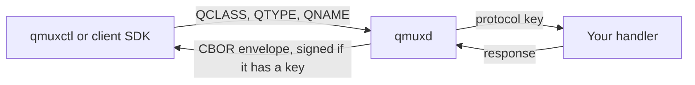

<p align="center">
  
</p>

<p align="center"><b>A DNS-native application protocol framework in Go.</b> Multiplex protocols over QCLASS, QTYPE, and QNAME.</p>

<p align="center">
  <a href="https://github.com/Crank-Git/qmux/actions/workflows/ci.yml"></a>
  <a href="https://github.com/Crank-Git/qmux/actions/workflows/interop.yml"></a>
  
  <a href="LICENSE"></a>
</p>

<p align="center">
  <a href="docs/architecture.md"><b>Docs</b></a> ·
  <a href="#install"><b>Install</b></a> ·
  <a href="#quick-start"><b>Quick start</b></a>
</p>



## Why QMux

I wanted to know whether a private DNS class buys anything over IN-class DNS when the
class and type pick the protocol. So in QMux each protocol owns a `(QCLASS, QTYPE)` protocol
key, the QNAME names the resource, and you register a handler for the key. QMux handles the
DNS packets, the envelope encoding, and the signatures.

QMux has three parts. The library, `github.com/Crank-Git/qmux`, holds an authoritative
server, a client SDK, a protocol registry, a CBOR envelope codec, discovery, and Ed25519
signatures. The tools are `qmuxd` (the server), `qmuxctl` (query, discover, keygen), and
`qmux-probe` (the interop probes). The research harness runs an embedded-device recovery
demonstration, an interop matrix through BIND and Unbound, and a benchmark against IN-class
DNS, CoAP, and HTTPS. The class is the only variable between the private-class path and
the IN-class baseline.

The answer so far: in the tested configurations, BIND 9.20 and Unbound 1.26.2 carry class
IN only, so a private class works only on the direct path. One benchmark run on that path
found no difference between a private class and IN larger than the noise of one run. That's
one host and one run size, not a verdict on every resolver or a real radio link; the
[findings](docs/interoperability.md#findings-on-the-research-question) have the detail.

### What QMux is not

- **Not a DNS tunnel.** It doesn't fragment a payload or transfer files over DNS.
- **Not a replacement for conventional DNS.** The server never recurses, and it doesn't do
  delegation, zone transfer, DNSSEC signing, or dynamic update.
- **Not a TCP-over-DNS transport.** It doesn't carry a byte stream. Each query gets one
  answer.

## Requirements

- **Go 1.25** or later.
- **GNU Make**, for the build, demo, and check targets.
- **golangci-lint v2**, only for `make lint` and `make check`.
- **Docker with Compose**, only for `make interop` and `make bench`.

## Install

Use the library in your module:

```sh
go get github.com/Crank-Git/qmux
```

Build the three tools into `bin/` from a clone:

```sh
git clone https://github.com/Crank-Git/qmux.git
cd qmux
make build
```

There are no release binaries yet. To run `qmuxd` in a container instead, see
[command-line tools](docs/commands.md#run-qmuxd-in-a-container).

## Quick start

Run each command from the repository root.

1. Build `qmuxd`, `qmuxctl`, and `qmux-probe` into `bin/`:

   ```bash
   make build
   ```

2. Make the directory for the signing key, then make the key and its trust anchor file:

   ```bash
   mkdir -p examples/keys
   bin/qmuxctl keygen --out examples/keys/qmuxd
   ```

   This writes `examples/keys/qmuxd.key` with mode 0600 and
   `examples/keys/qmuxd.anchor.json`. Git ignores every `.key` file.

3. Start the server:

   ```bash
   bin/qmuxd serve --config examples/qmuxd.json
   ```

   `examples/qmuxd.json` serves the zone `fleet.example.` with the three demonstration
   protocols on `127.0.0.1:5300`, signed with `keys/qmuxd.key` (relative to the file). It
   doesn't use 5353 because `mDNSResponder` holds that port on macOS. Add `--listen <addr>`
   to use another address; [configuration](docs/configuration.md) lists every field.

4. In a second terminal, query the bootstrap record and verify it:

   ```bash
   bin/qmuxctl query --server 127.0.0.1:5300 --class 65280 --type 65280 --version 1 --name device42.fleet.example. --trust-anchors examples/keys/qmuxd.anchor.json
   ```

   The output includes `rcode: NOERROR`, `verified: true`, and
   `protocol_id: org.qmux.bootstrap`.

5. Print the server's manifest:

   ```bash
   bin/qmuxctl discover --server 127.0.0.1:5300 --name fleet.example. --trust-anchors examples/keys/qmuxd.anchor.json
   ```

   ```
   zone fleet.example.  framework 1  verified yes
   PROTOCOL                VERSIONS  CLASS  TYPE
   org.qmux.bootstrap      1         65280  65280
   org.qmux.discovery      1         65280  65534
   org.qmux.configuration  1         65281  65280
   org.qmux.firmware       1         65282  65280
   ```

6. Stop `qmuxd` with Ctrl+C, then run the embedded recovery demonstration:

   ```bash
   make demo
   ```

   The demonstration starts its own server and mock HTTPS service on ports the OS picks. A
   device with no state reconciles, and the last line is
   `[device]  result: reconciled (2 downloads)`. See the
   [demonstration's README](examples/embedded-bootstrap/README.md).

Exit codes for every tool are on the [command-line tools](docs/commands.md#exit-codes) page.

## Go examples

Each block below is the body of an `Example` function in
[`example_test.go`](example_test.go), which also defines `firmwareHandler` and
`firmwareRecord`. Both use the firmware protocol key `65282/65280` from the quick start.

### Server

<!-- example: ExampleNewServer -->
```go
srv := qmux.NewServer(qmux.ServerConfig{
	Address: "127.0.0.1:5300",
	Zones:   []string{"fleet.example."},
})
key := qmux.ProtocolKey{Class: 65282, Type: 65280}
if err := srv.Register(key, firmwareHandler{}); err != nil {
	log.Fatal(err)
}

ctx, stop := signal.NotifyContext(context.Background(), os.Interrupt)
defer stop()
if err := srv.ListenAndServe(ctx); err != nil {
	log.Fatal(err)
}
```

A few rules for handlers:

- The handler types `protocol.Request`, `protocol.Response`, `protocol.Info`, and
  `protocol.HandlerFunc` come from `github.com/Crank-Git/qmux/pkg/protocol`. The root
  package doesn't alias them.
- `Register` accepts only a handler with an `Info() protocol.Info` method. Without it you
  get `server.ErrMissingInfo`.
- Set `Response.Version` to `req.Version`. If you leave it at 0, the server uses the highest
  registered version, which isn't always the version of the query.

This server and the quick-start `qmuxd` both listen on `127.0.0.1:5300`, so stop `qmuxd`
first or change `Address`.

### Client

The client asks for the firmware record of `device42.fleet.example.` and decodes the CBOR
payload with `codec.Unmarshal` from `github.com/Crank-Git/qmux/pkg/codec`:

<!-- example: ExampleNewClient -->
```go
c := qmux.NewClient(qmux.ClientConfig{Resolver: "127.0.0.1:5300"})
res, err := c.Query(context.Background(), qmux.Query{
	Name:  "device42.fleet.example.",
	Class: 65282,
	Type:  65280,
})
if err != nil {
	log.Fatal(err)
}
var fw firmwareRecord
if err := codec.Unmarshal(res.Payload, &fw); err != nil {
	log.Fatal(err)
}
fmt.Printf("%s v%d: firmware %s at %s\n", res.ProtocolID, res.Version, fw.Version, fw.URL)
```

Against the quick-start `qmuxd`, it prints:

```text
org.qmux.firmware v1: firmware 2.4.1 at https://mgmt.fleet.example/firmware/2.4.1.bin
```

This client has no trust anchors, so the result has `Verified: false`. A client with trust
anchors verifies every envelope before it returns a field.

## Architecture

The root package `qmux` holds type aliases and constructors only; the packages under `pkg/`
do the work, and only `pkg/transport` imports `github.com/miekg/dns`. A handler returns a
response, the server encodes it as an envelope and signs it if it has a signing key, and the
envelope is the RDATA of one RR. The RCODE reports the DNS outcome, and the application
status inside the envelope reports the application outcome.

[`docs/architecture.md`](docs/architecture.md) has the package import graph, the lifecycle
of one request, the ADR index, and the design tradeoffs. The wire format is in
[`docs/protocol.md`](docs/protocol.md).

## Documentation

| Page | What's there |
|---|---|
| [Architecture](docs/architecture.md) | Package import graph, request lifecycle, ADR index, and design tradeoffs. |
| [Protocol](docs/protocol.md) | Envelope, error semantics, class and type allocation, discovery, and version negotiation. |
| [Security](docs/security.md) | Trust model, signing, replay and freshness controls, and the threat model. |
| [Configuration](docs/configuration.md) | Every field of the `qmuxd` configuration file. |
| [Command-line tools](docs/commands.md) | Exit codes and running `qmuxd` in a container. |
| [Interoperability](docs/interoperability.md) | Methodology, resolver configurations, results, and baseline benchmarks. |
| [Specification](docs/specs/spec.md) | The approved spec, its features, and the [acceptance map](docs/acceptance.md). |

## Development

```bash
make check   # go vet, golangci-lint, go test, go test -race
```

`make lint` needs golangci-lint v2. `make interop` and `make bench` need Docker with Compose.

## Security limitations

- **DNS gives no confidentiality.** QMux doesn't encrypt envelopes, so an on-path observer
  reads each QNAME and each payload. The signatures give integrity and origin
  authentication only.
- **Read-only operations only.** A handler answers a query. There's no remote command
  execution, no arbitrary RPC, and no device control.
- **The TTL isn't a security expiry.** Only `expires_at` ends an envelope's validity. The
  verifier never reads the TTL.
- **No key revocation.** A stolen signing key signs valid envelopes until you remove its
  trust anchor.

Freshness also depends on the client clock, and the rate limit isn't DoS protection.
[`docs/security.md`](docs/security.md#limitations) has every limitation, the threat model,
the verification errors, and the defaults.

## Compatibility status

The table below copies the interop matrix of one local run of
`make interop REQUIRE_DIRECT=true`:

- Date: 2026-11-21 00:29 UTC.
- Commit: `11b581eb9803d76eb3264876ca0c2a5cd313925f`.
- Host: `arm64` (macOS), Docker 29.9.3. BIND ran as `amd64` under emulation.

| Class | `direct` | `bind` (BIND 9.20) | `unbound` (Unbound 1.26.2) |
|---|---|---|---|
| 1 (IN) | `ok` | `ok` | `ok` |
| 3 (CH) | `ok` | `rcode REFUSED` | `rcode REFUSED` |
| 4 (HS) | `ok` | `rcode REFUSED` | `rcode REFUSED` |
| 65280 | `ok` | `rcode NOTIMP` | `rcode REFUSED` |
| 65281 | `ok` | `rcode NOTIMP` | `rcode REFUSED` |

Each cell holds the same outcome for both transports (UDP and TCP) and both types (16 and
65280). No resolver probe of class 3, 4, 65280 or 65281 reached `qmuxd`. The RCODE in
those cells comes from the resolver, not from QMux.

[`docs/interoperability.md`](docs/interoperability.md#observed-results) holds the 60
probe records, the resolver configurations and the reproduction steps.

## License

MIT. See [`LICENSE`](LICENSE).

---

<sub>Part of <a href="https://github.com/Crank-Git#things-over-port-53"><b>Things over port 53</b></a>,
my experiments in what else DNS can carry.
Siblings: <a href="https://github.com/Crank-Git/epochalypse">epochalypse</a> ·
<a href="https://github.com/Crank-Git/mcport53">mcport53</a> ·
<a href="https://github.com/Crank-Git/wingman">wingman</a> ·
<a href="https://github.com/Crank-Git/cachemoney">cachemoney</a> ·
<a href="https://github.com/Crank-Git/llamaoverdns">llamaoverdns</a> ·
Built by <a href="https://github.com/Crank-Git">Crank</a></sub>
