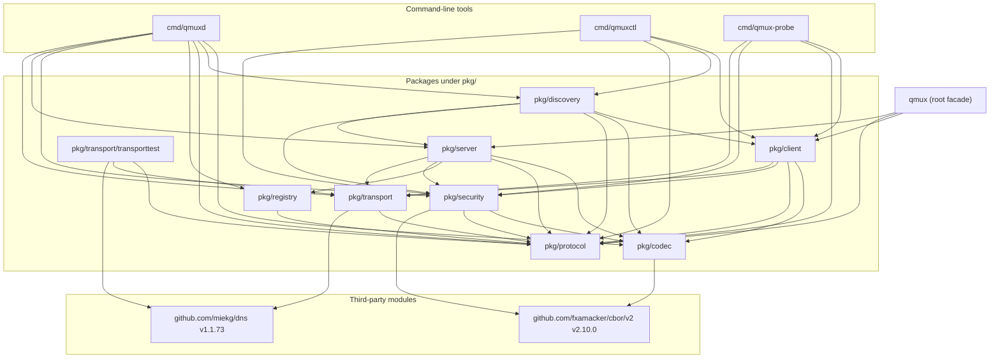
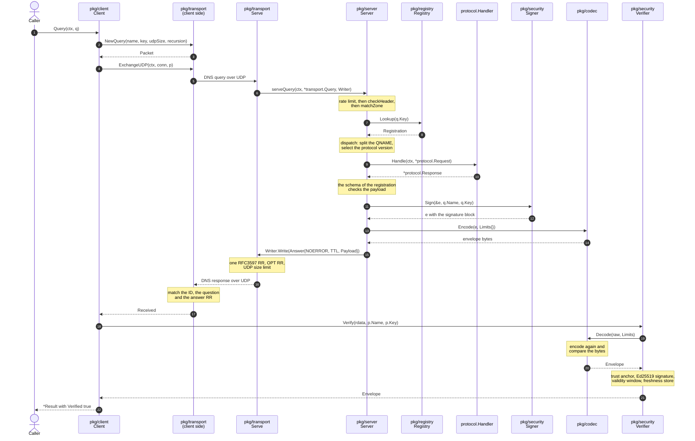

# QMux architecture

This document shows how the packages of the library module depend on each other, and how
one query moves from the client to the handler and back. It lists every ADR and the
design tradeoffs that shaped the build.

The design is in `docs/specs/spec.md` and `docs/specs/features/*.md`. The spec is the
source of the requirements. This document describes the code that implements them.

## Package import graph

The graph shows the Go imports of the library module `github.com/Crank-Git/qmux`. An
arrow points from the package that imports to the package that it imports. The graph
comes from this command on the code, so it shows the real imports:

```bash
go list -f '{{.ImportPath}} {{join .Imports " "}}' ./...
```

The graph shows the root package, every package under `pkg/` and every command under
`cmd/`. It shows the two third-party modules and omits the standard library. The
package `examples/embedded-bootstrap` and its subpackages are not in the graph. The
harness module `tests/interoperability/` is a separate module (ADR 0002), so it is not in
the graph.



The graph has these properties:

- `pkg/protocol` imports no other QMux package. Every other package can use its types.
- `pkg/codec` imports no QMux package. Only `pkg/codec` and `pkg/security` import CBOR.
- Only `pkg/transport` and its test helper `pkg/transport/transporttest` import
  `github.com/miekg/dns` (ADR 0001, ADR 0005). The `depguard` rule in `.golangci.yml`
  enforces this boundary.
- `pkg/transport/transporttest` holds test code only. No package outside a test imports it.
- `pkg/discovery` imports `pkg/server` to register the discovery handler, and
  `pkg/client` to query the manifest.
- The graph has no cycle. The Go compiler rejects an import cycle.

## Lifecycle of one verified query

The diagram shows one query over UDP from a client with trust anchors to a server with a
signing key. The query gets a NOERROR answer with an envelope that verifies.



The steps that the diagram compresses:

1. `Client.Query` builds the QNAME with the version label, when the query names a
   protocol version.
2. `serveQuery` applies the checks in a fixed order. A query that fails a check gets
   the RCODE of the first check that it fails (see `docs/specs/spec.md` § Error
   semantics).
3. `dispatch` answers a bad version label, or a version that the registration does not
   have, with an envelope that holds the application status. The server does not call
   the handler.
4. If the handler returns an error, panics, or runs past the handler timeout, the
   server answers SERVFAIL.
5. If the UDP response is larger than the UDP size limit, the transport sets the TC bit.
   The client then sends the query again over TCP (TCP fallback).
6. If `Verify` fails, `Query` returns a `*VerifyError` and no result.
7. If the application status is not `ok`, `Query` returns the result and a `*AppError`.

## ADR index

The index has one line for each file in `docs/adr/`.

| ADR | Decision |
|---|---|
| [0000 — template](adr/0000-template.md) | The template for a new ADR. It records no decision. |
| [0001 — Pin miekg/dns v1 and confine it to pkg/transport](adr/0001-miekg-dns-v1.md) | QMux pins `github.com/miekg/dns` v1.1.73, and only `pkg/transport` imports it. |
| [0002 — Keep the baselines in a separate Go module](adr/0002-separate-harness-module.md) | `tests/interoperability/` is a separate Go module, so go-coap stays out of the library module. |
| [0003 — Simulate packet loss with tc netem in Docker](adr/0003-netem-packet-loss.md) | `tc netem` in Docker containers applies the same delay and loss to every transport in the benchmark. |
| [0004 — Add a root qmux package as a facade](adr/0004-root-facade-package.md) | The root package `qmux` holds type aliases and constructors only. The behavior is in `pkg/`. |
| [0005 — Define the pkg/transport API for the server and the client](adr/0005-transport-api.md) | `pkg/transport` exports QMux-native types only and runs its own UDP and TCP read loops. |
| [0006 — Keep one protocol key for each protocol ID](adr/0006-one-key-per-protocol-id.md) | The registry holds one protocol key for each protocol ID. A feature that needs more keys uses more protocol IDs. |
| [0007 — Build each footprint client from a leaf fixture package](adr/0007-footprint-client-leaf-package.md) | Each benchmark client imports only the leaf package `baseline/fixture` and its own protocol stack. |

## Design tradeoffs

Each tradeoff names the choice, the alternative that QMux did not take, the reason, and
the ADR or the spec section that decides it.

### The DNS library

- **Choice:** `github.com/miekg/dns` v1.1.73, imported only by `pkg/transport`.
- **Alternative:** the successor module `codeberg.org/miekg/dns`.
- **Reason:** the successor is tagged v0.6.x and allows breaking changes. It needs Go
  1.27 and has no confirmed private-type API. One importer keeps a later port to one
  package.
- **Decided by:** ADR 0001.

### The server read loops

- **Choice:** `pkg/transport` runs its own UDP and TCP read loops.
- **Alternative:** `dns.Server` with a custom `MsgAcceptFunc`.
- **Reason:** `dns.Server` does not give the received size to the handler, so the server
  cannot measure the query size exactly. `dns.Server` also writes FORMERR or NOTIMP
  itself and ignores the write error.
- **Decided by:** ADR 0005.

### The transport API

- **Choice:** `pkg/transport` exports QMux-native types only. No exported identifier names
  a miekg type.
- **Alternative:** `pkg/transport` re-exports miekg types, or `pkg/server` imports miekg
  directly.
- **Reason:** with re-exported types, each caller must still know the hex `Rdata`, the
  `Truncate` rules and the `SetEdns0` rules. `depguard` cannot see a use of an alias. With
  a direct import, a port to another DNS module changes several packages.
- **Decided by:** ADR 0005.

### The root package

- **Choice:** the root package `qmux` holds type aliases and constructors only.
- **Alternative:** no root package, so callers import `pkg/server` and `pkg/client`
  directly.
- **Reason:** the brief shows `qmux.NewServer`, `qmux.ProtocolKey`, `qmux.NewClient` and
  `qmux.Query`. The facade makes those examples compile. It holds no logic, so it adds no
  layer to test.
- **Decided by:** ADR 0004.

### Protocol keys for one protocol ID

- **Choice:** the registry holds one protocol key for each protocol ID.
- **Alternative:** one protocol ID answers at more than one protocol key.
- **Reason:** the manifest lists one key for each protocol ID, and manifest validation
  rejects two entries with one protocol ID. One key for each protocol ID keeps a simple
  map in the registry, the manifest and `discovery.Negotiate`.
- **Decided by:** ADR 0006.

### The RCODE and the application status

- **Choice:** the RCODE reports DNS outcomes only. The envelope carries the application
  outcome in the application status.
- **Alternative:** report an application outcome, for example "not found", as an RCODE.
- **Reason:** a registration that answers always sends NOERROR with an envelope. The client
  returns three separate Go error types: `*client.DNSError`, `*client.AppError` and
  `*client.VerifyError`. A caller can then tell a DNS failure from an application outcome
  with `errors.As`.
- **Decided by:** `docs/specs/spec.md` § Error semantics.

### The TTL and the security expiry

- **Choice:** the TTL controls caching only. Only `expires_at` in the signature block
  limits the validity of an envelope.
- **Alternative:** use the TTL as the security expiry.
- **Reason:** the signature does not cover the TTL, and a resolver can change it. For
  example, the Unbound image defaults to `serve-expired: yes`, so Unbound can serve an
  answer after its TTL ends.
- **Decided by:** `docs/specs/spec.md` § Security posture.

### Unverified envelopes

- **Choice:** a client with trust anchors never returns an unsigned or unverifiable
  envelope. No silent fallback exists.
- **Alternative:** return the unverified result with `Verified: false` when the
  verification fails.
- **Reason:** QMux assumes that an on-path attacker can forge packets. With a fallback, the
  attacker removes the signature block and the client accepts the forged envelope.
- **Decided by:** `docs/specs/spec.md` § Security posture.

### Replay protection

- **Choice:** the validity window plus a monotonic `issued_at` check for each protocol ID
  and QNAME in the freshness store.
- **Alternative:** a client nonce in each query.
- **Reason:** a DNS question carries no client nonce through a resolver cache.
- **Decided by:** `docs/specs/spec.md` § Assumptions, item 7.

### When the server signs

- **Choice:** the authoritative server signs each envelope at answer time. Handlers never
  sign.
- **Alternative:** each handler signs its own payload, or the operator signs the records
  before the server starts.
- **Reason:** the signature covers the QNAME with the version label and the protocol key.
  The server knows both only when it answers, so one envelope cannot verify for another
  version (FR-security-16).
- **Decided by:** `docs/specs/spec.md` § Assumptions, item 6.

### Deterministic CBOR

- **Choice:** `codec.Decode` encodes the decoded envelope again and compares the bytes.
- **Alternative:** trust a decoder option to reject non-deterministic input.
- **Reason:** fxamacker/cbor has no decode option that rejects non-deterministic input. A
  signature covers exact bytes, so two encodings of one envelope must not both decode.
- **Decided by:** `docs/specs/spec.md` § Assumptions, item 8, and FR-codec-10.

### Packet loss in the benchmark

- **Choice:** `tc netem` in Docker containers applies the delay and the loss.
- **Alternative:** a userspace UDP proxy that drops datagrams.
- **Reason:** a UDP proxy cannot drop TCP segments, so the HTTPS baseline would have no
  loss figures. With netem, every transport gets the same loss.
- **Decided by:** ADR 0003.

### The harness module

- **Choice:** `tests/interoperability/` is a separate Go module with the baselines and
  `qmux-bench`.
- **Alternative:** one module for the library and the harness.
- **Reason:** the CoAP baseline needs go-coap v3.8.2, which declares `go 1.26.0` and has
  its own dependencies. The library module is limited to two third-party modules, and a
  user who imports QMux never downloads go-coap.
- **Decided by:** ADR 0002.

### The benchmark clients

- **Choice:** each footprint client imports only the leaf package `baseline/fixture` and
  its own protocol stack.
- **Alternative:** each client imports the package `baseline`.
- **Reason:** `baseline` links go-coap, `net/http` and `pkg/server`, so every client linked
  every protocol. The stripped `qmux-private` client was 8.65 MB in place of 4.45 MB.
- **Decided by:** ADR 0007.
