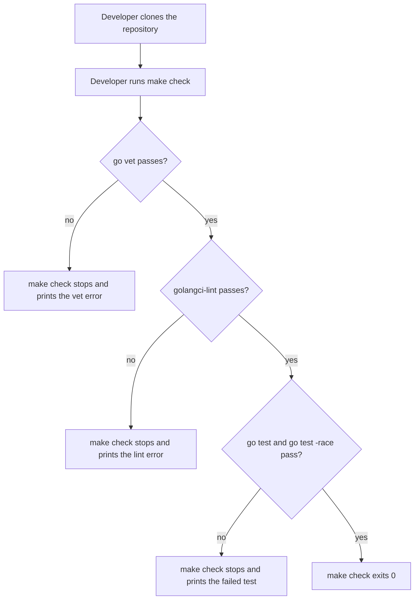
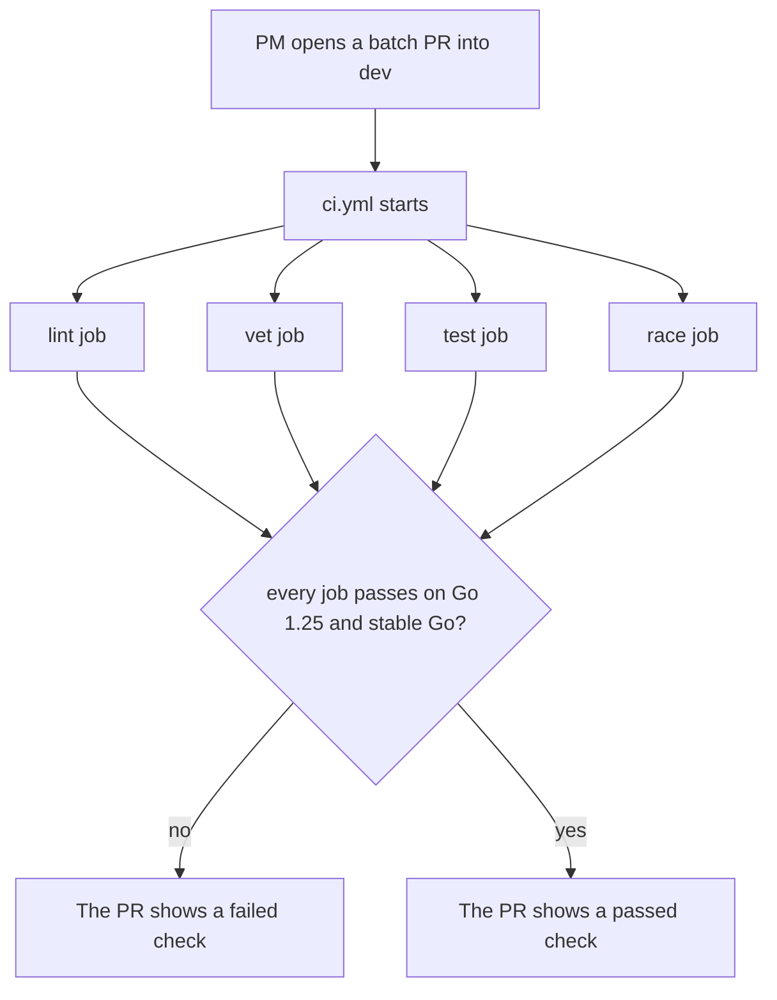

## Purpose

The foundation gives every later epic a repository that builds, tests, lints and runs CI.
It also proves that miekg/dns v1.1.73 can carry private classes, private types and
opaque RDATA. The brief requires this proof before any application feature:

> "Before implementing application features, validate that the selected DNS library can
> correctly encode and decode private QCLASS/QTYPE combinations and opaque RDATA. If
> library limitations exist, document them and implement the smallest safe extension
> necessary."

QMux has no deploy target. CI is the only automated environment.

## User stories

- As a protocol developer, I want a fresh clone to pass one check command, so that I know
  the repository is healthy before I change it.
- As a protocol developer, I want CI to run on every PR to `dev`, so that a broken batch
  never reaches `dev`.
- As a researcher, I want proof that the DNS library round-trips private classes and
  opaque RDATA, so that later results do not rest on a library defect.

## Functional requirements

### Module and layout

- FR-foundation-1 — The repository root holds a Go module with the path
  `github.com/Crank-Git/qmux` and the directive `go 1.25`.
- FR-foundation-2 — The root `go.mod` pins `github.com/miekg/dns` at v1.1.73.
- FR-foundation-3 — The root `go.mod` pins `github.com/fxamacker/cbor/v2` at v2.10.0 when
  the first package imports it.
- FR-foundation-4 — The repository holds the directories `cmd/qmuxd`, `cmd/qmuxctl`,
  `cmd/qmux-probe`, `pkg/server`, `pkg/client`, `pkg/protocol`, `pkg/registry`,
  `pkg/codec`, `pkg/discovery`, `pkg/security`, `pkg/transport`,
  `examples/embedded-bootstrap`, `tests/integration`, `tests/interoperability` and `docs`.
- FR-foundation-5 — Each `pkg/` directory holds a `doc.go` file with a package comment
  that states the package purpose from the spec's package table.
- FR-foundation-6 — The repository root holds `qmux.go`, the package comment of the root
  facade package `qmux`.
- FR-foundation-7 — `tests/interoperability/` holds a separate Go module with its own
  `go.mod`, the directive `go 1.26`, and a `replace` directive to the root module.
- FR-foundation-8 — The repository root holds an MIT `LICENSE` with the copyright line
  `Copyright (c) 2026 Crank-Git`.
- FR-foundation-9 — The repository root holds a `README.md` stub with the project name,
  one paragraph from the spec Overview, and the `make check` command.

### Build, test and lint commands

- FR-foundation-10 — `make build` builds `qmuxd`, `qmuxctl` and `qmux-probe` into `bin/`.
- FR-foundation-11 — Each of the three binaries prints the module version and exits 0
  for the subcommand `version`.
- FR-foundation-12 — `make test` runs `go test ./...`.
- FR-foundation-13 — `make race` runs `go test -race ./...`.
- FR-foundation-14 — `make vet` runs `go vet ./...`.
- FR-foundation-15 — `make lint` runs `golangci-lint run`.
- FR-foundation-16 — `make fuzz` runs every fuzz target for `FUZZTIME`, with the default
  value `30s`.
- FR-foundation-17 — `make check` runs `vet`, `lint`, `test` and `race` in that order and
  stops at the first failure.
- FR-foundation-18 — `.golangci.yml` uses the golangci-lint v2 format and enables
  `govet`, `staticcheck`, `errcheck`, `unused`, `gocyclo`, `nestif`, `gofmt` and
  `goimports`.
- FR-foundation-19 — `.golangci.yml` sets the `gocyclo` minimum complexity to 15.
- FR-foundation-20 — `.golangci.yml` sets the `nestif` minimum complexity to 4.

### CI and branch model

- FR-foundation-21 — `.github/workflows/ci.yml` runs on each pull request to `dev` or
  `main` and on each push to `dev`.
- FR-foundation-22 — `ci.yml` runs its jobs on Go 1.25 and on the latest stable Go.
- FR-foundation-23 — `ci.yml` has the separate jobs `lint`, `vet`, `test` and `race`.
- FR-foundation-24 — `ci.yml` runs `go build ./...` inside `tests/interoperability`.
- FR-foundation-25 — `ci.yml` pins each action to a version that the action's own README
  documents.
- FR-foundation-26 — The repository has a `dev` branch, created from `main`.
- FR-foundation-27 — Batch PRs use `dev` as their base branch.

### DNS library validation

- FR-foundation-28 — `pkg/transport/wire_test.go` packs and unpacks a query with QCLASS
  65281 and QTYPE 65280, and the unpacked question equals the packed question.
- FR-foundation-29 — `wire_test.go` packs an answer RR of type 65280 and class 65281 as
  `*dns.RFC3597`, and the unpacked RDATA bytes equal the original bytes.
- FR-foundation-30 — `wire_test.go` repeats the opaque RDATA round trip for the classes
  IN (1), CH (3) and HS (4).
- FR-foundation-31 — `wire_test.go` sets EDNS(0) with a UDP size of 1232, and the
  unpacked message reports a UDP size of 1232.
- FR-foundation-32 — `wire_test.go` records the behavior of `Msg.Truncate` for a message
  with one large opaque RR.
- FR-foundation-33 — The `Consequences` section of `docs/adr/0001-miekg-dns-v1.md` lists
  each library limitation that the spike test observed.

## User flows

### Flow 1 — A developer checks a fresh clone

1. The developer clones the repository.
2. The developer runs `make check`.
3. If `go vet` fails, `make check` stops and prints the error.
4. If `golangci-lint` fails, `make check` stops and prints the error.
5. If a test fails, `make check` stops and prints the failed test.
6. If every step passes, `make check` exits 0.

### Flow 2 — CI checks a batch PR

1. The PM opens a batch PR into `dev`.
2. GitHub Actions starts `ci.yml`.
3. `ci.yml` runs the jobs `lint`, `vet`, `test` and `race` on both Go versions.
4. If a job fails, the PR shows a failed check.
5. If every job passes, the PR shows a passed check.

## Screens & states

No screens. The only output is command-line output:

- `qmuxd version`, `qmuxctl version` and `qmux-probe version` print one line, for example
  `qmuxd v0.0.0-dev`.
- `make check` prints the output of each tool and exits 0 or non-zero.

## Behaviour rules

- The module version string comes from `runtime/debug.ReadBuildInfo`. If the build has no
  version, the binaries print `v0.0.0-dev`.
- `bin/` is a build output directory and `.gitignore` excludes it.
- The root module never imports `github.com/plgd-dev/go-coap/v3`. Only the
  `tests/interoperability` module may import it.
- Epic 0 defines only the Makefile targets `check`, `test`, `race`, `vet`, `lint`,
  `fuzz` and `build`. Later epics add `demo`, `interop` and `bench`.

## Data touched

No runtime data. The epic creates `go.mod`, `go.sum`, `Makefile`, `.golangci.yml`,
`.github/workflows/ci.yml`, `LICENSE`, `README.md` and the package directories.

## Interfaces

miekg/dns v1.1.73 facts that the spike test relies on. Verified against
https://github.com/miekg/dns (v1.1.73), `go doc`, and a pack and unpack program on
2026-11-20:

- `Question.Qclass` and `RR_Header.Class` are plain `uint16` fields and accept 65281.
- On unpack, a type that is not in `dns.TypeToRR` comes back as `*dns.RFC3597`.
- `RFC3597.Rdata` is a hex string, not a byte slice. `pkg/transport` must convert between
  hex and bytes.
- `Msg.SetEdns0(udpsize uint16, do bool) *Msg` adds an OPT RR. `Msg.IsEdns0() *OPT`
  returns it. `OPT.UDPSize()` reads the size.
- `Msg.Truncate(size int)` treats a size below 512 as 512, keeps the OPT RR, removes RRs
  until the message fits, and sets TC when it removes an RR.

Make targets:

| Target | Command |
|---|---|
| `check` | `vet`, `lint`, `test`, `race` |
| `test` | `go test ./...` |
| `race` | `go test -race ./...` |
| `vet` | `go vet ./...` |
| `lint` | `golangci-lint run` |
| `fuzz` | `go test -run=^$ -fuzz=<target> -fuzztime=$(FUZZTIME) <package>` per target |
| `build` | `go build -o bin/ ./cmd/...` |

## Edge cases & failures

- If `golangci-lint` is not installed, `make lint` prints an install hint and exits
  non-zero.
- If no fuzz target exists yet, `make fuzz` prints `no fuzz targets` and exits 0.
- If the spike test finds that an opaque RR does not round-trip, the test fails. The
  developer records the limitation in ADR 0001 and implements the smallest safe extension
  in `pkg/transport`, for example a `dns.PrivateHandle` registration.

## Acceptance criteria

- `go.mod` declares `module github.com/Crank-Git/qmux` and `go 1.25`. (FR-foundation-1)
- `go.mod` lists `github.com/miekg/dns v1.1.73`. (FR-foundation-2)
- When a package imports CBOR, `go.mod` lists `github.com/fxamacker/cbor/v2 v2.10.0`.
  (FR-foundation-3)
- Every directory in FR-foundation-4 exists in a fresh clone. (FR-foundation-4)
- `go doc ./pkg/<name>` prints a package comment for each `pkg/` package.
  (FR-foundation-5)
- `go doc github.com/Crank-Git/qmux` prints the facade package comment. (FR-foundation-6)
- `go build ./...` inside `tests/interoperability` succeeds, and its `go.mod` declares
  `go 1.26` and a `replace` to the root. (FR-foundation-7)
- `LICENSE` holds the MIT text and the line `Copyright (c) 2026 Crank-Git`.
  (FR-foundation-8)
- `README.md` holds the project name and the `make check` command. (FR-foundation-9)
- After `make build`, `bin/` holds `qmuxd`, `qmuxctl` and `qmux-probe`. (FR-foundation-10)
- `bin/qmuxd version` prints a version line and exits 0. The same holds for `qmuxctl`
  and `qmux-probe`. (FR-foundation-11)
- `make test`, `make race`, `make vet` and `make lint` each run their command and exit 0 on
  a fresh clone. (FR-foundation-12 to FR-foundation-15)
- `make fuzz FUZZTIME=5s` runs each fuzz target for 5 seconds. (FR-foundation-16)
- A deliberate vet error makes `make check` stop before the lint step. (FR-foundation-17)
- `golangci-lint linters` lists the eight linters of FR-foundation-18 as enabled.
  (FR-foundation-18)
- A function with cyclomatic complexity 16 fails `make lint`. (FR-foundation-19)
- An `if` nested to complexity 5 fails `make lint`. (FR-foundation-20)
- A PR into `dev` starts `ci.yml`. A push to `dev` starts `ci.yml`. (FR-foundation-21)
- The `ci.yml` run shows each job on Go 1.25 and on stable Go. (FR-foundation-22)
- The `ci.yml` run shows four separate jobs: `lint`, `vet`, `test`, `race`.
  (FR-foundation-23)
- The `ci.yml` log shows `go build ./...` inside `tests/interoperability`.
  (FR-foundation-24)
- Each `uses:` line in `ci.yml` names a version that the action's README documents.
  (FR-foundation-25)
- `git branch -r` lists `origin/dev`. (FR-foundation-26)
- The Epic 0 batch PR and every later batch PR target `dev`. (FR-foundation-27)
- The private class query round-trip test passes. (FR-foundation-28)
- The opaque RDATA round-trip test passes with byte-exact RDATA. (FR-foundation-29)
- The round-trip test passes for classes 1, 3 and 4. (FR-foundation-30)
- The EDNS(0) test reads back a UDP size of 1232. (FR-foundation-31)
- The truncation test asserts the TC bit and the answer count after `Msg.Truncate`.
  (FR-foundation-32)
- ADR 0001 `Consequences` names each observed limitation, or states that the test found
  none. (FR-foundation-33)

## Out of scope

- The Makefile targets `demo`, `interop` and `bench`. Epics 7, 9 and 10 add them.
- The interop CI workflow. Epic 9 adds it.
- A release process, a container image push, or a deploy target.

## Open questions
