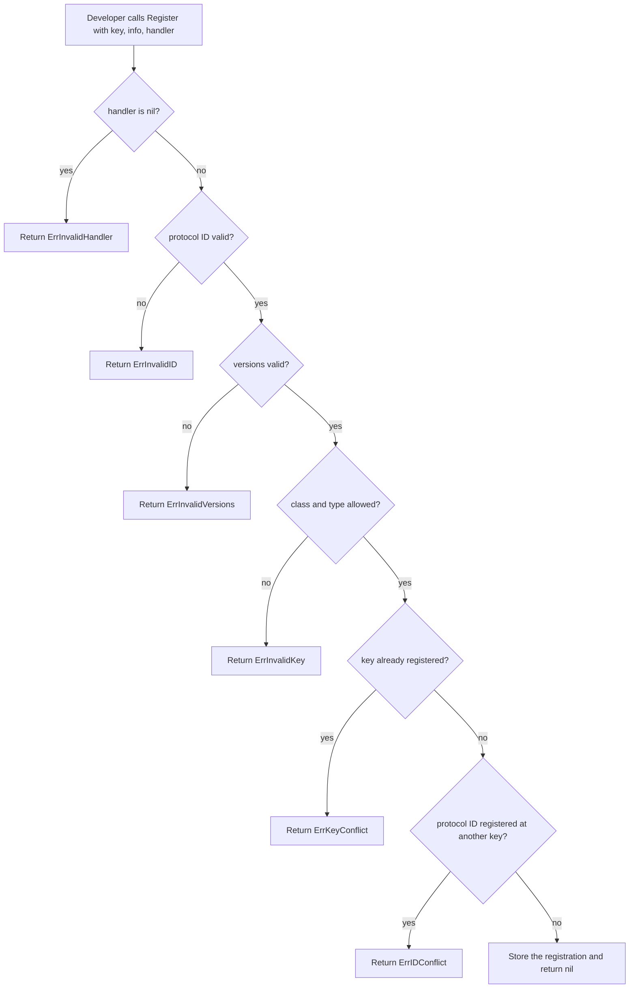
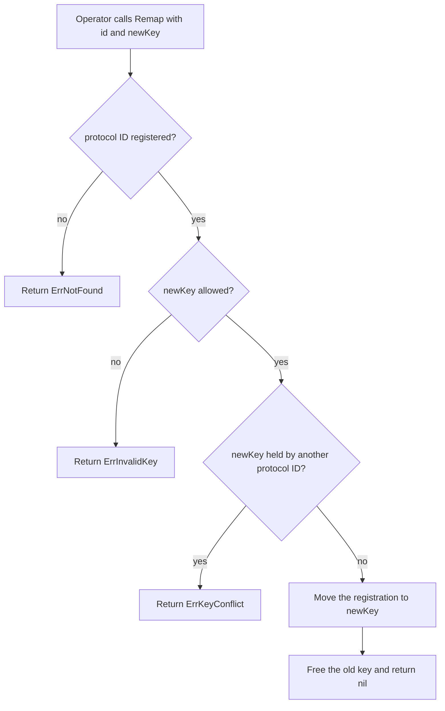

## Purpose

The protocol registry holds the registrations of one authoritative server. Each
registration binds one protocol key to one handler and to one protocol ID with its
supported versions. The registry rejects conflicts and invalid protocol keys. It lets an
operator remap a protocol ID to a different protocol key, because class and type numbers
are local to one server and are not global identifiers.

This feature also defines the core types in `pkg/protocol` that every other package
uses.

## User stories

- As a protocol developer, I want to register a handler for a protocol key, so that the
  server answers that protocol without my own DNS code.
- As a protocol developer, I want the registry to reject a second registration for the
  same protocol key, so that two protocols never answer the same questions.
- As an operator, I want to remap a protocol ID to a different protocol key, so that I
  can avoid a class that a local network already uses.
- As a protocol developer, I want several private types in one private class, so that one
  protocol namespace can hold several message kinds.

## Functional requirements

### Core types in pkg/protocol

- FR-registry-1 — `pkg/protocol` defines `ProtocolKey` with the fields `Class uint16` and
  `Type uint16`.
- FR-registry-2 — `ProtocolKey.String()` returns `<class>/<type>` in decimal, for example
  `65280/65280`.
- FR-registry-3 — `pkg/protocol` defines `Info` with the fields `ID string`,
  `Versions []uint16` and `Schema Schema`.
- FR-registry-4 — `pkg/protocol` defines the interface `Schema` with the method
  `Validate(version uint16, payload []byte) error`.
- FR-registry-5 — `pkg/protocol` defines the interface `Handler` with the method
  `Handle(ctx context.Context, req *Request) (*Response, error)`.
- FR-registry-6 — `pkg/protocol` defines `HandlerFunc`, a function type that implements
  `Handler`.
- FR-registry-7 — `pkg/protocol` defines the interface `Describer` with the method
  `Info() Info`.
- FR-registry-8 — `pkg/protocol` defines `Status` constants for every row of the spec's
  application status table.
- FR-registry-9 — `pkg/protocol` defines `MessageType` constants `MessageRecord` (1) and
  `MessageManifest` (2).
- FR-registry-10 — `IsPrivateClass(c uint16)` returns true only for 65280–65534.
- FR-registry-11 — `IsPrivateType(t uint16)` returns true only for 65280–65534.

### Validation

- FR-registry-12 — The registry accepts a protocol ID only when it matches
  `^[a-z0-9]([a-z0-9-]*[a-z0-9])?(\.[a-z0-9]([a-z0-9-]*[a-z0-9])?)+$` and is 1–128 bytes
  long.
- FR-registry-13 — The registry rejects an `Info` with an empty `Versions` list.
- FR-registry-14 — The registry rejects an `Info` with a version of 0.
- FR-registry-15 — The registry rejects an `Info` with a duplicate version.
- FR-registry-16 — The registry stores `Versions` in ascending order.
- FR-registry-17 — The registry accepts the classes 65280–65534 and IN (1).
- FR-registry-18 — The registry accepts a reserved class only when
  `Options.AllowReservedClasses` is true.
- FR-registry-19 — The registry rejects every other class.
- FR-registry-20 — The registry accepts the types 65280–65534.
- FR-registry-21 — The registry accepts a type outside 65280–65534 only when
  `Options.AllowNonPrivateTypes` is true.
- FR-registry-22 — The registry always rejects the types 0, 41, 250, 251, 252, 255 and
  65535.
- FR-registry-23 — The registry rejects a nil handler.

### Registration operations

- FR-registry-24 — `Register(key, info, handler)` adds a registration when the key and
  the info are valid.
- FR-registry-25 — `Register` returns `ErrKeyConflict` when the protocol key already has
  a registration.
- FR-registry-26 — `Register` returns `ErrIDConflict` when the protocol ID already has a
  registration at a different protocol key.
- FR-registry-27 — The registry accepts two registrations with the same class and
  different types.
- FR-registry-28 — `Unregister(key)` removes the registration of the protocol key.
- FR-registry-29 — `Unregister` returns `ErrNotFound` when the protocol key has no
  registration.
- FR-registry-30 — `Lookup(key)` returns the registration of the protocol key and true,
  or a zero value and false.
- FR-registry-31 — `LookupID(id)` returns the registration of the protocol ID and true,
  or a zero value and false.
- FR-registry-32 — `List()` returns every registration, ordered by class and then by type.
- FR-registry-33 — `List()` returns a copy, so a change to the returned slice does not
  change the registry.

### Remap and concurrency

- FR-registry-34 — `Remap(id, newKey)` moves the registration of the protocol ID to the
  new protocol key and frees the old protocol key.
- FR-registry-35 — `Remap` returns `ErrNotFound` when the protocol ID has no
  registration.
- FR-registry-36 — `Remap` returns `ErrKeyConflict` when the new protocol key has a
  registration of a different protocol ID.
- FR-registry-37 — `Remap` returns `ErrInvalidKey` when the new protocol key fails the
  class or type rules.
- FR-registry-38 — A failed `Remap` leaves the registry unchanged.
- FR-registry-39 — Every registry method is safe for concurrent use by many goroutines.

## User flows

### Flow 1 — A protocol developer registers a protocol



1. The developer calls `Register` with a protocol key, an `Info` and a handler.
2. If the handler is nil, the registry returns `ErrInvalidHandler`.
3. If the protocol ID is invalid, the registry returns `ErrInvalidID`.
4. If the versions are invalid, the registry returns `ErrInvalidVersions`.
5. If the class or the type is not allowed, the registry returns `ErrInvalidKey`.
6. If the protocol key has a registration, the registry returns `ErrKeyConflict`.
7. If the protocol ID has a registration at another key, the registry returns
   `ErrIDConflict`.
8. Otherwise, the registry stores the registration and returns nil.

### Flow 2 — An operator remaps a protocol ID



1. The operator calls `Remap` with a protocol ID and a new protocol key.
2. If the protocol ID has no registration, the registry returns `ErrNotFound`.
3. If the new protocol key is not allowed, the registry returns `ErrInvalidKey`.
4. If a different protocol ID holds the new protocol key, the registry returns
   `ErrKeyConflict`.
5. Otherwise, the registry moves the registration to the new protocol key.
6. The registry frees the old protocol key and returns nil.

## Screens & states

No screens. The feature is library code only.

## Behaviour rules

- The registry takes a write lock for `Register`, `Unregister` and `Remap`. It takes a
  read lock for `Lookup`, `LookupID` and `List`.
- `Remap` to the protocol key that the protocol ID already holds returns nil and changes
  nothing.
- The registry checks the rules in this order: handler, protocol ID, versions, protocol
  key, key conflict, ID conflict. The first failed rule decides the error.
- Every error wraps one of the sentinel errors, so callers test it with `errors.Is`.
- The error text names the protocol key and the protocol ID.
- The registry does not call the handler or the schema.

## Data touched

In-memory only. The registry holds a map from `ProtocolKey` to `Registration` and a map
from protocol ID to `ProtocolKey`. Nothing persists.

## Interfaces

```go
package protocol

type ProtocolKey struct {
    Class uint16
    Type  uint16
}
func (k ProtocolKey) String() string

type Info struct {
    ID       string
    Versions []uint16
    Schema   Schema // optional
}

type Schema interface {
    Validate(version uint16, payload []byte) error
}

type Handler interface {
    Handle(ctx context.Context, req *Request) (*Response, error)
}
type HandlerFunc func(ctx context.Context, req *Request) (*Response, error)

type Describer interface {
    Info() Info
}

type Status uint16
const (
    StatusOK                 Status = 0
    StatusNotFound           Status = 1
    StatusBadRequest         Status = 2
    StatusVersionUnsupported Status = 3
    StatusUnavailable        Status = 4
)

type MessageType uint16
const (
    MessageRecord   MessageType = 1
    MessageManifest MessageType = 2
)

func IsPrivateClass(c uint16) bool
func IsPrivateType(t uint16) bool
```

`Request` and `Response` are defined in `pkg/protocol` by Epic 2. Epic 1 declares them as
structs with the fields that features/02-authoritative-server.md lists.

```go
package registry

type Options struct {
    AllowReservedClasses bool
    AllowNonPrivateTypes bool
}

type Registration struct {
    Key     protocol.ProtocolKey
    Info    protocol.Info
    Handler protocol.Handler
}

var (
    ErrInvalidKey      = errors.New("registry: invalid protocol key")
    ErrInvalidID       = errors.New("registry: invalid protocol ID")
    ErrInvalidVersions = errors.New("registry: invalid protocol versions")
    ErrInvalidHandler  = errors.New("registry: nil handler")
    ErrKeyConflict     = errors.New("registry: protocol key already registered")
    ErrIDConflict      = errors.New("registry: protocol ID already registered")
    ErrNotFound        = errors.New("registry: not found")
)

func New(opts Options) *Registry
func (r *Registry) Register(key protocol.ProtocolKey, info protocol.Info, h protocol.Handler) error
func (r *Registry) Unregister(key protocol.ProtocolKey) error
func (r *Registry) Lookup(key protocol.ProtocolKey) (Registration, bool)
func (r *Registry) LookupID(id string) (Registration, bool)
func (r *Registry) List() []Registration
func (r *Registry) Remap(id string, newKey protocol.ProtocolKey) error
```

## Edge cases & failures

- A caller changes the `Versions` slice after `Register`. The registry stores its own
  copy, so the registration does not change.
- A caller registers class 65535 or type 65535. The registry returns `ErrInvalidKey`,
  because 65535 is reserved and not private.
- A caller registers class 3 with `AllowReservedClasses` false. The registry returns
  `ErrInvalidKey`.
- 100 goroutines call `Register`, `Lookup` and `List` at the same time. The race detector
  reports no race, and each protocol key holds at most one registration.

## Acceptance criteria

- `ProtocolKey{Class: 65280, Type: 65280}` compiles with those field names.
  (FR-registry-1)
- `ProtocolKey{65280, 65281}.String()` returns `65280/65281`. (FR-registry-2)
- An `Info` literal with `ID`, `Versions` and `Schema` compiles. (FR-registry-3)
- A test type with `Validate(uint16, []byte) error` satisfies `Schema`. (FR-registry-4)
- A test type with the brief's `Handle` signature satisfies `Handler`. (FR-registry-5)
- A `HandlerFunc` value satisfies `Handler` and calls the wrapped function.
  (FR-registry-6)
- A test type with `Info() Info` satisfies `Describer`. (FR-registry-7)
- `StatusOK` to `StatusUnavailable` equal 0 to 4. (FR-registry-8)
- `MessageRecord` equals 1 and `MessageManifest` equals 2. (FR-registry-9)
- `IsPrivateClass` returns true for 65280 and 65534, and false for 65279 and 65535.
  (FR-registry-10)
- `IsPrivateType` returns true for 65280 and 65534, and false for 65279 and 65535.
  (FR-registry-11)
- The protocol ID `org.qmux.bootstrap` registers. The IDs `qmux`, `Org.Qmux.x`,
  `org..qmux`, `-org.qmux` and a 129-byte ID return `ErrInvalidID`. (FR-registry-12)
- An `Info` with no versions returns `ErrInvalidVersions`. (FR-registry-13)
- An `Info` with version 0 returns `ErrInvalidVersions`. (FR-registry-14)
- An `Info` with versions `[1, 1]` returns `ErrInvalidVersions`. (FR-registry-15)
- An `Info` with versions `[3, 1, 2]` reads back from `Lookup` as `[1, 2, 3]`.
  (FR-registry-16)
- Classes 1, 65280 and 65534 register. (FR-registry-17)
- Class 3 returns `ErrInvalidKey` by default and registers with
  `AllowReservedClasses: true`. (FR-registry-18)
- Classes 0, 2, 254, 255, 65279 and 65535 return `ErrInvalidKey`. (FR-registry-19)
- Types 65280 and 65534 register. (FR-registry-20)
- Type 16 returns `ErrInvalidKey` by default and registers with
  `AllowNonPrivateTypes: true`. (FR-registry-21)
- Types 0, 41, 250, 251, 252, 255 and 65535 return `ErrInvalidKey` with both options
  true.
  (FR-registry-22)
- A nil handler returns `ErrInvalidHandler`. (FR-registry-23)
- After a valid `Register`, `Lookup` returns the registration. (FR-registry-24)
- A second `Register` at the same protocol key returns `ErrKeyConflict`. (FR-registry-25)
- A second `Register` of the same protocol ID at a different key returns
  `ErrIDConflict`. (FR-registry-26)
- Registrations at `65280/65280` and `65280/65534` both succeed. (FR-registry-27)
- After `Unregister`, `Lookup` returns false. (FR-registry-28)
- `Unregister` of an unknown protocol key returns `ErrNotFound`. (FR-registry-29)
- `Lookup` of an unknown protocol key returns false. (FR-registry-30)
- `LookupID("org.qmux.bootstrap")` returns the registration and true. (FR-registry-31)
- `List()` after registrations at `65281/65280`, `65280/65534` and `65280/65280` returns
  them in the order `65280/65280`, `65280/65534`, `65281/65280`. (FR-registry-32)
- A test that overwrites an element of the `List()` result sees the original value in the
  next `List()`. (FR-registry-33)
- After `Remap("org.qmux.bootstrap", 65283/65280)`, `Lookup(65283/65280)` returns it and
  `Lookup(65280/65280)` returns false. (FR-registry-34)
- `Remap` of an unknown protocol ID returns `ErrNotFound`. (FR-registry-35)
- `Remap` onto a key that another protocol ID holds returns `ErrKeyConflict`.
  (FR-registry-36)
- `Remap` onto class 65535 returns `ErrInvalidKey`. (FR-registry-37)
- After each failed `Remap`, `List()` equals the list before the call. (FR-registry-38)
- A test with 100 goroutines that call every method passes under `go test -race`.
  (FR-registry-39)

## Out of scope

- Persistence of registrations. `qmuxd` builds the registry from its configuration file
  at each start.
- Dispatch of requests to handlers. Epic 2 does this.
- The manifest that lists the registrations. Epic 5 builds it.

## Open questions
