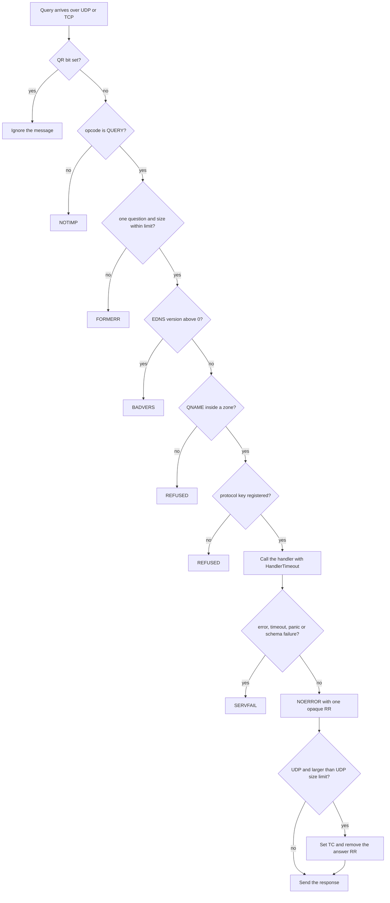
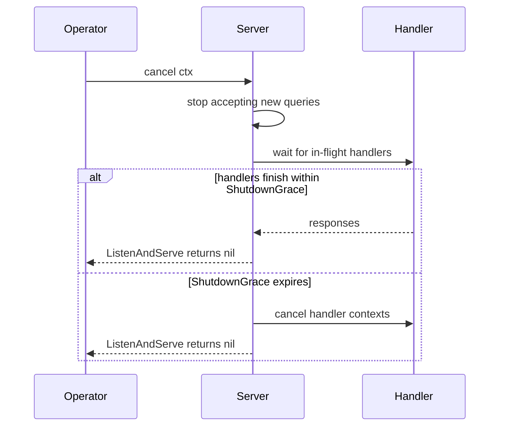

## Purpose

The authoritative server receives DNS queries over UDP and TCP, validates them, and
dispatches each one to the handler of its protocol key. It returns the handler's payload
as opaque RDATA in one answer RR. The class and the type of the answer RR are the class
and the type of the question. It enforces size limits, EDNS(0), timeouts and graceful
shutdown, and it logs one record per query.

In Epic 2 the RDATA is the raw `Response.Payload`. Epic 4 replaces the raw payload with
the envelope. The server never recurses and never delegates.

## User stories

- As a protocol developer, I want to register a handler and call `ListenAndServe`, so that
  my protocol answers over DNS with no DNS code of my own.
- As a protocol developer, I want the server to reject malformed and unsupported queries
  with the correct RCODE, so that clients can tell DNS failures from application outcomes.
- As an operator, I want the server to stop cleanly on a signal, so that in-flight
  queries complete before the process exits.
- As an operator, I want one log record per query, so that I can see what the server
  answered.

## Functional requirements

### Configuration and lifecycle

- FR-server-1 — `NewServer(cfg ServerConfig)` returns a server that holds a new registry
  built with `cfg.Registry`.
- FR-server-2 — `NewServer` applies the defaults from the spec's timeouts table to every
  zero field of `ServerConfig`.
- FR-server-3 — `Register(key, h)` registers `h` with the `Info` that `h.Info()` returns.
- FR-server-4 — `Register` returns `ErrMissingInfo` when `h` does not implement
  `protocol.Describer`.
- FR-server-5 — `RegisterProtocol(key, info, h)` registers `h` with an explicit `Info`.
- FR-server-6 — `ListenAndServe(ctx)` listens on `cfg.Address` over UDP and over TCP.
- FR-server-7 — `ListenAndServe` returns the bind error when either listener fails to
  start.
- FR-server-8 — `ListenAndServe` returns nil after `ctx` is cancelled and the graceful
  shutdown completes.
- FR-server-9 — `Serve(ctx, pc, l)` serves on a caller-supplied `net.PacketConn` and
  `net.Listener`.
- FR-server-10 — `Addr()` returns the UDP address the server listens on, after the
  listeners start.
- FR-server-11 — On shutdown, the server stops accepting new queries and waits up to
  `ShutdownGrace` for in-flight handlers.
- FR-server-12 — After `ShutdownGrace`, the server cancels the context of every handler
  that still runs.

### Request validation

- FR-server-13 — The server ignores a message with the QR bit set.
- FR-server-14 — The server answers `NOTIMP` to an opcode other than QUERY.
- FR-server-15 — The server answers `FORMERR` to a query with a question count other
  than 1.
- FR-server-16 — The server answers `FORMERR` to a parseable query larger than 512 bytes
  without EDNS(0).
- FR-server-17 — The server answers `FORMERR` to a parseable query larger than 1232 bytes
  with EDNS(0).
- FR-server-18 — The server answers `BADVERS` to a query with an EDNS version above 0.
- FR-server-19 — The server answers `REFUSED` when the QNAME is outside every configured
  zone.
- FR-server-20 — The server accepts every QNAME when `Zones` is empty.
- FR-server-21 — The server logs one warning at start when `Zones` is empty.
- FR-server-22 — The server answers `REFUSED` when the protocol key has no registration.

### Dispatch and answer

- FR-server-23 — The server builds a `Request` with the QNAME in lowercase fully
  qualified form.
- FR-server-24 — The server sets `Request.Version` from a leftmost `_v<N>` label, or to 0
  when the QNAME has no version label.
- FR-server-25 — The server sets `Request.Labels` to the QNAME labels below the zone, with
  the version label removed.
- FR-server-26 — The server sets `Request.Source`, `Request.Transport`,
  `Request.UDPSize`, `Request.ID` and `Request.ReceivedAt` from the received query.
- FR-server-27 — The server calls the handler of the registration with a context that
  expires after `HandlerTimeout`.
- FR-server-28 — The server calls `Info.Schema.Validate` on the response payload when the
  registration has a schema.
- FR-server-29 — On a handler response, the server answers `NOERROR` with the AA bit set
  and exactly one answer RR.
- FR-server-30 — The answer RR has the QNAME as received, and the class and type of the
  question.
- FR-server-31 — The answer RR carries `Response.Payload` as opaque RDATA in a
  `*dns.RFC3597` RR.
- FR-server-32 — The answer RR TTL is `Response.TTL`, or `cfg.TTL` when `Response.TTL` is
  0.
- FR-server-33 — The server answers `SERVFAIL` when the handler returns an error.
- FR-server-34 — The server answers `SERVFAIL` when the handler exceeds `HandlerTimeout`.
- FR-server-35 — The server answers `SERVFAIL` when the handler panics, and logs the panic
  at error level.
- FR-server-36 — The server answers `SERVFAIL` when the schema rejects the payload.

### Size limits and EDNS(0)

- FR-server-37 — The UDP size limit is 512 bytes for a query without EDNS(0).
- FR-server-38 — The UDP size limit is the smaller of the advertised size and
  `cfg.UDPSize` for a query with EDNS(0).
- FR-server-39 — The server adds an OPT RR with `cfg.UDPSize` to each response to an
  EDNS(0) query.
- FR-server-40 — When a UDP response exceeds the UDP size limit, the server sets the TC
  bit, removes the answer RR, and keeps the OPT RR.
- FR-server-41 — The server answers `SERVFAIL` over TCP when the response exceeds 65535
  bytes.

### Logging and robustness

- FR-server-42 — The server writes one `slog` record per answered query with the fields
  of the spec's Logging section.
- FR-server-43 — The server never logs payload bytes.
- FR-server-44 — `FuzzServeMessage` sends arbitrary bytes through the request path, and
  the server never panics.
- FR-server-45 — The server answers 100 concurrent queries with no data race under
  `go test -race`.

## User flows

### Flow 1 — The server answers one query



1. A query arrives over UDP or TCP.
2. If the QR bit is set, the server ignores the message.
3. If the opcode is not QUERY, the server answers `NOTIMP`.
4. If the query has more or fewer than one question, the server answers `FORMERR`.
5. If the query exceeds its size limit, the server answers `FORMERR`.
6. If the EDNS version is above 0, the server answers `BADVERS`.
7. If the QNAME is outside every zone, the server answers `REFUSED`.
8. If the protocol key has no registration, the server answers `REFUSED`.
9. The server calls the handler with a context that expires after `HandlerTimeout`.
10. If the handler fails, times out or panics, the server answers `SERVFAIL`.
11. If the schema rejects the payload, the server answers `SERVFAIL`.
12. The server builds a `NOERROR` response with one opaque answer RR.
13. If the transport is UDP and the response exceeds the UDP size limit, the server sets
    TC and removes the answer RR.
14. The server sends the response and writes one log record.

### Flow 2 — The server shuts down under load



1. The operator cancels the context of `ListenAndServe`.
2. The server stops accepting new queries.
3. The server waits for in-flight handlers.
4. If the handlers finish within `ShutdownGrace`, the server sends their responses.
5. If `ShutdownGrace` expires, the server cancels every handler context.
6. `ListenAndServe` returns nil.

## Screens & states

No screens. The feature is library code only. The log record is the only output:

```
level=INFO msg=query qname=device42.fleet.example. qclass=65280 qtype=65280 transport=udp source=127.0.0.1:53211 rcode=NOERROR status=0 bytes_in=51 bytes_out=88 duration_ms=0.21
```

`status` is empty in Epic 2 for a response with no envelope. Epic 4 fills it.

## Behaviour rules

- The server compares QNAMEs and zones in lowercase. The answer RR keeps the QNAME case
  as received.
- A zone matches a QNAME when the last labels of the QNAME equal the labels of the zone.
  An escaped dot (`\.`) is part of its label and is not a label boundary.
- When several zones match, the longest zone is the `Request.Zone`.
- With empty `Zones`, `Request.Zone` is `.` and `Request.Labels` holds every QNAME label.
- A version label is a leftmost label `_v` followed by a decimal number from 1 to 65535
  with no leading zero. Any other leftmost label that starts with `_v` is an ordinary
  label.
- In Epic 2 the server passes the version label through to the handler. Epic 5 adds the
  check against the registration versions.
- `Response.Version` 0 means the highest version of the registration.
  `Response.MessageType` 0 means `MessageRecord`. Epic 4 writes both into the envelope.
- `pkg/transport` runs its own UDP and TCP read loops, so no miekg/dns accept function
  filters the queries. `pkg/server` answers NOTIFY and IQUERY with `NOTIMP`. See ADR 0005.
- A response to a non-EDNS query carries no OPT RR.
- The server sets the RA bit to 0 on every response.

## Data touched

In-memory only. The server reads the registry. It writes log records. It stores no
state per query after the response.

## Interfaces

```go
package server

type ServerConfig struct {
    Address        string        // "127.0.0.1:5353"
    Zones          []string      // empty: every QNAME
    TTL            uint32        // default 60
    UDPSize        uint16        // default 1232
    HandlerTimeout time.Duration // default 2s
    ReadTimeout    time.Duration // default 2s
    WriteTimeout   time.Duration // default 2s
    ShutdownGrace  time.Duration // default 5s
    Logger         *slog.Logger  // default slog.Default()
    Registry       registry.Options
}

var ErrMissingInfo = errors.New("server: handler does not implement protocol.Describer")

func NewServer(cfg ServerConfig) *Server
func (s *Server) Register(key protocol.ProtocolKey, h protocol.Handler) error
func (s *Server) RegisterProtocol(key protocol.ProtocolKey, info protocol.Info, h protocol.Handler) error
func (s *Server) Unregister(key protocol.ProtocolKey) error
func (s *Server) Registry() *registry.Registry
func (s *Server) ListenAndServe(ctx context.Context) error
func (s *Server) Serve(ctx context.Context, pc net.PacketConn, l net.Listener) error
func (s *Server) Addr() net.Addr
```

```go
package protocol

type Request struct {
    QName      string // lowercase FQDN
    Key        ProtocolKey
    Version    uint16 // 0 when no version label
    Labels     []string
    Zone       string
    Source     netip.AddrPort
    Transport  string // "udp" or "tcp"
    UDPSize    uint16
    ID         uint16
    ReceivedAt time.Time
}

type Response struct {
    Payload     []byte
    TTL         uint32      // 0: server default
    Status      Status
    Version     uint16      // 0: highest registered version
    MessageType MessageType // 0: MessageRecord
}
```

`pkg/transport` holds every miekg/dns call: the UDP and TCP read loops, the conversion
between bytes and the hex `RFC3597.Rdata`, the EDNS(0) handling, and the size checks.
ADR 0005 defines its API. miekg/dns v1.1.73 facts, verified against
https://github.com/miekg/dns (v1.1.73) and `go doc` on 2026-11-20:

- `pkg/transport` uses miekg/dns only for `Msg.Pack`, `Msg.Unpack`, `Msg.Truncate`,
  `SetEdns0` and `RFC3597`. It does not use `dns.Server`.
- `dns.Server` reads a UDP query into a buffer of `UDPSize` bytes and does not give the
  received size to the handler. `Msg.Unpack` ignores trailing bytes. So `pkg/transport`
  measures each query from the bytes that it receives.
- `Msg.IsEdns0()` returns the OPT RR. `OPT.UDPSize()` and `OPT.Version()` read its fields.

## Edge cases & failures

- A query with QCLASS ANY (255) has no registration, so the server answers `REFUSED`.
- A handler returns a nil `*Response` and a nil error. The server answers `SERVFAIL` and
  logs the handler bug.
- A handler ignores its context and runs past `HandlerTimeout`. The server answers
  `SERVFAIL` at the timeout and discards the late response.
- A client closes a TCP connection before the response. The server logs the write error
  at debug level and continues.
- The port is already in use. `ListenAndServe` returns the bind error and starts no
  listener.
- `Addr()` before the listeners start returns nil.

## Acceptance criteria

- `NewServer(ServerConfig{})` returns a server whose registry accepts a valid
  registration. (FR-server-1)
- `NewServer(ServerConfig{})` applies TTL 60, UDP size 1232, handler timeout 2s, read and
  write timeouts 2s, and shutdown grace 5s. (FR-server-2)
- `Register` with a `Describer` handler adds a registration with the handler's `Info`.
  (FR-server-3)
- `Register` with a plain `HandlerFunc` returns `ErrMissingInfo`. (FR-server-4)
- `RegisterProtocol` adds a registration with the given `Info`. (FR-server-5)
- A test sends one query over UDP and one over TCP to the same address and gets two
  answers. (FR-server-6)
- `ListenAndServe` on a port already in use returns a non-nil error. (FR-server-7)
- `ListenAndServe` returns nil within 1 second of a context cancel with no load.
  (FR-server-8)
- `Serve` with listeners on port 0 answers queries. (FR-server-9)
- `Addr()` returns a non-zero port after `Serve` starts. (FR-server-10)
- During shutdown, a handler that sleeps 1s with a grace of 5s completes and its response
  arrives. (FR-server-11)
- During shutdown, a handler that blocks on its context with a grace of 100ms sees its
  context cancelled. (FR-server-12)
- A message with QR set gets no response. (FR-server-13)
- An IQUERY and a NOTIFY each get `NOTIMP`. (FR-server-14)
- A query with zero questions and one with two questions each get `FORMERR`.
  (FR-server-15)
- A 600-byte query without EDNS(0) gets `FORMERR`. (FR-server-16)
- A 1300-byte query with EDNS(0) gets `FORMERR`. (FR-server-17)
- A query with EDNS version 1 gets `BADVERS`. (FR-server-18)
- With zone `fleet.example.`, the QNAME `a.other.example.` gets `REFUSED`.
  (FR-server-19)
- With no zones, the QNAME `a.other.example.` reaches the handler. (FR-server-20)
- With no zones, the log holds one warning at start. (FR-server-21)
- A query for an unregistered protocol key gets `REFUSED`. (FR-server-22)
- The QNAME `Device42.Fleet.Example.` reaches the handler as `device42.fleet.example.`.
  (FR-server-23)
- The QNAME `_v2.device42.fleet.example.` gives `Request.Version` 2. A QNAME with no
  version label gives 0. (FR-server-24)
- With zone `fleet.example.`, `_v2.device42.fleet.example.` gives `Request.Labels`
  `["device42"]`. (FR-server-25)
- A handler sees the client source address, `udp` or `tcp`, the query ID, and a
  non-zero `ReceivedAt`. (FR-server-26)
- A handler sees a context deadline about 2 seconds after the call with default
  settings. (FR-server-27)
- A schema that counts its calls records one call per answered query. (FR-server-28)
- A handler response gives `NOERROR`, AA set, and an answer count of 1. (FR-server-29)
- The answer RR for `Device42.fleet.example.` class 65281 type 65280 has that exact name,
  class 65281 and type 65280. (FR-server-30)
- The answer RDATA bytes equal the handler's payload bytes. (FR-server-31)
- A response with TTL 0 gives an RR TTL of 60. A response with TTL 5 gives 5.
  (FR-server-32)
- A handler error gives `SERVFAIL`. (FR-server-33)
- A handler that sleeps past the timeout gives `SERVFAIL`. (FR-server-34)
- A handler panic gives `SERVFAIL`, one error log record, and the server keeps
  answering. (FR-server-35)
- A schema that returns an error gives `SERVFAIL`. (FR-server-36)
- A 600-byte payload to a non-EDNS UDP query gives TC set and no answer RR.
  (FR-server-37)
- A 1500-byte payload to a UDP query that advertises 4096 gives TC set with the default
  `UDPSize` of 1232. (FR-server-38)
- A response to an EDNS(0) query holds an OPT RR with UDP size 1232. (FR-server-39)
- A truncated UDP response holds the OPT RR and no answer RR. (FR-server-40)
- A 70000-byte payload over TCP gives `SERVFAIL`. (FR-server-41)
- Each answered query produces one log record with the ten fields of the spec.
  (FR-server-42)
- No log record contains the payload bytes of a test payload marker. (FR-server-43)
- `FuzzServeMessage` runs its seed corpus with no panic. (FR-server-44)
- An integration test with 100 concurrent queries passes under `go test -race`.
  (FR-server-45)

## Out of scope

- The envelope as RDATA. Epic 4 replaces the raw payload.
- The `version-unsupported` check against registration versions. Epic 5 adds it.
- `ServerConfig.Signer`. Epic 6 adds it.
- `ServerConfig.RateLimit` and the observation log. Epic 8 adds them.
- Recursion, delegation, zone transfer, SOA and NS answers, and DNS over TLS.

## Open questions
