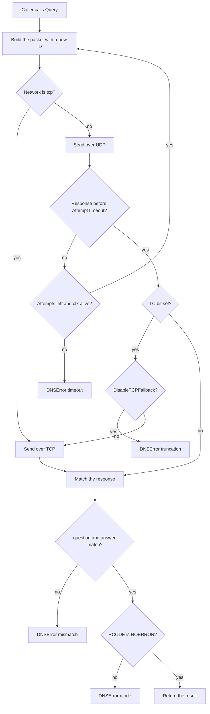
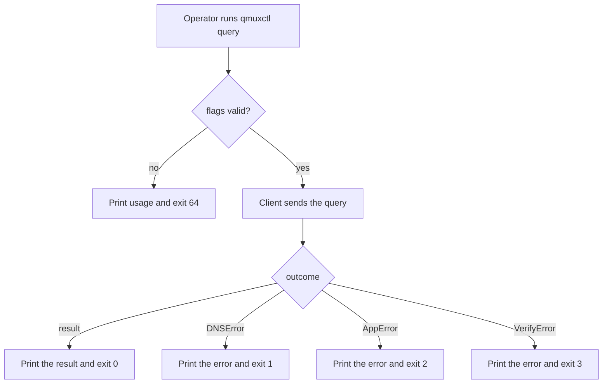

## Purpose

The client SDK sends a query for one QNAME, QCLASS and QTYPE directly to a configured
server, and returns a result. It builds every DNS packet itself and never uses the
operating system's stub resolver. It retries on a UDP timeout, repeats a truncated
query over TCP, and checks that the answer matches the question exactly. It reports DNS
failures and application outcomes as separate error types.

`qmuxctl query` exposes the SDK on the command line. This epic also adds the root `qmux`
facade, so the brief's API examples compile as written. The Phase 1 deliverable closes
this epic: two protocols answer through two private classes.

## User stories

- As a device integrator, I want to send a query with a private class and a private type,
  so that the device reads protocol data with no recursive resolver.
- As a device integrator, I want the client to retry and to fall back to TCP, so that a
  lost packet or a large answer does not fail the query.
- As a device integrator, I want a mismatched answer to fail, so that a spoofed or
  confused response never reaches my code.
- As an operator, I want `qmuxctl query`, so that I can inspect an answer from a shell.

## Functional requirements

### Client configuration and query

- FR-client-1 — `NewClient(cfg ClientConfig)` returns a client that sends every query to
  `cfg.Resolver`.
- FR-client-2 — `NewClient` applies the defaults from the spec's timeouts table to every
  zero field of `ClientConfig`.
- FR-client-3 — `Query(ctx, q)` sends one DNS question with `q.Name`, `q.Class` and
  `q.Type`.
- FR-client-4 — `Query` adds the version label `_v<N>` to the QNAME when `q.Version` is
  not 0.
- FR-client-5 — `Query` adds an OPT RR with `cfg.UDPSize` to every UDP query.
- FR-client-6 — `Query` builds the packet through `pkg/transport` and sends it with
  `net.Dialer`.
- FR-client-7 — `Query` uses a new random query ID for each attempt.

### Transport, retries and fallback

- FR-client-8 — `Query` sends over UDP when `cfg.Network` is `udp` or empty.
- FR-client-9 — `Query` sends over TCP only when `cfg.Network` is `tcp`.
- FR-client-10 — `Query` makes a new UDP attempt after `AttemptTimeout` with no
  response, up to `Attempts` attempts.
- FR-client-11 — `Query` makes no new attempt after a response with any RCODE.
- FR-client-12 — `Query` stops and returns a timeout `DNSError` when `ctx` expires.
- FR-client-13 — `Query` stops and returns an error that wraps `context.Canceled` when
  `ctx` is cancelled.
- FR-client-14 — `Query` repeats the query once over TCP when a UDP response has the TC
  bit set.
- FR-client-15 — `Query` returns a truncation `DNSError` when the TC bit is set and
  `cfg.DisableTCPFallback` is true.

### Response matching and errors

- FR-client-16 — `Query` ignores a UDP response whose ID differs from the query ID, and
  waits for the matching response until the attempt times out.
- FR-client-17 — `Query` returns a mismatch `DNSError` when the response question name,
  class or type differs from the query.
- FR-client-18 — `Query` compares names without regard to case.
- FR-client-19 — `Query` returns a mismatch `DNSError` when a `NOERROR` response does not
  hold exactly one answer RR.
- FR-client-20 — `Query` returns a mismatch `DNSError` when the answer RR name, class or
  type differs from the question.
- FR-client-21 — `Query` returns an RCODE `DNSError` that holds the RCODE when the RCODE
  is not `NOERROR`.
- FR-client-22 — `Query` returns a malformed `DNSError` when the response does not parse.
- FR-client-23 — `Query` returns a network `DNSError` when the dial, the write or the
  read fails for a reason other than a timeout.
- FR-client-24 — `pkg/client` defines `AppError` with the fields `Status`, `ProtocolID`
  and `Version`.
- FR-client-25 — `pkg/client` defines `VerifyError` with the fields `Reason` and `Err`.

### Result

- FR-client-26 — `Result.Payload` holds the payload of the envelope in the answer RR
  (FR-codec-38).
- FR-client-27 — `Result` holds the QNAME, protocol key, RCODE and TTL of the answer.
- FR-client-28 — `Result.Transport` is `udp` or `tcp`, the transport of the final
  attempt.
- FR-client-29 — `Result.FellBack` is true when the client repeated the query over TCP.
- FR-client-30 — `Result.RTT` is the time of the final attempt.
- FR-client-31 — `Result.QueryBytes` and `Result.ResponseBytes` are the wire sizes of the
  final attempt.
- FR-client-32 — `Result.Verified` is false in Epic 3.

### qmuxctl query

- FR-client-33 — `qmuxctl query` accepts the flags `--server`, `--class`, `--type`,
  `--name`, `--version`, `--tcp`, `--timeout` and `--json`.
- FR-client-34 — `qmuxctl query` prints one `key: value` line per result field, with the
  payload as lowercase hex.
- FR-client-35 — `qmuxctl query --json` prints the result as one JSON object.
- FR-client-36 — `qmuxctl query` exits 0 on a result.
- FR-client-37 — `qmuxctl query` exits 1 on a `DNSError`.
- FR-client-38 — `qmuxctl query` exits 2 on an `AppError`.
- FR-client-39 — `qmuxctl query` exits 3 on a `VerifyError`.
- FR-client-40 — `qmuxctl query` exits 64 on a missing or invalid flag, and prints the
  usage.

### Facade and Phase 1 deliverable

- FR-client-41 — The root package `qmux` defines the aliases `ServerConfig`,
  `ClientConfig`, `ProtocolKey` and `Query`, and the functions `NewServer` and
  `NewClient`.
- FR-client-42 — `example_test.go` holds the brief's server snippet and client snippet,
  and both compile.
- FR-client-43 — `tests/integration` holds a test in which protocols at `65280/65280`
  and `65281/65280` answer different payloads to one client over UDP.
- FR-client-44 — The same integration test repeats both queries over TCP.
- FR-client-45 — `tests/integration` holds a test in which a large answer arrives
  through TCP fallback.

## User flows

### Flow 1 — The client sends a query



1. The caller calls `Query`.
2. The client builds the packet with a new random ID.
3. If `Network` is `tcp`, the client sends over TCP.
4. Otherwise, the client sends over UDP.
5. If no response arrives before `AttemptTimeout`, and attempts and context remain, the
   client starts again at step 2.
6. If no attempts remain, the client returns a timeout `DNSError`.
7. If the TC bit is set and `DisableTCPFallback` is true, the client returns a
   truncation `DNSError`.
8. If the TC bit is set, the client sends the query over TCP.
9. The client matches the response against the query.
10. If the question or the answer does not match, the client returns a mismatch
    `DNSError`.
11. If the RCODE is not `NOERROR`, the client returns an RCODE `DNSError`.
12. The client returns the result.

### Flow 2 — An operator runs qmuxctl query



1. The operator runs `qmuxctl query` with flags.
2. If a flag is missing or invalid, `qmuxctl` prints the usage and exits 64.
3. The client sends the query.
4. If the client returns a result, `qmuxctl` prints it and exits 0.
5. If the client returns a `DNSError`, `qmuxctl` prints it and exits 1.
6. If the client returns an `AppError`, `qmuxctl` prints the result to stdout, prints the
   error to stderr and exits 2.
7. If the client returns a `VerifyError`, `qmuxctl` prints it and exits 3.

## Screens & states

No graphical screens. `qmuxctl query` output states:

Result:

```
$ qmuxctl query --server 127.0.0.1:5300 --class 65280 --type 65280 --name device42.fleet.example.
name: device42.fleet.example.
class: 65280
type: 65280
rcode: NOERROR
ttl: 60
transport: udp
fell_back: false
rtt_ms: 0.41
query_bytes: 51
response_bytes: 88
verified: false
payload: a1016b68656c6c6f
```

DNS error (exit 1):

```
error: dns: rcode REFUSED for device42.fleet.example. 65283/65280
```

Timeout (exit 1):

```
error: dns: timeout after 3 attempts to 127.0.0.1:5300
```

Usage error (exit 64): the usage text for `qmuxctl query`.

## Behaviour rules

- `cfg.Resolver` is a `host:port` string. `NewClient` does not resolve a host name through
  DNS. A host name in `Resolver` is an error at the first query.
- `q.Name` must be a fully qualified name. The client adds the final `.` when it is
  absent.
- The client sets RD to 0 for a direct query. A caller can set `ClientConfig.Recursion`
  to true, so that a query through a resolver sets RD to 1.
- The client never retries over TCP on a timeout. A TCP attempt uses the remaining
  context time and `AttemptTimeout`, whichever ends first.
- The TCP fallback counts as one extra attempt beyond `Attempts`.
- `Result.TTL` is informational. Nothing in the client uses it as an expiry.
- `DNSError.Error()` names the kind, the QNAME and the protocol key. For the kind
  `rcode`, it also names the RCODE text. For the kind `timeout`, it names the attempt
  count and the resolver address in place of the QNAME and the protocol key.
- Every error wraps a cause, so callers test it with `errors.As` and `errors.Is`.
- In Epic 3 the client never returns `AppError` or `VerifyError`. Epics 4 and 6 return
  them.

## Data touched

In-memory only. The client holds its configuration. It stores nothing between queries.

## Interfaces

```go
package client

type ClientConfig struct {
    Resolver           string        // "127.0.0.1:5353"
    Network            string        // "udp" (default) or "tcp"
    AttemptTimeout     time.Duration // default 1s
    Attempts           int           // default 3
    UDPSize            uint16        // default 1232
    DisableTCPFallback bool
    Recursion          bool          // sets RD, for queries through a resolver
    Logger             *slog.Logger
}

type Query struct {
    Name    string
    Class   uint16
    Type    uint16
    Version uint16 // 0: no version label
}

type Result struct {
    Name          string
    Key           protocol.ProtocolKey
    RCode         int
    Payload       []byte
    TTL           uint32
    Transport     string // "udp" or "tcp"
    FellBack      bool
    RTT           time.Duration
    QueryBytes    int
    ResponseBytes int
    Verified      bool
}

type ErrorKind string
const (
    KindRCode      ErrorKind = "rcode"
    KindTimeout    ErrorKind = "timeout"
    KindNetwork    ErrorKind = "network"
    KindMismatch   ErrorKind = "mismatch"
    KindMalformed  ErrorKind = "malformed"
    KindTruncation ErrorKind = "truncation"
)

type DNSError struct {
    Kind  ErrorKind
    RCode int
    Name  string
    Key   protocol.ProtocolKey
    Err   error
}

type AppError struct {
    Status     protocol.Status
    ProtocolID string
    Version    uint16
}

type VerifyError struct {
    Reason error // the security sentinel, or the codec error; a string before Epic 6
    Err    error
}

func NewClient(cfg ClientConfig) *Client
func (c *Client) Query(ctx context.Context, q Query) (*Result, error)
```

```go
package qmux

type ServerConfig = server.ServerConfig
type ClientConfig = client.ClientConfig
type ProtocolKey  = protocol.ProtocolKey
type Query        = client.Query

func NewServer(cfg ServerConfig) *server.Server
func NewClient(cfg ClientConfig) *client.Client
```

miekg/dns v1.1.73 facts, verified against https://github.com/miekg/dns (v1.1.73) and
`go doc` on 2026-11-20:

- `pkg/transport` does not use `dns.Client`. It sends each query on a `net.Conn` with
  `Msg.Pack` and reads the response with `Msg.Unpack`. ADR 0005 defines the API.
- `pkg/transport` reports the wire sizes of the query and the response.

## Edge cases & failures

- The server answers with a different ID over UDP. The client ignores the packet and
  waits for the correct ID until the attempt times out.
- The server answers `NOERROR` with zero answer RRs. The client returns a mismatch
  `DNSError`.
- The server answers with an RR of type 65281 to a question of type 65280. The client
  returns a mismatch `DNSError`.
- The server answers TC over TCP. The client returns a malformed `DNSError`, because TCP
  allows no truncation.
- The context has 300ms left and `AttemptTimeout` is 1s. The single attempt stops at
  300ms with a timeout `DNSError`.
- Nothing listens on the TCP port during fallback. The client returns a network
  `DNSError`.

## Acceptance criteria

- A query from a client built with `Resolver` set reaches that address. (FR-client-1)
- `NewClient(ClientConfig{Resolver: addr})` applies attempt timeout 1s, 3 attempts and
  UDP size 1232. (FR-client-2)
- The server sees one question with the QNAME, class and type of the query.
  (FR-client-3)
- A query with `Version: 2` reaches the server as `_v2.<name>`. (FR-client-4)
- The server sees an OPT RR with UDP size 1232 on each UDP query. (FR-client-5)
- A test with the system resolver configuration removed still completes a query.
  (FR-client-6)
- A test server that drops the first two packets sees three different query IDs.
  (FR-client-7)
- A default client query reaches the server over UDP. (FR-client-8)
- A client with `Network: "tcp"` reaches the server over TCP only. (FR-client-9)
- A test server that drops every packet sees exactly 3 attempts. (FR-client-10)
- A test server that answers `SERVFAIL` sees exactly 1 attempt. (FR-client-11)
- A context with a 200ms deadline against a silent server returns a timeout `DNSError`
  within 300ms. (FR-client-12)
- A context cancelled during an attempt returns an error for which
  `errors.Is(err, context.Canceled)` is true. (FR-client-13)
- A UDP answer with TC set leads to one TCP query and a result with `FellBack` true.
  (FR-client-14)
- With `DisableTCPFallback`, a TC answer returns a truncation `DNSError`. (FR-client-15)
- A test server that sends a wrong-ID packet and then the correct packet produces a
  result. (FR-client-16)
- A response with a different question type returns a mismatch `DNSError`.
  (FR-client-17)
- A response question `DEVICE42.fleet.example.` matches a query for
  `device42.fleet.example.`. (FR-client-18)
- A `NOERROR` response with two answer RRs returns a mismatch `DNSError`.
  (FR-client-19)
- An answer RR with class 65281 to a class 65280 question returns a mismatch `DNSError`.
  (FR-client-20)
- A `REFUSED` response returns a `DNSError` with kind `rcode` and `RCode` 5.
  (FR-client-21)
- A truncated, unparseable TCP response returns a malformed `DNSError`. (FR-client-22)
- A query to a closed TCP port returns a network `DNSError`. (FR-client-23)
- `AppError{Status: 1, ProtocolID: "org.qmux.firmware", Version: 1}` compiles and its
  `Error()` names the status. (FR-client-24)
- `VerifyError{Reason: "expired"}` compiles and its `Error()` names the reason. From
  Epic 6, FR-security-36 replaces the string: `Reason` holds the sentinel error.
  (FR-client-25)
- `Result.Payload` equals the payload of the envelope, which is the handler's payload.
  (FR-client-26)
- `Result` holds the QNAME, protocol key, `NOERROR` and the RR TTL. (FR-client-27)
- `Result.Transport` is `tcp` after a fallback and `udp` otherwise. (FR-client-28)
- `Result.FellBack` is false for a small answer. (FR-client-29)
- `Result.RTT` is greater than 0. (FR-client-30)
- `Result.QueryBytes` and `Result.ResponseBytes` equal the packed sizes the test server
  records. (FR-client-31)
- `Result.Verified` is false. (FR-client-32)
- `qmuxctl query --help` lists the eight flags of FR-client-33, and from Epic 6 also `--trust-anchors` (FR-security-50). (FR-client-33)
- `qmuxctl query` prints `payload:` followed by lowercase hex. (FR-client-34)
- `qmuxctl query --json` output parses as one JSON object. (FR-client-35)
- `qmuxctl query` against a registered protocol key exits 0. (FR-client-36)
- `qmuxctl query` against an unregistered protocol key exits 1. (FR-client-37)
- A unit test of the exit-code function maps an `AppError` to 2. (FR-client-38)
- A unit test of the exit-code function maps a `VerifyError` to 3. (FR-client-39)
- `qmuxctl query` with no `--name` exits 64 and prints the usage. (FR-client-40)
- `qmux.NewServer`, `qmux.NewClient`, `qmux.ServerConfig`, `qmux.ClientConfig`,
  `qmux.ProtocolKey` and `qmux.Query` resolve in `go doc`. (FR-client-41)
- `go vet ./...` compiles `example_test.go` with both snippets. (FR-client-42)
- The integration test receives payload A from `65280/65280` and payload B from
  `65281/65280` over UDP. (FR-client-43)
- The integration test receives the same two payloads over TCP. (FR-client-44)
- The integration test receives a 4000-byte payload with `FellBack` true.
  (FR-client-45)

## Out of scope

- Envelope decoding and `AppError` returns. Epic 4 adds them.
- Signature verification and `ClientConfig.TrustAnchors`. Epic 6 adds them.
- Discovery and version negotiation. Epic 5 adds them.
- Use of the operating system's stub resolver, DNS over TLS, and DNS over HTTPS.
- A connection pool for TCP.

## Open questions
