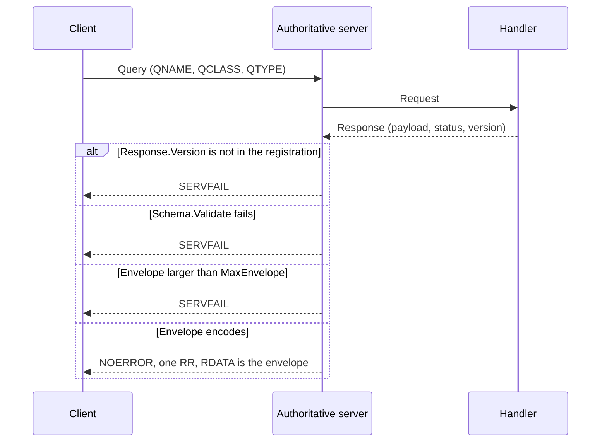
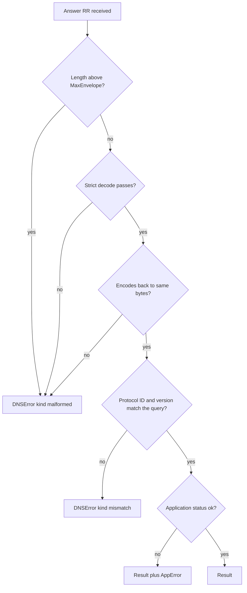

## Purpose

Every answer RR carries one envelope as its RDATA. The envelope is a CBOR map with a
fixed set of integer keys. It names the protocol ID, the protocol version, the message
type and the application status, and it carries the payload.

This feature adds `pkg/codec`. It encodes the envelope with deterministic CBOR and
decodes it strictly. The authoritative server then wraps every response in an envelope,
and the client SDK decodes every answer from an envelope. Epic 6 signs the envelope, so
the encoding must give the same bytes for the same values on every platform.

## User stories

- As a protocol developer, I want QMux to put my payload in a standard envelope, so that
  I do not write DNS or CBOR framing code.
- As a device integrator, I want the client to reject any malformed or oversized
  envelope, so that bad input never reaches my code.
- As a protocol developer, I want helpers that encode my payload structs with the same
  strict rules, so that my payload schema is as strict as the envelope.
- As a researcher, I want committed golden vectors, so that a change to the wire format
  fails a test.

## Functional requirements

### Envelope type and encoding

- **FR-codec-1** — `pkg/codec` defines an `Envelope` struct with one field per key of the
  envelope table in `docs/specs/spec.md` § Data model.
- **FR-codec-2** — Each `Envelope` field carries the struct tag `cbor:"<key>,keyasint"`
  with the key number from the envelope table.
- **FR-codec-3** — The signature block field (key 6) carries `omitempty`, so an envelope
  without a signature block has no key 6.
- **FR-codec-4** — `codec.Encode` encodes an envelope with `cbor.CoreDetEncOptions()`.
- **FR-codec-5** — `codec.Encode` returns `ErrTooLarge` when the encoded envelope is longer
  than `Limits.MaxEnvelope`.
- **FR-codec-6** — `codec.Encode` validates the envelope fields with the same rules as
  `codec.Decode` before it returns bytes.

### Strict decoding

- **FR-codec-7** — `codec.Decode` returns `ErrTooLarge` when the input is longer than
  `Limits.MaxEnvelope`, before it parses any byte.
- **FR-codec-8** — `codec.Decode` uses a decode mode with these `cbor.DecOptions` values:
  - `DupMapKey: DupMapKeyEnforcedAPF`
  - `IndefLength: IndefLengthForbidden`
  - `MaxNestedLevels: 8`
  - `MaxArrayElements: 1024`
  - `MaxMapPairs: 64`
  - `ExtraReturnErrors: ExtraDecErrorUnknownField`
  - `TagsMd: TagsForbidden`
  - `UTF8: UTF8RejectInvalid`
  - `NaN: NaNDecodeForbidden`
  - `Inf: InfDecodeForbidden`
- **FR-codec-9** — `codec.Decode` rejects input that has bytes after the first CBOR item.
- **FR-codec-10** — `codec.Decode` encodes the decoded envelope again and returns
  `ErrNotDeterministic` when the bytes differ from the input.
- **FR-codec-11** — `codec.Decode` returns `ErrFormat` when the format field is not `1`.
- **FR-codec-12** — `codec.Decode` returns `ErrInvalidProtocolID` when the protocol ID is
  empty, longer than 128 bytes, or contains a byte outside `[a-z0-9.-]`.
- **FR-codec-13** — `codec.Decode` returns `ErrInvalidVersion` when the protocol version is
  0 or above 65535.
- **FR-codec-14** — `codec.Decode` returns `ErrInvalidMessageType` when the message type is
  0, or is in 3–255.
- **FR-codec-15** — `codec.Decode` returns a wrapped CBOR error for every other decode
  failure. The error message never contains payload bytes.

### Limits

- **FR-codec-16** — `codec.Limits` has a field `MaxEnvelope` with a default of 16384 bytes.
- **FR-codec-17** — `codec.Limits.Validate` returns an error when `MaxEnvelope` is above
  65000 or below 64.
- **FR-codec-18** — A zero `codec.Limits` value means the default limits.

### Payload helpers

- **FR-codec-19** — `codec.Marshal` encodes a protocol payload value with the same encode
  options as `codec.Encode`.
- **FR-codec-20** — `codec.Unmarshal` decodes a protocol payload with the same decode
  options as `codec.Decode`.
- **FR-codec-21** — `codec.Unmarshal` returns an error for a map key that the target
  struct does not declare. This is the unknown-field policy of QMux.
- **FR-codec-22** — `codec.Unmarshal` returns `ErrNotDeterministic` for a payload that does
  not encode back to the same bytes.

### Golden vectors and fuzz

- **FR-codec-23** — The repository holds golden vectors in `pkg/codec/testdata/v1/` as
  pairs of `<name>.cbor` and `<name>.json` files. The JSON file states the expected field
  values or the expected error name.
- **FR-codec-24** — A test decodes every committed v1 vector and checks the expected
  values or error.
- **FR-codec-25** — The same test encodes every valid v1 vector again and checks that the
  bytes are identical to the file.
- **FR-codec-26** — The v1 vectors include at least these cases:
  - a minimal record envelope
  - a manifest envelope
  - an envelope with each application status in the status table
  - an envelope with a protocol-specific status 256
  - a duplicate key, an unknown key, an indefinite length, a tag, invalid UTF-8
  - a non-deterministic key order, a non-shortest integer, a format value `2`
- **FR-codec-27** — `FuzzDecodeEnvelope` in `pkg/codec` uses every v1 vector as a seed.
- **FR-codec-28** — `FuzzDecodeEnvelope` checks that `codec.Decode` never panics. It also
  checks that each envelope it accepts encodes back to the input bytes.

### Server and client use of the envelope

- **FR-codec-29** — The authoritative server wraps every handler response in an envelope.
  The answer RR RDATA is the encoded envelope.
- **FR-codec-30** — The server takes the protocol ID of the envelope from the registration.
- **FR-codec-31** — The server uses `Response.Version` as the protocol version. When
  `Response.Version` is 0, the server uses the highest version of the registration.
- **FR-codec-32** — The server returns `SERVFAIL` when `Response.Version` is not a version
  of the registration.
- **FR-codec-33** — The server uses message type `record` when `Response.MessageType` is 0.
- **FR-codec-34** — When the registration `Info` has a `Schema`, the server calls
  `Schema.Validate(version, payload)` before it encodes the envelope.
- **FR-codec-35** — The server returns `SERVFAIL` and logs the error at level `error` when
  `Schema.Validate` returns an error.
- **FR-codec-36** — The server returns `SERVFAIL` when `codec.Encode` returns an error,
  including `ErrTooLarge`.
- **FR-codec-37** — The client decodes the RDATA of the answer RR with `codec.Decode`. A
  decode error returns a `*client.DNSError` of kind `malformed`.
- **FR-codec-38** — `client.Result` has the fields `ProtocolID`, `Version`, `MessageType`,
  `Status` and `Payload`, from the envelope.
- **FR-codec-39** — When the application status is not `ok`, `Client.Query` returns the
  result and a `*client.AppError` together. `*client.AppError` holds the status and the
  protocol ID.
- **FR-codec-40** — `client.Query` has an optional field `ExpectedProtocolID`. When it is
  set and the envelope protocol ID differs, the client returns a `*client.DNSError` of
  kind `mismatch`.
- **FR-codec-41** — When the query QNAME has a version label, the client returns a
  `*client.DNSError` of kind `mismatch` if the envelope version differs from the label.
- **FR-codec-42** — `qmuxctl query` prints the protocol ID, the protocol version, the
  message type, the application status and the payload length of the result.

### Protocol document

- **FR-codec-43** — The project adds `docs/protocol.md` with the sections `Wire format`,
  `Error semantics` and `Class/type allocation`.
- **FR-codec-44** — The `Wire format` section holds the envelope table, the limits and the
  decode rules of this feature, with one hex example from the golden vectors.

## User flows

### Flow 1 — The server answers a query with an envelope



1. The client sends a query.
2. The server finds the registration and calls the handler with the request.
3. The handler returns a response.
4. If the response version is not a version of the registration, the server returns
   `SERVFAIL`.
5. If the registration has a schema and the schema rejects the payload, the server
   returns `SERVFAIL` and logs the error.
6. The server encodes the envelope with deterministic CBOR.
7. If the envelope is larger than `MaxEnvelope`, the server returns `SERVFAIL`.
8. The server returns `NOERROR` with one answer RR. The RDATA is the envelope.

### Flow 2 — The client decodes an envelope



1. The client receives an answer RR.
2. If the RDATA is longer than `MaxEnvelope`, the client returns a `DNSError` of kind
   `malformed`.
3. The client decodes the RDATA with the strict decode mode.
4. If the decode fails, the client returns a `DNSError` of kind `malformed`.
5. If the envelope does not encode back to the same bytes, the client returns a
   `DNSError` of kind `malformed`.
6. If `ExpectedProtocolID` is set and differs, the client returns a `DNSError` of kind
   `mismatch`.
7. If the QNAME has a version label and the envelope version differs, the client returns
   a `DNSError` of kind `mismatch`.
8. If the application status is not `ok`, the client returns the result and an
   `AppError`.
9. Otherwise the client returns the result.

## Screens & states

No screens: library only. `qmuxctl query` output gains these lines:

```
protocol   org.qmux.firmware
version    1
type       record
status     ok
payload    74 bytes
```

When the status is not `ok`, the `status` line shows the status name, and `qmuxctl`
exits with code 2.

## Behaviour rules

- The envelope keys are unsigned integers 0–6. No other key is valid in format 1.
- A change to the envelope keys or their types is a new format value. Format 1 never
  changes.
- A change to a payload schema is a new protocol version. Old versions keep their schema.
- The decoder never allocates more than `MaxEnvelope` bytes for the input.
- `Encode` and `Decode` are safe for concurrent use. The encode and decode modes are
  built once at package start.
- Message types 1 (`record`) and 2 (`manifest`) are framework values. 256–65535 are
  protocol-specific. 0 and 3–255 are invalid.
- Application status values 5–255 are reserved for later framework values. The decoder
  accepts them. The client returns an `AppError` for them, as for any status that is not
  `ok`.

## Data touched

- New package `pkg/codec`.
- `protocol.Response` gains the field `MessageType`, if Epic 2 did not add it.
- `protocol.Info` gains the field `Schema`, if Epic 1 did not add it. `Schema` is an
  interface with one method `Validate(version uint16, payload []byte) error`.
- `client.Result` gains the fields `ProtocolID`, `Version`, `MessageType`, `Status` and
  `Payload`.
- `client.Query` gains the field `ExpectedProtocolID`.
- New files: `pkg/codec/testdata/v1/*.cbor`, `pkg/codec/testdata/v1/*.json`,
  `docs/protocol.md`.

## Interfaces

```go
package codec

type Envelope struct {
    Format      uint64           `cbor:"0,keyasint"`
    ProtocolID  string           `cbor:"1,keyasint"`
    Version     uint64           `cbor:"2,keyasint"`
    MessageType uint64           `cbor:"3,keyasint"`
    Status      uint64           `cbor:"4,keyasint"`
    Payload     []byte           `cbor:"5,keyasint"`
    Signature   *SignatureBlock  `cbor:"6,keyasint,omitempty"`
}

type Limits struct{ MaxEnvelope int }

func Encode(e Envelope, l Limits) ([]byte, error)
func Decode(b []byte, l Limits) (Envelope, error)
func Marshal(v any) ([]byte, error)
func Unmarshal(b []byte, v any) error

var ErrTooLarge, ErrNotDeterministic, ErrFormat, ErrInvalidProtocolID,
    ErrInvalidVersion, ErrInvalidMessageType error
```

`SignatureBlock` is declared in this epic with the keys of the signature block table, so
the envelope shape is final. Epic 6 fills it and verifies it.

External library:

- `github.com/fxamacker/cbor/v2` v2.10.0. `CoreDetEncOptions()` follows RFC 8949 § 4.2.1
  core deterministic encoding. The `DecOptions` fields in FR-codec-8 exist in v2.10.0.
  The library has no decode option that rejects non-deterministic input, so FR-codec-10
  encodes again and compares.
  Verified against: https://pkg.go.dev/github.com/fxamacker/cbor/v2@v2.10.0 (`go doc`,
  retrieved 2026-11-20).
- RFC 8949 § 4.2.1: https://www.rfc-editor.org/rfc/rfc8949#section-4.2.1

## Edge cases & failures

| Case | Result |
|---|---|
| RDATA of length 0 | `DNSError` kind `malformed`. |
| A valid envelope followed by extra bytes | `DNSError` kind `malformed`. |
| A map with 65 pairs | Decode error from `MaxMapPairs`. |
| A payload of 16000 bytes with `MaxEnvelope` 16384 | Encodes if the full envelope fits, else `ErrTooLarge`. |
| A float in a field that expects uint | Decode error. |
| A handler returns `Status` 300 | The envelope carries 300. The client returns a result and an `AppError`. |
| A handler returns `MessageType` 7 | `codec.Encode` returns `ErrInvalidMessageType`. The server returns `SERVFAIL`. |

## Acceptance criteria

- [ ] FR-codec-1, FR-codec-2: a test encodes an `Envelope` and finds keys 0–5 as CBOR unsigned integers.
- [ ] FR-codec-3: an envelope with a nil signature block encodes with no key 6.
- [ ] FR-codec-4: the encoded map keys of a test envelope appear in bytewise order.
- [ ] FR-codec-5: `Encode` returns `ErrTooLarge` for a payload that makes the envelope 16385 bytes.
- [ ] FR-codec-6: `Encode` returns `ErrFormat` for an envelope with format 2.
- [ ] FR-codec-7: `Decode` returns `ErrTooLarge` for 16385 input bytes.
- [ ] FR-codec-8: the vectors for a duplicate key, an indefinite length, a tag and invalid UTF-8 each return an error.
- [ ] FR-codec-9: a valid vector with one extra byte returns an error.
- [ ] FR-codec-10: the non-deterministic key-order vector returns `ErrNotDeterministic`.
- [ ] FR-codec-11: the format-2 vector returns `ErrFormat`.
- [ ] FR-codec-12: protocol IDs `""`, `Org.Qmux`, and 129 bytes each return `ErrInvalidProtocolID`.
- [ ] FR-codec-13: versions 0 and 65536 each return `ErrInvalidVersion`.
- [ ] FR-codec-14: message types 0 and 3 each return `ErrInvalidMessageType`.
- [ ] FR-codec-15: a decode error message for a 100-byte payload does not contain the payload bytes in hex or raw form.
- [ ] FR-codec-16, FR-codec-18: a zero `Limits` rejects 16385 bytes and accepts 16384 bytes.
- [ ] FR-codec-17: `Limits{MaxEnvelope: 65001}.Validate()` returns an error.
- [ ] FR-codec-19: `Marshal` of a struct with two int-keyed fields gives bytewise-sorted keys.
- [ ] FR-codec-20, FR-codec-21: `Unmarshal` of a map with an undeclared key returns an error.
- [ ] FR-codec-22: `Unmarshal` of a non-shortest integer returns `ErrNotDeterministic`.
- [ ] FR-codec-23, FR-codec-26: `pkg/codec/testdata/v1/` holds every listed case as a `.cbor` and `.json` pair.
- [ ] FR-codec-24: the vector test passes for every pair.
- [ ] FR-codec-25: every valid vector re-encodes to identical bytes.
- [ ] FR-codec-27, FR-codec-28: `go test ./pkg/codec` runs `FuzzDecodeEnvelope` on the seed corpus with no failure.
- [ ] FR-codec-29, FR-codec-30: an integration test receives an answer RR whose RDATA decodes to the registration protocol ID.
- [ ] FR-codec-31: a response with `Version` 0 on a registration with versions `[1, 2]` gives envelope version 2.
- [ ] FR-codec-32: a response with `Version` 3 on that registration gives `SERVFAIL`.
- [ ] FR-codec-33: a response with `MessageType` 0 gives envelope message type 1.
- [ ] FR-codec-34, FR-codec-35: a schema that rejects the payload gives `SERVFAIL` and one log record at level `error`.
- [ ] FR-codec-36: a 20000-byte payload gives `SERVFAIL`.
- [ ] FR-codec-37: an answer RR with RDATA `0xff` gives a `DNSError` of kind `malformed`.
- [ ] FR-codec-38: a result carries the protocol ID, version, message type, status and payload of the envelope.
- [ ] FR-codec-39: a `not-found` envelope gives a non-nil result and an error that `errors.As` matches to `*client.AppError`.
- [ ] FR-codec-40: `ExpectedProtocolID: "org.qmux.other"` gives a `DNSError` of kind `mismatch`.
- [ ] FR-codec-41: a query with label `_v1` that receives envelope version 2 gives a `DNSError` of kind `mismatch`.
- [ ] FR-codec-42: `qmuxctl query` output contains the five lines of the Screens section.
- [ ] FR-codec-43, FR-codec-44: `docs/protocol.md` has the three sections, and the `Wire format` section holds the envelope table and one hex example.

## Out of scope

- Signing and verification of the signature block (Epic 6).
- The manifest payload schema (Epic 5).
- Payload compression.
- Fragmentation of a payload over several RRs.

## Open questions
