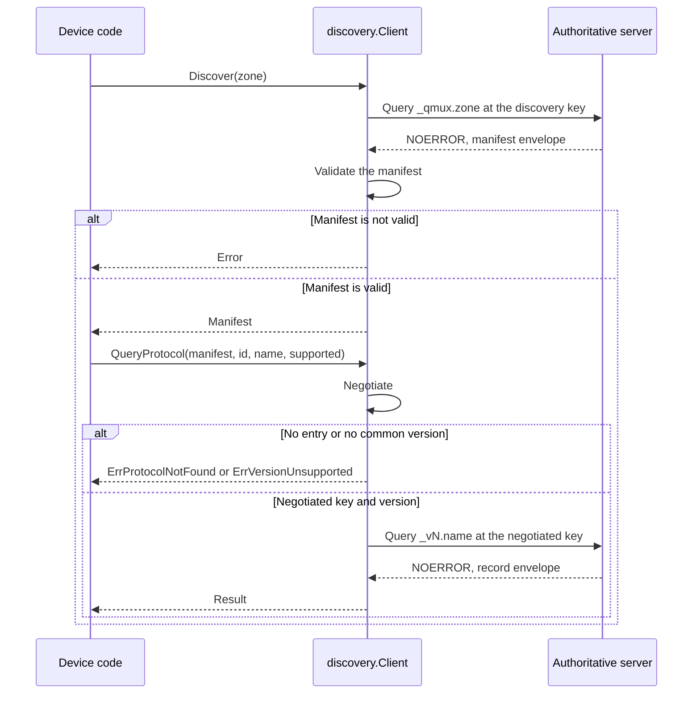
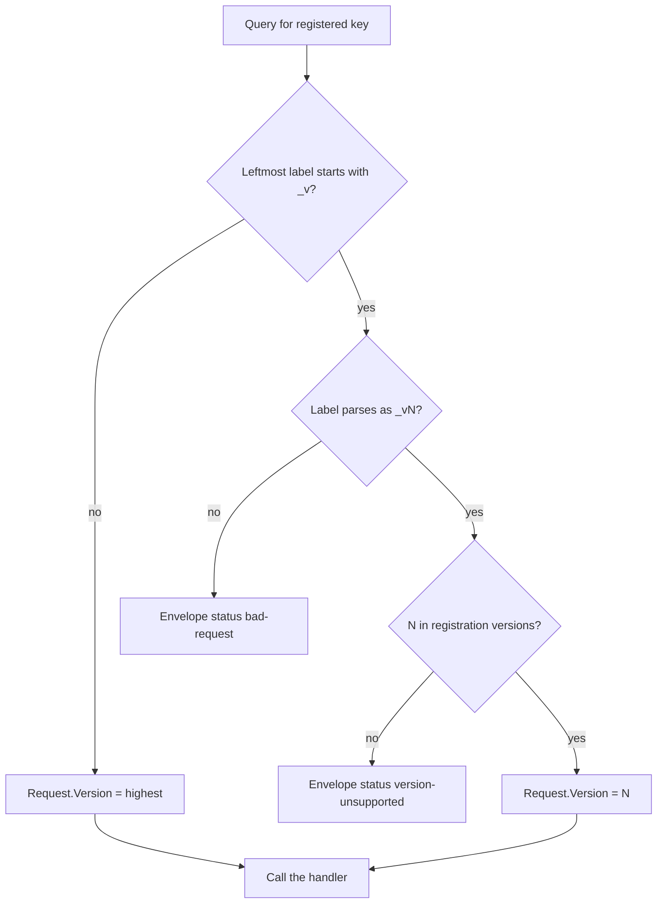

## Purpose

A client must not know every private class in advance. Discovery gives the client one
fixed entry point: the discovery key and the discovery name. The server answers there with
a manifest that lists every registration: the protocol ID, the supported versions, the
class and the type.

The client then negotiates a protocol version for each protocol it needs and sends the
query with a version label. The server checks the version label before it calls the
handler.

This epic delivers Phase 2 of the brief: a client discovers the registrations and queries
each one. Signatures arrive in Epic 6. Until then, discovery runs only with an explicit
`InsecureSkipVerify`.

## User stories

- As a device integrator, I want to learn the protocol keys of a server from one query,
  so that the device firmware holds only the discovery key.
- As a device integrator, I want the client to pick the highest common protocol version,
  so that old devices keep working when a server adds a version.
- As an operator, I want to remap a protocol to a different protocol key, so that two
  deployments can use different private classes with no client change.
- As a device integrator, I want a preconfigured mapping, so that a device can skip
  discovery when it has no need for it.
- As an operator, I want `qmuxctl discover` to print the manifest, so that I can inspect a
  server.

## Functional requirements

### Manifest schema

- **FR-discovery-1** — `pkg/discovery` defines a `Manifest` type with the fields
  `FrameworkVersion`, `Zone` and `Protocols`, from the manifest payload table in
  `docs/specs/spec.md` § Data model.
- **FR-discovery-2** — Each `Protocols` entry has the fields `ID`, `Versions`, `Class` and
  `Type`, with CBOR keys 1–4.
- **FR-discovery-3** — The manifest payload encodes with `codec.Marshal` and decodes with
  `codec.Unmarshal`.
- **FR-discovery-4** — Manifest validation returns an error when the framework version is
  not 1.
- **FR-discovery-5** — Manifest validation returns an error when the zone differs from the
  zone the client queried. The comparison ignores letter case.
- **FR-discovery-6** — Manifest validation returns an error when two entries share a
  protocol ID.
- **FR-discovery-7** — Manifest validation returns an error when two entries share a
  protocol key.
- **FR-discovery-8** — Manifest validation returns an error when an entry has an empty
  version list, a version of 0, or an unsorted or repeated version.
- **FR-discovery-9** — `Manifest.Lookup(id)` returns the entry for a protocol ID and a
  boolean that is false when no entry exists.

### Discovery handler

- **FR-discovery-10** — `discovery.Register(srv, zone, opts)` registers the protocol
  `org.qmux.discovery` with version 1 at `opts.Key`.
- **FR-discovery-11** — The default `opts.Key` is `(65280, 65534)`.
- **FR-discovery-12** — When `opts.InClass` is true, `discovery.Register` registers
  `org.qmux.discovery` only at `(1, 65534)`, in place of `opts.Key`.
- **FR-discovery-13** — The discovery handler answers the QNAME `_qmux.<zone>` with message
  type `manifest`.
- **FR-discovery-14** — The discovery handler builds the manifest from the registry list
  at request time. A protocol that is registered after start appears in the next manifest.
- **FR-discovery-15** — The manifest lists every registration of the server, including the
  discovery registration. It sorts the entries by class, then by type.
- **FR-discovery-16** — The discovery handler returns the application status `not-found`
  for every QNAME other than `_qmux.<zone>`.

### Version label on the server

- **FR-discovery-17** — The server reads a leftmost QNAME label of the form `_v<N>`, where
  `<N>` is a decimal number 1–65535 with no leading zero, as the version label.
- **FR-discovery-18** — The server puts the version from the version label in
  `Request.Version`, and puts the QNAME without the version label in `Request.Name`.
- **FR-discovery-19** — When the version label names a version that the registration does
  not support, the server returns an envelope with the application status
  `version-unsupported`. It does not call the handler.
- **FR-discovery-20** — The `version-unsupported` envelope carries the highest version of
  the registration as its protocol version.
- **FR-discovery-21** — When the QNAME has no version label, the server sets
  `Request.Version` to the highest version of the registration.
- **FR-discovery-22** — A leftmost label that starts with `_v` but does not parse as a
  version label gives the application status `bad-request`. The server does not call the
  handler.

### Client discovery and negotiation

- **FR-discovery-23** — `discovery.Client` has the fields `Client` (a `*client.Client`),
  `Key` and `InsecureSkipVerify`. The default `Key` is `(65280, 65534)`.
- **FR-discovery-24** — `Client.Discover(ctx, zone)` sends one query for `_qmux.<zone>` at
  `Key` and returns the validated manifest.
- **FR-discovery-25** — `Client.Discover` returns an error when the envelope message type is
  not `manifest` or the protocol ID is not `org.qmux.discovery`.
- **FR-discovery-26** — In Epic 5, `Client.Discover` returns `ErrInsecure` and sends no
  query when `InsecureSkipVerify` is false. Epic 6 replaces this rule with signature
  verification.
- **FR-discovery-27** — `discovery.Negotiate(m, id, supported)` returns the protocol key and
  the highest version that is in both `supported` and the manifest entry.
- **FR-discovery-28** — `discovery.Negotiate` returns `ErrProtocolNotFound` when the
  manifest has no entry for the protocol ID.
- **FR-discovery-29** — `discovery.Negotiate` returns `ErrVersionUnsupported` when no common
  version exists.
- **FR-discovery-30** — `Client.QueryProtocol(ctx, m, id, name, supported)` negotiates first.
  It sends no query when the negotiation fails.
- **FR-discovery-31** — `Client.QueryProtocol` sends the query for `_v<N>.<name>` at the
  negotiated protocol key, with `ExpectedProtocolID` set to the protocol ID.
- **FR-discovery-32** — `discovery.Static(zone, entries)` returns a manifest that passes
  manifest validation, with no query. It returns an error when validation fails.

### qmuxctl discover

- **FR-discovery-33** — `qmuxctl discover` takes the flags `--server`, `--name`, `--class`,
  `--type`, `--in`, `--insecure` and `--json`. From the review #193, it also takes `--tcp`,
  with the same meaning as in `qmuxctl query`.
- **FR-discovery-34** — `--name` is the zone. `qmuxctl discover` queries `_qmux.<name>`.
- **FR-discovery-35** — `--class` and `--type` override the discovery key. `--in` sets the
  discovery key to `(1, 65534)`. `--in` together with `--class` is a usage error.
- **FR-discovery-36** — `qmuxctl discover` prints one table row per manifest entry with
  the columns protocol ID, versions, class and type.
- **FR-discovery-37** — With `--json`, `qmuxctl discover` prints the manifest as one JSON
  object with the field names of the illustrative JSON in the brief.
- **FR-discovery-38** — In Epic 5, `qmuxctl discover` without `--insecure` exits with code 3
  and the message `discovery requires --trust-anchors or --insecure`.

### Phase 2 integration test and document

- **FR-discovery-39** — An integration test starts a server with three registrations in
  different private classes. It discovers the manifest, then queries every registration
  through `QueryProtocol`, over UDP and over TCP.
- **FR-discovery-40** — An integration test discovers through the IN option `(1, 65534)`.
- **FR-discovery-41** — An integration test remaps one protocol ID to a new protocol key.
  The next discovery returns the new key, and `QueryProtocol` reaches the handler there.
- **FR-discovery-42** — `docs/protocol.md` gains the sections `Protocol dispatch`,
  `Discovery` and `Version negotiation`.

## User flows

### Flow 1 — A client discovers and queries a protocol



1. The device code calls `Discover` with the zone.
2. The discovery client sends a query for `_qmux.<zone>` at the discovery key.
3. The server returns the manifest envelope.
4. The discovery client validates the manifest.
5. If the manifest is not valid, the discovery client returns an error.
6. The device code calls `QueryProtocol` with the protocol ID, the name and its
   supported versions.
7. The discovery client negotiates the protocol key and the version.
8. If no entry or no common version exists, the discovery client returns
   `ErrProtocolNotFound` or `ErrVersionUnsupported` and sends no query.
9. The discovery client sends the query for `_v<N>.<name>` at the negotiated protocol key.
10. The discovery client returns the result.

### Flow 2 — The server checks the version label



1. The server receives a query for a registered protocol key.
2. If the leftmost label does not start with `_v`, the server sets `Request.Version` to
   the highest version and calls the handler.
3. If the label does not parse as a version label, the server returns an envelope with
   status `bad-request`.
4. If the registration does not support the version, the server returns an envelope with
   status `version-unsupported`.
5. The server sets `Request.Version` to the version and calls the handler.

## Screens & states

No graphical screens. `qmuxctl discover` output:

```
$ qmuxctl discover --server 127.0.0.1:5300 --name fleet.example. --insecure
zone fleet.example.  framework 1  verified no
PROTOCOL                 VERSIONS  CLASS  TYPE
org.qmux.bootstrap       1         65280  65280
org.qmux.discovery       1         65280  65534
org.qmux.configuration   1         65281  65280
org.qmux.firmware        1         65282  65280
```

States:

| State | Output | Exit code |
|---|---|---|
| Success | The table above. | 0 |
| DNS failure (timeout, RCODE, mismatch) | `error: <DNSError text>` on stderr. | 1 |
| Application status not `ok` | `error: <status name>` on stderr. | 2 |
| No `--insecure` in Epic 5 | `discovery requires --trust-anchors or --insecure` on stderr. | 3 |
| Usage error | Usage text on stderr. | 64 |

## Behaviour rules

- The discovery name is `_qmux.` followed by the zone, in lowercase.
- The manifest lists protocol keys local to this server. The client never assumes a
  protocol key from another server.
- The negotiation picks the highest common version. It never picks a version that the
  client did not list.
- The client sends the version label on every `QueryProtocol` query, so the server and
  the client agree on the version.
- `Request.Name` never contains the version label. A handler never parses it.
- `MaxEnvelope` bounds the size of the manifest. If the manifest does not fit, the server
  returns `SERVFAIL` (FR-codec-36). A normal manifest of 8 entries fits in 1232 bytes.

## Data touched

- New package `pkg/discovery`.
- `protocol.Request` gains the field `Version` and the field `Name` without the version
  label, if Epic 2 did not add them.
- `client.Query` gains a `Version` field that makes the client prefix the version label.
- `docs/protocol.md` gains three sections.

## Interfaces

```go
package discovery

const ProtocolID = "org.qmux.discovery"

var DefaultKey = protocol.ProtocolKey{Class: 65280, Type: 65534}
var INKey      = protocol.ProtocolKey{Class: 1, Type: 65534}

type Entry struct {
    ID       string   `cbor:"1,keyasint"`
    Versions []uint16 `cbor:"2,keyasint"`
    Class    uint16   `cbor:"3,keyasint"`
    Type     uint16   `cbor:"4,keyasint"`
}

type Manifest struct {
    FrameworkVersion uint64  `cbor:"1,keyasint"`
    Zone             string  `cbor:"2,keyasint"`
    Protocols        []Entry `cbor:"3,keyasint"`
}

type Options struct {
    Key     protocol.ProtocolKey
    InClass bool
}

func Register(srv *server.Server, zone string, opts Options) error
func RegisterZones(srv *server.Server, zones []string, opts Options) error
func Static(zone string, entries []Entry) (*Manifest, error)
func Negotiate(m *Manifest, id string, supported []uint16) (protocol.ProtocolKey, uint16, error)
func (m *Manifest) Lookup(id string) (Entry, bool)

type Client struct {
    Client             *client.Client
    Key                protocol.ProtocolKey
    InsecureSkipVerify bool
}

func (c *Client) Discover(ctx context.Context, zone string) (*Manifest, error)
func (c *Client) QueryProtocol(ctx context.Context, m *Manifest, id, name string,
    supported []uint16) (*client.Result, error)

var ErrInsecure, ErrProtocolNotFound, ErrVersionUnsupported, ErrInvalidManifest error
```

`discovery.Register` imports `pkg/server`. `pkg/server` never imports `pkg/discovery`.

## Edge cases & failures

| Case | Result |
|---|---|
| The server has no discovery registration | `Discover` returns a `DNSError` with RCODE `REFUSED`. |
| The manifest zone is `other.example.` | `Discover` returns `ErrInvalidManifest`. |
| The client supports `[2, 3]`, the manifest lists `[1, 2]` | Negotiation picks version 2. |
| The client supports `[3]`, the manifest lists `[1, 2]` | `ErrVersionUnsupported`, no query. |
| The query QNAME is `_v01.device42.fleet.example.` | Status `bad-request`. |
| The query QNAME is `_v9.device42.fleet.example.` and the registration lists `[1]` | Status `version-unsupported`, envelope version 1. |
| A protocol is unregistered between discovery and query | The query returns a `DNSError` with RCODE `REFUSED`. The caller discovers again. |

## Acceptance criteria

- [ ] FR-discovery-1, FR-discovery-2, FR-discovery-3: a manifest round trip through `codec.Marshal` and `codec.Unmarshal` gives an equal value.
- [ ] FR-discovery-4: a manifest with framework version 2 fails validation.
- [ ] FR-discovery-5: a manifest for `other.example.` fails validation for the zone `fleet.example.`, and `FLEET.example.` passes.
- [ ] FR-discovery-6: a manifest with two `org.qmux.firmware` entries fails validation.
- [ ] FR-discovery-7: a manifest with two entries at `(65281, 65280)` fails validation.
- [ ] FR-discovery-8: the version lists `[]`, `[0]`, `[2, 1]` and `[1, 1]` each fail validation.
- [ ] FR-discovery-9: `Lookup("org.qmux.firmware")` returns the entry and true, and `Lookup("x.y")` returns false.
- [ ] FR-discovery-10, FR-discovery-11: after `Register` with zero options, the registry lists `org.qmux.discovery` at `(65280, 65534)`.
- [ ] FR-discovery-12: with `InClass` true, the registry lists it at `(1, 65534)` and not at `(65280, 65534)`.
- [ ] FR-discovery-13: a query for `_qmux.fleet.example.` returns an envelope with message type 2.
- [ ] FR-discovery-14: a protocol registered after the server starts appears in the next manifest.
- [ ] FR-discovery-15: the manifest entries are in class-then-type order and include `org.qmux.discovery`.
- [ ] FR-discovery-16: a query for `x.fleet.example.` at the discovery key returns status `not-found`.
- [ ] FR-discovery-17, FR-discovery-18: a handler that receives `_v2.device42.fleet.example.` sees `Request.Version` 2 and `Request.Name` `device42.fleet.example.`
- [ ] FR-discovery-19: a query with `_v9` on a registration with `[1]` returns status `version-unsupported`, and the handler call count stays 0.
- [ ] FR-discovery-20: that envelope carries protocol version 1.
- [ ] FR-discovery-21: a query with no version label on a registration with `[1, 2]` gives `Request.Version` 2.
- [ ] FR-discovery-22: a query with `_vx` returns status `bad-request`, and the handler call count stays 0.
- [ ] FR-discovery-23, FR-discovery-24: `Discover` with zero `Key` sends one query at `(65280, 65534)`.
- [ ] FR-discovery-25: a record envelope at the discovery key makes `Discover` return an error.
- [ ] FR-discovery-26: `Discover` with `InsecureSkipVerify` false returns `ErrInsecure`, and the server receives no query.
- [ ] FR-discovery-27: supported `[2, 3]` against manifest `[1, 2]` returns version 2.
- [ ] FR-discovery-28: an unknown protocol ID returns `ErrProtocolNotFound`.
- [ ] FR-discovery-29: supported `[3]` against `[1, 2]` returns `ErrVersionUnsupported`.
- [ ] FR-discovery-30: a failed negotiation sends no query to the server.
- [ ] FR-discovery-31: the server receives the QNAME `_v1.device42.fleet.example.` at the negotiated key.
- [ ] FR-discovery-32: `Static` with a duplicate protocol ID returns an error, and a valid list returns a manifest.
- [ ] FR-discovery-33, FR-discovery-34: `qmuxctl discover --name fleet.example.` queries `_qmux.fleet.example.`
- [ ] FR-discovery-35: `--in` queries at `(1, 65534)`, and `--in --class 65280` exits with code 64.
- [ ] FR-discovery-36: the table output has one row per manifest entry with four columns.
- [ ] FR-discovery-37: the `--json` output parses as JSON with the fields `framework_version` and `protocols`.
- [ ] FR-discovery-38: `qmuxctl discover` without `--insecure` exits with code 3 and the stated message.
- [ ] FR-discovery-39: the Phase 2 integration test passes over UDP and over TCP.
- [ ] FR-discovery-40: the IN-option integration test passes.
- [ ] FR-discovery-41: the remap integration test passes.
- [ ] FR-discovery-42: `docs/protocol.md` has the three new sections.

## Out of scope

- Signature verification of the manifest and the manifest cache (Epic 6).
- Discovery through a resolver over a private class. Epic 9 measures it.
- Discovery of a zone list. A client knows its zone.
- An EDNS option for the protocol version.

## Open questions
