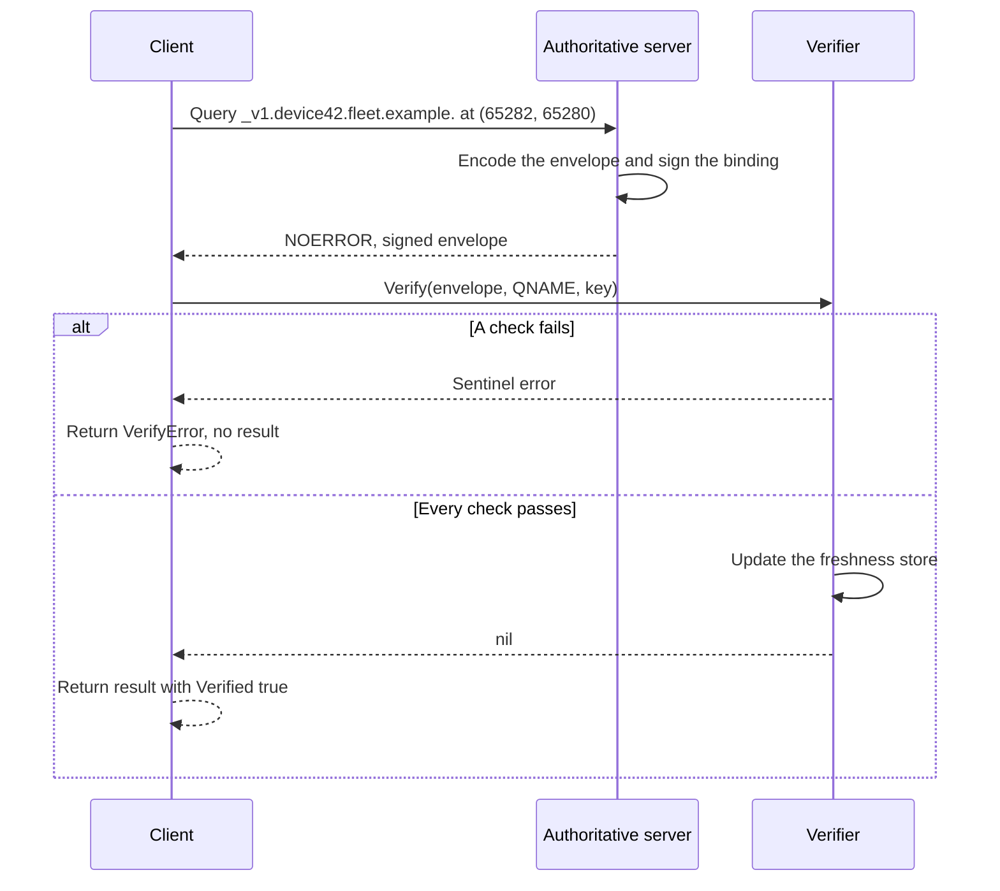
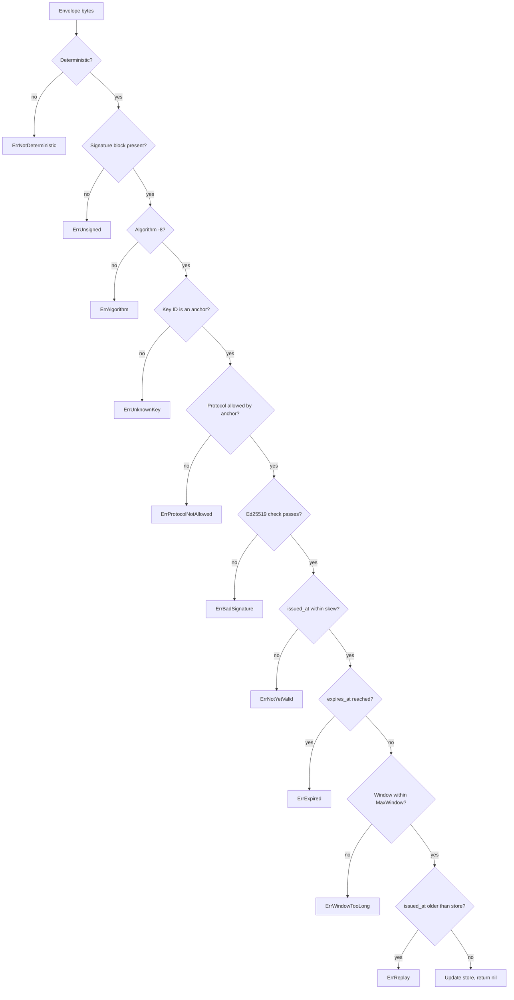
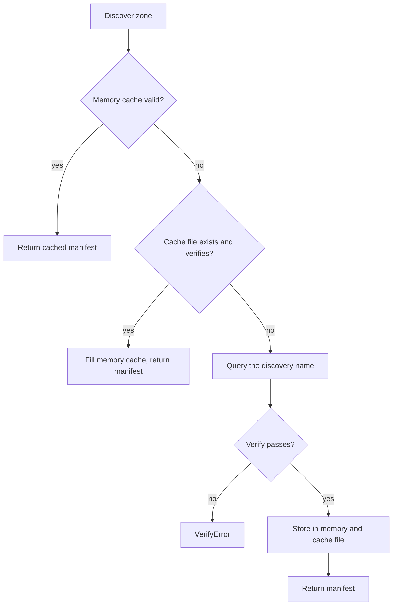

## Purpose

DNS gives no integrity and no authentication. This feature makes every envelope
verifiable. The authoritative server signs each envelope at answer time with an Ed25519
key. The signature binds the QNAME, the class, the type, the protocol ID and the validity
window. A client with trust anchors verifies every envelope before it returns any field.
It rejects each envelope that is tampered, signed by an unknown key, outside its validity
window, older than one it already accepted, or copied to another name or protocol key.

This epic delivers Phase 3 of the brief: clients reject tampered, expired or incorrectly
signed metadata. It also adds the manifest cache, key files, trust anchor files and
`qmuxctl keygen`.

## User stories

- As a device integrator, I want the client to verify every envelope against my trust
  anchors, so that a forged DNS answer never reaches device logic.
- As a device integrator, I want the client to reject a replayed older envelope, so that
  an attacker cannot roll a device back to old metadata.
- As an operator, I want to generate a signing key and a trust anchor file with one
  command, so that I can provision devices.
- As a device integrator, I want a verified manifest cache, so that a device can skip
  discovery while the manifest is valid.
- As a researcher, I want each verification failure to have its own error, so that tests
  and logs show the exact reason.

## Functional requirements

### Keys, key IDs and files

- **FR-security-1** — `security.KeyID(pub)` returns the first 8 bytes of the SHA-256 digest
  of the 32-byte Ed25519 public key.
- **FR-security-2** — `security.GenerateKey()` returns a new Ed25519 private key from
  `crypto/rand`.
- **FR-security-3** — `security.WritePrivateKey(path, key)` writes the key as a PKCS#8 PEM
  block of type `PRIVATE KEY`, with file mode 0600.
- **FR-security-4** — `security.WritePrivateKey` returns an error when the file exists.
- **FR-security-5** — `security.LoadPrivateKey(path)` returns an error when the PEM block is
  not PKCS#8 or the key is not Ed25519.
- **FR-security-6** — `security.LoadPrivateKey` returns a warning value when the file mode
  allows group or world read. The caller logs the warning.
- **FR-security-7** — `security.LoadTrustAnchors(path)` reads the trust anchor file schema in
  `docs/specs/spec.md` § Files.
- **FR-security-8** — `security.LoadTrustAnchors` returns an error when a `key_id` differs
  from `KeyID(public_key)`.
- **FR-security-9** — `security.LoadTrustAnchors` returns an error when a public key is not
  32 bytes after base64 decoding, or when two anchors share a key ID.
- **FR-security-10** — `security.WriteTrustAnchors(path, anchors)` writes the same schema.

### Signer and server signing

- **FR-security-11** — `security.Signer` has the fields `Key`, `Validity` and `Now`. The
  default `Validity` is 1 hour. The default `Now` is `time.Now`.
- **FR-security-12** — `Signer.Sign(env, qname, key)` sets the signature block with the key
  ID, algorithm `-8`, `issued_at` = now, and `expires_at` = now + `Validity`.
- **FR-security-13** — `Signer.Sign` computes the Ed25519 signature over the signing input
  of `docs/specs/spec.md` § Data model, with the QNAME in lowercase.
- **FR-security-14** — The signing input encodes with `cbor.CoreDetEncOptions()` as a CBOR
  array of 14 items in the stated order.
- **FR-security-15** — `server.ServerConfig` gains the field `Signer`. When it is set, the
  server signs every envelope it returns, for every application status.
- **FR-security-16** — The server signs with the full QNAME of the question, including the
  version label.
- **FR-security-17** — The server returns `SERVFAIL` when signing fails.

### Verifier and freshness store

- **FR-security-18** — `security.Verifier` has the fields `Anchors`, `Skew`, `MaxWindow`,
  `Store` and `Now`. The defaults are 60 s, 24 h, a new in-memory store, and `time.Now`.
- **FR-security-19** — `Verifier.Verify(env, qname, key)` returns `ErrUnsigned` when the
  envelope has no signature block.
- **FR-security-20** — `Verify` returns `ErrAlgorithm` when the algorithm is not `-8`.
- **FR-security-21** — `Verify` returns `ErrUnknownKey` when no trust anchor has the key ID.
- **FR-security-22** — `Verify` returns `ErrProtocolNotAllowed` when the anchor has a
  non-empty `protocols` list without the envelope protocol ID.
- **FR-security-23** — `Verify` returns `ErrBadSignature` when the Ed25519 check over the
  signing input fails.
- **FR-security-24** — `Verify` returns `ErrNotYetValid` when `issued_at` is later than now
  + `Skew`.
- **FR-security-25** — `Verify` returns `ErrExpired` when `expires_at` is earlier than now −
  `Skew`.
- **FR-security-26** — `Verify` returns `ErrWindowTooLong` when `expires_at` − `issued_at`
  is greater than `MaxWindow`, or when `expires_at` is not greater than `issued_at`.
- **FR-security-27** — `Verify` returns `ErrReplay` when `issued_at` is older than the newest
  `issued_at` in the freshness store for the protocol ID and the QNAME. An equal value
  passes.
- **FR-security-28** — `Verify` returns `ErrNotDeterministic` when the envelope bytes do not
  encode back to the same bytes.
- **FR-security-29** — `Verify` runs the check of FR-security-28 first, then the checks of
  FR-security-19 to FR-security-27 in that order. It returns the first failure.
- **FR-security-30** — `Verify` updates the freshness store only after every check passes.
- **FR-security-31** — The freshness store is safe for concurrent use.
- **FR-security-32** — `FreshnessStore.Save(path)` and `security.LoadFreshnessStore(path)`
  write and read the store as JSON, so the device keeps it across restarts.
- **FR-security-33** — Each sentinel error is wrapped in an error that names the protocol
  ID and the QNAME, and `errors.Is` matches the sentinel.

### Client verification

- **FR-security-34** — `client.ClientConfig` gains the field `TrustAnchors`, of type
  `*security.Verifier`.
- **FR-security-35** — When `TrustAnchors` is set, the client verifies every envelope before
  it returns any result field.
- **FR-security-36** — When verification fails, the client returns a `*client.VerifyError`
  with the field `Reason`, which holds the sentinel error. It returns no result.
- **FR-security-37** — When `TrustAnchors` is set and verification passes, `Result.Verified`
  is true.
- **FR-security-38** — When `TrustAnchors` is nil, `Result.Verified` is false. The client
  never returns `Verified: true` without a verification.
- **FR-security-39** — The client verifies an envelope with any application status, before
  it builds an `AppError`.
- **FR-security-40** — `discovery.Client.Discover` returns `ErrInsecure` when the client has
  no `TrustAnchors` and `InsecureSkipVerify` is false. This replaces FR-discovery-26.

### Manifest cache

- **FR-security-41** — `discovery.Client` gains the field `CacheDir`.
- **FR-security-42** — `Discover` keeps each verified manifest in memory per zone until its
  `expires_at`. Before `expires_at`, `Discover` returns the cached manifest with no query.
- **FR-security-43** — When `CacheDir` is set, `Discover` writes each verified manifest to
  `<CacheDir>/<zone>.qmuxcache`. The file holds the raw envelope bytes, the QNAME, the
  class and the type.
- **FR-security-44** — When the memory cache is empty, `Discover` loads the cache file and
  verifies it again with the same verifier. It ignores the file when verification fails.
- **FR-security-45** — A newly verified manifest replaces the cached manifest only when its
  `issued_at` is newer.
- **FR-security-46** — The manifest cache never uses the TTL. Only `expires_at` ends a cache
  entry.
- **FR-security-47** — The cache is never used when `InsecureSkipVerify` is true and no
  trust anchors exist.

### qmuxctl, fuzz and Phase 3 test

- **FR-security-48** — `qmuxctl keygen --out <prefix>` writes `<prefix>.key` and
  `<prefix>.anchor.json`. It prints the key ID in hex.
- **FR-security-49** — `qmuxctl keygen` exits with code 1 and writes nothing when either file
  exists.
- **FR-security-50** — `qmuxctl query` and `qmuxctl discover` gain the flag
  `--trust-anchors <path>`.
- **FR-security-51** — `qmuxctl` exits with code 3 when verification fails, and prints the
  sentinel name.
- **FR-security-52** — `FuzzVerify` in `pkg/security` calls `Verify` on fuzzed envelope bytes
  and checks that it never panics and never returns nil for a modified signed envelope.
- **FR-security-53** — An integration test sends real queries and checks each case below
  fails with its own error:
  - a tampered payload byte → `ErrBadSignature`
  - a key that is not an anchor → `ErrUnknownKey`
  - an expired envelope → `ErrExpired`
  - an envelope issued 10 minutes in the future → `ErrNotYetValid`
  - an older envelope after a newer one → `ErrReplay`
  - an envelope copied to another QNAME → `ErrBadSignature`
  - an envelope copied to another protocol key → `ErrBadSignature`
  - an unsigned envelope → `ErrUnsigned`

### Security document

- **FR-security-54** — The project adds `docs/security.md` with the sections `Trust model`,
  `Signing`, `Replay and freshness controls`, `Threat model` and `Limitations`.
- **FR-security-55** — The `Threat model` section is a table with the columns threat,
  control and residual risk.
- **FR-security-56** — The `Limitations` section states each of these facts:
  - DNS gives no confidentiality.
  - Freshness depends on the client clock.
  - A stolen server key signs valid envelopes until the anchor is removed.
  - The rate limit does not protect against a denial of service.
  - The TTL is not a security expiry.

## User flows

### Flow 1 — The client verifies a signed answer



1. The client sends a query.
2. The server encodes the envelope and signs the signing input.
3. The server returns the signed envelope.
4. The client calls `Verify` with the envelope, the QNAME and the protocol key.
5. If a check fails, the client returns a `VerifyError` and no result.
6. The verifier updates the freshness store.
7. The client returns the result with `Verified` true.

### Flow 2 — The verifier order of checks



1. If the envelope does not encode back to the same bytes, return `ErrNotDeterministic`.
2. If the envelope has no signature block, return `ErrUnsigned`.
3. If the algorithm is not `-8`, return `ErrAlgorithm`.
4. If no anchor has the key ID, return `ErrUnknownKey`.
5. If the anchor does not allow the protocol ID, return `ErrProtocolNotAllowed`.
6. If the Ed25519 check fails, return `ErrBadSignature`.
7. If `issued_at` is later than now + skew, return `ErrNotYetValid`.
8. If `expires_at` is earlier than now − skew, return `ErrExpired`.
9. If the window is longer than `MaxWindow` or not positive, return `ErrWindowTooLong`.
10. If `issued_at` is older than the stored value, return `ErrReplay`.
11. Update the freshness store and return nil.

### Flow 3 — Discover with the manifest cache



1. If the memory cache holds a manifest before its `expires_at`, return it.
2. If the cache file exists and verifies, fill the memory cache and return the manifest.
3. Send the discovery query.
4. If verification fails, return a `VerifyError`.
5. Store the manifest in memory and, if `CacheDir` is set, in the cache file.
6. Return the manifest.

## Screens & states

No graphical screens. `qmuxctl keygen` output:

```
$ qmuxctl keygen --out keys/qmuxd
wrote keys/qmuxd.key (mode 0600)
wrote keys/qmuxd.anchor.json
key_id 3f9a1c0b7d2e4a65
```

`qmuxctl query` with `--trust-anchors` adds the line `verified   yes`. A failure prints:

```
error: verify: ErrExpired: org.qmux.firmware device42.fleet.example.
```

and exits with code 3.

## Behaviour rules

- The server signs; handlers never sign.
- The signing input always uses the lowercase QNAME of the question.
- The client never returns a field of an envelope that failed verification.
- A client with trust anchors never accepts an unsigned envelope. No option turns this
  off for that client.
- The freshness store key is the pair (protocol ID, lowercase QNAME without the version
  label). A version change does not reset freshness.
- `Skew` applies to both ends of the validity window.
- The verifier never reads the TTL.

## Data touched

- New package `pkg/security`.
- `codec.SignatureBlock` fields are filled.
- `server.ServerConfig.Signer`, `client.ClientConfig.TrustAnchors`, `client.Result.Verified`,
  `client.VerifyError`, `discovery.Client.CacheDir`, `client.Result.Raw` (the verified
  envelope bytes, which the manifest cache stores and verifies again on load).
- Files: signing key (PKCS#8 PEM), trust anchor file (JSON), freshness store file (JSON),
  manifest cache file.
- `docs/security.md`.
- `.gitignore` already excludes `*.key` (Epic 0).

## Interfaces

```go
package security

func KeyID(pub ed25519.PublicKey) [8]byte
func GenerateKey() (ed25519.PrivateKey, error)
func WritePrivateKey(path string, k ed25519.PrivateKey) error
func LoadPrivateKey(path string) (ed25519.PrivateKey, Warning, error)

type TrustAnchor struct {
    KeyID     [8]byte
    PublicKey ed25519.PublicKey
    Protocols []string
}
func LoadTrustAnchors(path string) ([]TrustAnchor, error)
func WriteTrustAnchors(path string, a []TrustAnchor) error

type Signer struct {
    Key      ed25519.PrivateKey
    Validity time.Duration
    Now      func() time.Time
}
func (s *Signer) Sign(e *codec.Envelope, qname string, key protocol.ProtocolKey) error

type Verifier struct {
    Anchors   []TrustAnchor
    Skew      time.Duration
    MaxWindow time.Duration
    Store     *FreshnessStore
    Now       func() time.Time
}
func (v *Verifier) Verify(raw []byte, qname string, key protocol.ProtocolKey) (codec.Envelope, error)

var ErrUnsigned, ErrAlgorithm, ErrUnknownKey, ErrProtocolNotAllowed, ErrBadSignature,
    ErrNotYetValid, ErrExpired, ErrWindowTooLong, ErrReplay, ErrNotDeterministic error
```

`Verify` takes the raw RDATA so it can run the deterministic check.

External references:

- `crypto/ed25519`, Go 1.25 standard library: https://pkg.go.dev/crypto/ed25519
- `crypto/x509` `MarshalPKCS8PrivateKey` and `ParsePKCS8PrivateKey` accept
  `ed25519.PrivateKey`: https://pkg.go.dev/crypto/x509#MarshalPKCS8PrivateKey
- RFC 9053 § 2.2, algorithm `-8` (EdDSA): https://www.rfc-editor.org/rfc/rfc9053#section-2.2
- RFC 8949 § 4.2.1, core deterministic encoding:
  https://www.rfc-editor.org/rfc/rfc8949#section-4.2.1
- `github.com/fxamacker/cbor/v2` v2.10.0 `CoreDetEncOptions`:
  https://pkg.go.dev/github.com/fxamacker/cbor/v2@v2.10.0

## Edge cases & failures

| Case | Result |
|---|---|
| The client clock is 2 hours fast | `ErrExpired` for a 1-hour window. The docs state the clock dependency. |
| A resolver cache returns an envelope after `expires_at` | `ErrExpired`. The client retries with a direct query only if the caller does so. |
| Two concurrent queries for the same QNAME receive two envelopes in reverse order | The older one returns `ErrReplay` if the newer one was stored first. |
| The trust anchor file is world-writable | `LoadTrustAnchors` succeeds. The docs tell the integrator to protect the file. |
| The cache file is replaced with an older valid manifest | Load verification returns `ErrReplay`, and `Discover` sends a query. |
| `Validity` is set to 48 h on the server | Clients with the default `MaxWindow` return `ErrWindowTooLong`. |

## Acceptance criteria

- [ ] FR-security-1: `KeyID` of a fixed-seed key equals the committed 8-byte vector.
- [ ] FR-security-2: two `GenerateKey` calls return different keys.
- [ ] FR-security-3: the written key file has mode 0600 and a `PRIVATE KEY` PEM block.
- [ ] FR-security-4: `WritePrivateKey` to an existing path returns an error and leaves the file unchanged.
- [ ] FR-security-5: `LoadPrivateKey` of an ECDSA PKCS#8 file returns an error.
- [ ] FR-security-6: `LoadPrivateKey` of a 0644 file returns a non-empty warning.
- [ ] FR-security-7, FR-security-10: a written trust anchor file loads to an equal list.
- [ ] FR-security-8: an anchor with a wrong `key_id` makes `LoadTrustAnchors` return an error.
- [ ] FR-security-9: a 31-byte public key and a duplicate key ID each make `LoadTrustAnchors` return an error.
- [ ] FR-security-11, FR-security-12: a signer with a fixed `Now` sets `issued_at` to that time and `expires_at` one hour later.
- [ ] FR-security-13, FR-security-14: the signing input of a fixed envelope equals the committed vector bytes, and the signature verifies with `ed25519.Verify`.
- [ ] FR-security-15: with `Signer` set, a `not-found` answer carries a signature block.
- [ ] FR-security-16: a query with `_v1.device42.fleet.example.` verifies only against that full QNAME.
- [ ] FR-security-17: a signer with a nil key gives `SERVFAIL`.
- [ ] FR-security-18: a zero `Verifier` uses 60 s skew and 24 h window.
- [ ] FR-security-19 to FR-security-28: one table test case per sentinel returns that sentinel.
- [ ] FR-security-29: an expired envelope with a bad signature returns `ErrBadSignature`.
- [ ] FR-security-30: a failed `Verify` leaves the store unchanged.
- [ ] FR-security-31: 100 concurrent `Verify` calls pass under `go test -race`.
- [ ] FR-security-32: a saved store loads to an equal store.
- [ ] FR-security-33: `errors.Is(err, security.ErrExpired)` is true, and the message contains the protocol ID and the QNAME.
- [ ] FR-security-34, FR-security-35, FR-security-37: a client with anchors returns `Verified` true for a signed answer.
- [ ] FR-security-36: a client with anchors returns a `*client.VerifyError` and a nil result for an unsigned answer.
- [ ] FR-security-38: a client with no anchors returns `Verified` false.
- [ ] FR-security-39: a signed `not-found` answer with a bad signature returns a `VerifyError`, not an `AppError`.
- [ ] FR-security-40: `Discover` with no anchors and `InsecureSkipVerify` false returns `ErrInsecure`.
- [ ] FR-security-41, FR-security-42: a second `Discover` before `expires_at` sends no query.
- [ ] FR-security-43: after `Discover`, the cache file exists in `CacheDir`.
- [ ] FR-security-44: a new client with the same `CacheDir` returns the manifest with no query, and a tampered cache file causes a query.
- [ ] FR-security-45: a manifest with an older `issued_at` does not replace the cached manifest.
- [ ] FR-security-46: a manifest with TTL 1 s stays cached until `expires_at`.
- [ ] FR-security-47: an insecure discovery writes no cache file.
- [ ] FR-security-48: `qmuxctl keygen --out <tmp>/k` writes both files and prints a 16-character hex key ID.
- [ ] FR-security-49: a second `qmuxctl keygen` with the same prefix exits with code 1.
- [ ] FR-security-50, FR-security-51: `qmuxctl query --trust-anchors` with a wrong anchor exits with code 3 and prints `ErrUnknownKey`.
- [ ] FR-security-52: `go test ./pkg/security` runs `FuzzVerify` on its seed corpus with no failure.
- [ ] FR-security-53: the Phase 3 integration test passes for all eight cases.
- [ ] FR-security-54, FR-security-55: `docs/security.md` has the five sections and the threat table has three columns.
- [ ] FR-security-56: the `Limitations` section states each of the five facts.

## Out of scope

- Key rotation tooling, key revocation lists, and hardware key storage.
- Encryption of envelopes.
- DNSSEC.
- Signatures made offline by a separate signing service.

## Open questions
