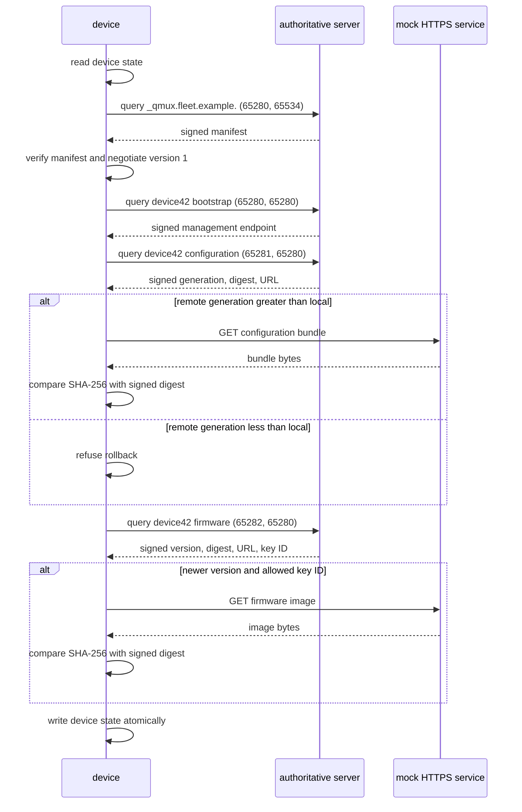
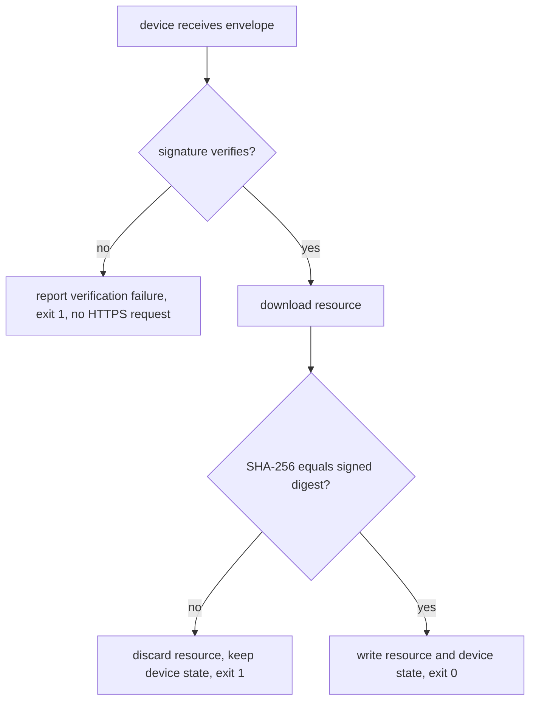

## Purpose

This feature shows QMux in a realistic setting. An industrial controller (the device)
reconnects after an extended outage. It must find its management endpoint, the current
approved configuration generation, and the latest authorized firmware release. The device
uses three independent protocols on three private classes. It downloads a resource only
when verified remote metadata shows a change.

The demonstration is one Go program. It starts an authoritative server, a mock HTTPS
service and the device in one process. It does not use `qmuxd`. It does not flash
firmware.

## User stories

- As a device integrator, I want to see a stale device reconcile with one command, so
  that I can judge whether QMux fits a recovery path.
- As a device integrator, I want the device to refuse tampered metadata and tampered
  resources, so that I can see the security model work.
- As a researcher, I want the demonstration to run as a test, so that CI proves it still
  works after each batch.
- As a protocol developer, I want three small payload schemas as a model, so that I can
  write my own protocol schema the same way.

## Functional requirements

### Payload schemas

- FR-demo-1 — The package `examples/embedded-bootstrap/schema` defines the bootstrap
  payload version 1 as a CBOR map with uint keys: `1` = management endpoint URL (text),
  `2` = management transport (text).
- FR-demo-2 — The package defines the configuration payload version 1 as a CBOR map: `1` =
  configuration generation (uint), `2` = SHA-256 digest (bytes, length 32), `3` = retrieval
  URL (text).
- FR-demo-3 — The package defines the firmware payload version 1 as a CBOR map: `1` =
  firmware version (text, `MAJOR.MINOR.PATCH`), `2` = SHA-256 digest (bytes, length 32), `3`
  = download URL (text), `4` = firmware signing key ID (bytes, length 8).
- FR-demo-4 — The schema package encodes each payload with the deterministic options of
  `pkg/codec`.
- FR-demo-5 — The schema package decodes each payload strictly. It rejects an unknown key,
  a missing key, a wrong CBOR type and a digest that is not 32 bytes.
- FR-demo-6 — Each payload type implements the registry schema interface of
  `pkg/protocol`, so the server validates handler payloads before it encodes them.

### Demonstration server and mock HTTPS service

- FR-demo-7 — The program starts an authoritative server on a loopback UDP and TCP port
  that the operating system selects.
- FR-demo-8 — The server is authoritative for the zone `fleet.example.`
- FR-demo-9 — The server registers discovery at the discovery key `(65280, 65534)`.
- FR-demo-10 — The server registers `org.qmux.bootstrap` at `(65280, 65280)`,
  `org.qmux.configuration` at `(65281, 65280)` and `org.qmux.firmware` at `(65282, 65280)`,
  each with version 1.
- FR-demo-11 — The program generates a new Ed25519 signing key at each start. The server
  signs every envelope with it.
- FR-demo-12 — The program gives the device one in-memory trust anchor: the public key of
  that signing key.
- FR-demo-13 — The program starts a mock HTTPS service with `net/http/httptest`
  `NewTLSServer` on loopback.
- FR-demo-14 — The device trusts only the certificate of the mock HTTPS service.
- FR-demo-15 — The mock HTTPS service serves one configuration bundle and one firmware
  image. The handlers for QNAME `device42.fleet.example.` return their URLs and SHA-256
  digests.
- FR-demo-16 — The mock HTTPS service counts the resource requests it receives.
- FR-demo-17 — The `--remote-generation` flag sets the remote configuration generation.
  The default is `7`.
- FR-demo-18 — The `--remote-firmware` flag sets the remote firmware version. The default
  is `2.4.1`.

### Device reconcile

- FR-demo-19 — The device reads the device state from the `--state` path.
- FR-demo-20 — If the device state file does not exist, the device uses configuration
  generation `0` and firmware version `0.0.0`.
- FR-demo-21 — The device runs discovery for the zone `fleet.example.` and accepts only a
  verified manifest.
- FR-demo-22 — The device negotiates version 1 for each of the three protocols from the
  manifest.
- FR-demo-23 — The device sends each query for the QNAME `device42.fleet.example.` to the
  protocol key that the manifest gives.
- FR-demo-24 — The device records the management endpoint and the management transport
  from the bootstrap result.
- FR-demo-25 — If the remote configuration generation is greater than the local one, the
  device downloads the configuration bundle from the retrieval URL.
- FR-demo-26 — If the remote configuration generation is less than the local one, the
  device refuses the rollback and keeps the local generation.
- FR-demo-27 — If the remote configuration generation equals the local one, the device
  sends no HTTPS request for the configuration bundle.
- FR-demo-28 — If the remote firmware version is greater than the local one, and the
  firmware signing key ID is in the allowed firmware key IDs of the device, the device
  downloads the firmware image.
- FR-demo-29 — If the firmware signing key ID is not allowed, the device skips the
  firmware image and prints the reason.
- FR-demo-30 — If the remote firmware version is not greater than the local one, the
  device sends no HTTPS request for the firmware image.
- FR-demo-31 — The device compares the SHA-256 digest of each downloaded resource with
  the digest in the verified metadata.
- FR-demo-32 — If a digest does not match, the device discards the resource and stops
  with exit code 1.
- FR-demo-33 — The device writes each accepted resource to the `--data-dir` directory.
- FR-demo-34 — The device writes the new device state only after every check passes.
- FR-demo-35 — The device writes the device state atomically: it writes a temporary file
  in the same directory, then renames it.
- FR-demo-36 — The device stores the firmware image and never flashes it.

### Output and tamper flags

- FR-demo-37 — The program prints one log line per step to standard output, in the format
  that § Screens & states shows.
- FR-demo-38 — The program exits with code 0 when the device reconciles or is already
  current.
- FR-demo-39 — The program exits with code 1 when any step fails.
- FR-demo-40 — The `--tamper-dns` flag makes the server change one byte of the
  configuration envelope after it signs it.
- FR-demo-41 — With `--tamper-dns`, the device reports a verification failure and sends
  no HTTPS request.
- FR-demo-42 — The `--tamper-https` flag makes the mock HTTPS service serve a
  configuration bundle whose bytes differ from the signed digest.
- FR-demo-43 — With `--tamper-https`, the device reports a digest mismatch and leaves the
  device state unchanged.
- FR-demo-44 — The target `make demo` runs the program with a state file and a data
  directory under a temporary directory.

### Demonstration test

- FR-demo-45 — `examples/embedded-bootstrap` contains a Go test that runs the stale
  case, the current case, the rollback case and both tamper cases.

## User flows

### Flow 1 — A stale device reconciles



1. The device reads the device state.
2. The device queries the discovery name `_qmux.fleet.example.` at the discovery key.
3. The device verifies the manifest.
4. The device negotiates version 1 for the three protocols.
5. The device queries the bootstrap protocol and records the management endpoint.
6. The device queries the configuration protocol.
7. If the remote generation is greater than the local one, the device downloads the
   configuration bundle and compares its digest.
8. If the remote generation is less than the local one, the device refuses the rollback.
9. The device queries the firmware protocol.
10. If the version is newer and the key ID is allowed, the device downloads the firmware
    image and compares its digest.
11. The device writes the device state atomically.

### Flow 2 — Tampered metadata or a tampered resource



1. The device receives an envelope.
2. If the signature does not verify, the device reports the failure and exits with code 1.
   It sends no HTTPS request.
3. If the signature verifies, the device downloads the resource.
4. If the digest does not match, the device discards the resource, keeps the device
   state, and exits with code 1.
5. If the digest matches, the device writes the resource and the device state, and exits
   with code 0.

## Screens & states

QMux has no graphical screens. The program writes to standard output.

Stale device (populated):

```
[server]  zone fleet.example. on 127.0.0.1:53412 (udp, tcp), key id 3f9a0c1d2e4b5a67
[https]   mock service on https://127.0.0.1:53413
[device]  state: config_generation=3 firmware_version=2.3.0
[device]  discovery: verified manifest, 4 protocols
[device]  negotiate: org.qmux.bootstrap v1, org.qmux.configuration v1, org.qmux.firmware v1
[device]  bootstrap: management https://127.0.0.1:53413/mgmt (transport https)
[device]  configuration: remote generation 7 > local 3, downloading
[device]  configuration: digest ok, wrote config-7.bin
[device]  firmware: remote 2.4.1 > local 2.3.0, key id 9c1e44a0b2d37f15 allowed, downloading
[device]  firmware: digest ok, stored firmware-2.4.1.img (not flashed)
[device]  state written: config_generation=7 firmware_version=2.4.1
[device]  result: reconciled (2 downloads)
```

Current device: the configuration and firmware lines say `up to date`, and the result is
`result: up to date (0 downloads)`.

Error states:

- Verification failure: `[device]  configuration: verification failed: bad signature` and
  `result: failed`.
- Digest mismatch: `[device]  configuration: digest mismatch, resource discarded` and
  `result: failed, state unchanged`.
- Rollback: `[device]  configuration: remote generation 2 < local 3, rollback refused`.

## Behaviour rules

- Version comparison for firmware uses the three integer fields of `MAJOR.MINOR.PATCH` in
  order. A version that does not parse is a failure.
- The allowed firmware key IDs are a list in the program. The default list holds the key
  ID of the mock firmware signing key.
- The device uses the client defaults of the spec: attempt timeout 1 s, 3 attempts.
- The device state file and the data directory are created with mode 0600 and 0700.
- Each query uses the verified client. An unverified result is never accepted.

## Data touched

- Device state (read and written).
- Files in the data directory: `config-<generation>.bin`, `firmware-<version>.img`.
- No other persistent data.

## Interfaces

Command:

```bash
go run ./examples/embedded-bootstrap --state ./device-state.json --data-dir ./device-data
```

| Flag | Default | Meaning |
|---|---|---|
| `--state` | `./device-state.json` | Path of the device state file. |
| `--data-dir` | `./device-data` | Directory for downloaded resources. |
| `--remote-generation` | `7` | Configuration generation that the server publishes. |
| `--remote-firmware` | `2.4.1` | Firmware version that the server publishes. |
| `--tamper-dns` | false | Change one byte of the configuration envelope after signing. |
| `--tamper-https` | false | Serve a configuration bundle that does not match its digest. |

External interface: `net/http/httptest.NewTLSServer` and `Server.Client()` from the Go
standard library, https://pkg.go.dev/net/http/httptest (Go 1.25).

## Edge cases & failures

- The device state file holds invalid JSON: the device stops with exit code 1 and does
  not overwrite the file.
- The data directory is not writable: the device stops before it changes the device
  state.
- The mock HTTPS service returns a status other than 200: the device stops with exit
  code 1.
- A manifest does not list one of the three protocols: the device stops with
  `protocol not found`.
- A process crash during the write leaves the old device state in place, because of the
  rename.

## Acceptance criteria

- FR-demo-1 to FR-demo-3: a round-trip test of each schema returns the same field values.
- FR-demo-4: encoding the same payload twice gives identical bytes.
- FR-demo-5: a test decodes a payload with an extra key and gets an error. A test decodes
  a 31-byte digest and gets an error.
- FR-demo-6: a handler that returns an invalid configuration payload causes `SERVFAIL`.
- FR-demo-7 and FR-demo-8: the first log line names the zone `fleet.example.` and a
  loopback address.
- FR-demo-9 and FR-demo-10: the manifest in the test lists the four protocol IDs at the
  stated protocol keys.
- FR-demo-11: two starts print two different key IDs.
- FR-demo-12: an envelope that a different key signs fails verification in the device.
- FR-demo-13 and FR-demo-14: a device client with the system certificate pool cannot
  connect to the mock HTTPS service.
- FR-demo-15: the configuration result for `device42.fleet.example.` holds the URL and
  digest of the served bundle.
- FR-demo-16: the test reads the request count from the mock HTTPS service.
- FR-demo-17 and FR-demo-18: with `--remote-generation 9`, the log shows
  `remote generation 9`.
- FR-demo-19 and FR-demo-20: with no state file, the log shows
  `config_generation=0 firmware_version=0.0.0`.
- FR-demo-21: with `--tamper-dns`, the device does not reach the configuration download.
- FR-demo-22: the log shows `v1` for each of the three protocols.
- FR-demo-23: each query in the test has the QNAME `device42.fleet.example.`
- FR-demo-24: the log shows the management endpoint URL.
- FR-demo-25: the stale case writes `config-7.bin`.
- FR-demo-26: with a local generation of 9 and a remote generation of 7, the log shows
  `rollback refused` and the device state keeps generation 9.
- FR-demo-27 and FR-demo-30: the current case makes 0 HTTPS requests.
- FR-demo-28: the stale case writes `firmware-2.4.1.img`.
- FR-demo-29: with an empty allowed key list, the log shows the skip reason and no
  firmware request occurs.
- FR-demo-31 and FR-demo-32: with `--tamper-https`, the program exits with code 1.
- FR-demo-33: the data directory holds both files after the stale case.
- FR-demo-34 and FR-demo-43: after each tamper case, the device state file has the same
  bytes as before the run.
- FR-demo-35: the code writes a temporary file and renames it. A test finds no temporary
  file after a run.
- FR-demo-36: the code holds no call that writes outside the data directory and the state
  file.
- FR-demo-37: the stale case output matches the line prefixes in § Screens & states.
- FR-demo-38: the stale case and the current case exit with code 0.
- FR-demo-39: each tamper case exits with code 1.
- FR-demo-40 and FR-demo-41: with `--tamper-dns`, the log shows `verification failed`,
  and the mock HTTPS service counts 0 requests.
- FR-demo-42: with `--tamper-https`, the log shows `digest mismatch`.
- FR-demo-44: `make demo` exits with code 0 on a clean checkout.
- FR-demo-45: the stale case counts 2 HTTPS requests, and `go test ./examples/...` passes.

## Out of scope

- Firmware flashing, a boot loader, or an A/B partition scheme.
- Verification of the firmware image signature. The device checks only the key ID and
  the digest.
- A real management protocol behind the management endpoint.
- Separate processes for the server, the mock HTTPS service and the device.

## Open questions
