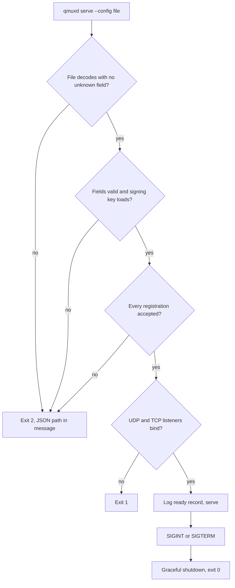
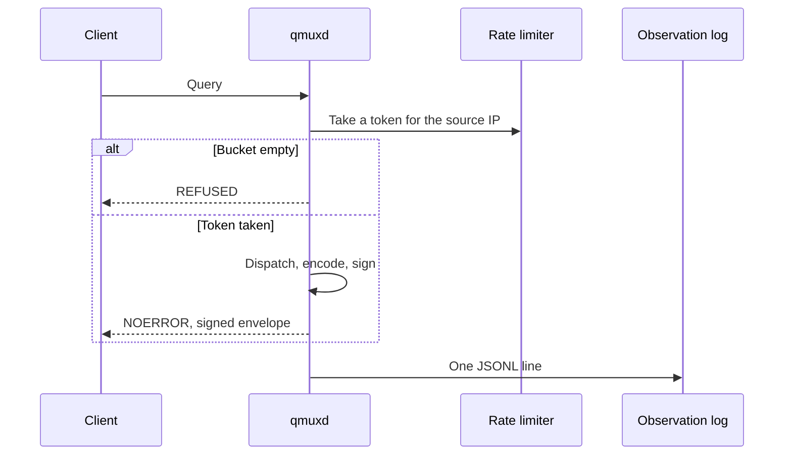

## Purpose

`qmuxd` is the standalone authoritative server. An operator runs it with a configuration
file and a signing key, and it serves static records for any number of protocols. No Go
code is necessary. `qmuxd` always signs. It adds two server capabilities that the library
exposes too: a per-source rate limit and an observation log. Epic 9 runs `qmuxd` in Docker
Compose and reads the observation log to find whether a probe reached the authoritative
server.

## User stories

- As an operator, I want to declare protocols and static records in one JSON file, so that
  I can serve QMux data with no Go code.
- As an operator, I want `qmuxd` to refuse an invalid configuration file before it
  listens, so that a typo never serves wrong data.
- As an operator, I want a per-source rate limit, so that one source cannot take all
  server capacity.
- As a researcher, I want one JSONL line per received query, so that I can prove which
  probes reached the authoritative server.
- As a protocol developer, I want a working example configuration file, so that I can start
  from it.

## Functional requirements

### Command line

- **FR-qmuxd-1** — `qmuxd serve` reads the configuration file at `--config`. The default is
  `./qmuxd.json`.
- **FR-qmuxd-2** — `qmuxd serve --listen <addr>` overrides the `listen` field of the
  configuration file.
- **FR-qmuxd-3** — `qmuxd serve` listens on UDP and on TCP at the listen address.
- **FR-qmuxd-4** — `qmuxd serve` logs one record at level `info` when both listeners are
  ready. The record holds the listen address, the zones, the key ID and the protocol count.
- **FR-qmuxd-5** — On SIGINT or SIGTERM, `qmuxd serve` shuts down with the grace period and
  exits with code 0.
- **FR-qmuxd-6** — `qmuxd version` prints the module version and the Go version.
- **FR-qmuxd-7** — `qmuxd` exits with code 1 when a listener cannot bind.

### Configuration file

- **FR-qmuxd-8** — `qmuxd` decodes the configuration file with `encoding/json` and
  `DisallowUnknownFields`.
- **FR-qmuxd-9** — The configuration file has the fields in the schema table below.
- **FR-qmuxd-10** — `qmuxd` exits with code 2 before it listens when the configuration file
  is not valid. The message names the JSON path of the first error, for example
  `protocols[1].records["device42.fleet.example."].payload`.
- **FR-qmuxd-11** — `qmuxd` exits with code 2 when `signing_key` is missing or does not load.
  `qmuxd` never serves unsigned envelopes.
- **FR-qmuxd-12** — `qmuxd` logs the warning from `security.LoadPrivateKey` at level `warn`.
- **FR-qmuxd-13** — `qmuxd` registers each protocol through the registry, so the registry
  rules apply. A registry error exits with code 2.
- **FR-qmuxd-14** — Each QNAME in `records` must be at or below one of the configured zones.
- **FR-qmuxd-15** — When `discovery.enabled` is true, `qmuxd` calls
  `discovery.RegisterZones` one time with every zone. `discovery.in_class` sets `InClass`.

### Static records and JSON-to-CBOR rule

- **FR-qmuxd-16** — A static-record handler answers a QNAME listed in `records`, with a
  case-insensitive match, with the record payload and status.
- **FR-qmuxd-17** — The static-record handler returns the status `not-found` for a QNAME not
  in `records`.
- **FR-qmuxd-18** — A record with a `version` field answers only that version. For another
  requested version, the handler returns `not-found`.
- **FR-qmuxd-19** — A record has exactly one of `payload` and `payload_hex`.
- **FR-qmuxd-20** — `payload_hex` is decoded from hex into the payload bytes.
- **FR-qmuxd-21** — `qmuxd` converts a `payload` JSON value into CBOR at load time with these
  rules:
  - An object whose keys are all decimal integers becomes a map with unsigned integer keys.
  - Any other object becomes a map with text keys.
  - An integral number becomes an unsigned integer, or a negative integer when below 0.
  - A number with a fraction becomes a float.
  - A string that starts with `hex:` becomes a byte string.
  - Any other string becomes a text string.
  - An array becomes an array. A boolean becomes a boolean.
  - `null` is a configuration error.
- **FR-qmuxd-22** — `qmuxd` encodes the converted value with `codec.Marshal`, so the payload
  is deterministic.
- **FR-qmuxd-23** — When the record `status` field is absent, the status is `ok`.

### Rate limit

- **FR-qmuxd-24** — `server.ServerConfig` gains the field `RateLimit` with `QPS` and `Burst`.
  A zero value disables the rate limit.
- **FR-qmuxd-25** — The server keeps one token bucket per source IP address.
- **FR-qmuxd-26** — The server returns `REFUSED` with no answer when the bucket of the source
  is empty.
- **FR-qmuxd-27** — The server tracks at most 65536 source addresses. It removes a bucket
  that has been full for 60 s.
- **FR-qmuxd-28** — When the table is full, the server applies one shared bucket to every
  new source.
- **FR-qmuxd-29** — The `qmuxd` defaults are `qps` 50 and `burst` 100. `"qps": 0` disables
  the rate limit.
- **FR-qmuxd-30** — The rate limiter uses no third-party module.

### Observation log

- **FR-qmuxd-31** — `server.ServerConfig` gains the field `ObservationLog` of type
  `io.Writer`.
- **FR-qmuxd-32** — When `ObservationLog` is set, the server writes one JSON object per
  received query, followed by a newline.
- **FR-qmuxd-33** — Each line has the fields `ts` (RFC 3339 with nanoseconds), `transport`,
  `source`, `qname`, `qclass`, `qtype`, `rcode`, `status`, `bytes_in`, `bytes_out` and
  `duration_us`.
- **FR-qmuxd-34** — The server writes a line for every query it parses, including queries
  that end in `REFUSED`, `FORMERR` or `SERVFAIL`. `status` is `null` when no envelope exists.
- **FR-qmuxd-35** — Writes to the observation log are serialized, so no two lines interleave.
- **FR-qmuxd-36** — `qmuxd` opens the `observation_log` path in append mode with file mode
  0644.

### Example configuration, container and integration test

- **FR-qmuxd-37** — `examples/qmuxd.json` serves the zone `fleet.example.` with the three
  demonstration protocols at the protocol keys of `docs/specs/spec.md` § Protocol key
  allocation.
- **FR-qmuxd-38** — `examples/qmuxd.json` has records for `device42.fleet.example.` that
  follow the payload schemas of `features/07-embedded-recovery.md`.
- **FR-qmuxd-39** — `examples/qmuxd.json` uses `signing_key` `keys/qmuxd.key`. The README
  step before it is `qmuxctl keygen --out keys/qmuxd`.
- **FR-qmuxd-40** — A `Dockerfile` at the repository root builds a static `qmuxd` binary in
  a build stage and copies it into a minimal final stage that runs as a non-root user.
- **FR-qmuxd-41** — The container listens on port 53 inside the container and reads
  `/etc/qmuxd/qmuxd.json`.
- **FR-qmuxd-42** — An integration test builds `qmuxd` and `qmuxctl`, starts `qmuxd` on a
  free loopback port with a temporary configuration file, and checks that `qmuxctl` verifies
  every protocol with the trust anchor file.
- **FR-qmuxd-43** — The integration test sends queries above the rate limit and receives
  `REFUSED`.
- **FR-qmuxd-44** — The integration test parses every observation log line as JSON with the
  fields of FR-qmuxd-33.

## User flows

### Flow 1 — The operator starts qmuxd



1. The operator runs `qmuxd serve --config <file>`.
2. If the file does not decode, `qmuxd` exits with code 2 and names the JSON path.
3. If a field is not valid or the signing key does not load, `qmuxd` exits with code 2.
4. `qmuxd` registers every protocol and, when enabled, discovery.
5. If the registry rejects a registration, `qmuxd` exits with code 2.
6. If a listener does not bind, `qmuxd` exits with code 1.
7. `qmuxd` logs the ready record and serves.
8. On SIGINT or SIGTERM, `qmuxd` shuts down and exits with code 0.

### Flow 2 — The server handles one query with a rate limit and an observation log



1. The client sends a query.
2. The server takes a token from the bucket of the source IP address.
3. If the bucket is empty, the server returns `REFUSED`.
4. The server dispatches the query, encodes the envelope, signs it and returns it.
5. The server writes one line to the observation log.

## Screens & states

No graphical screens. Console output of `qmuxd serve` with the `text` log format:

```
time=2026-11-20T10:00:00Z level=INFO msg="qmuxd ready" listen=127.0.0.1:5353 zones=[fleet.example.] key_id=3f9a1c0b7d2e4a65 protocols=4
```

Configuration error:

```
qmuxd: config: protocols[1].class: 300 is not an allowed class
```

One observation log line:

```json
{"ts":"2026-11-20T10:00:01.123456789Z","transport":"udp","source":"127.0.0.1:53000","qname":"_v1.device42.fleet.example.","qclass":65282,"qtype":65280,"rcode":"NOERROR","status":"ok","bytes_in":61,"bytes_out":214,"duration_us":180}
```

## Behaviour rules

### Configuration file schema

| Field | Type | Default | Rule |
|---|---|---|---|
| `listen` | string | `127.0.0.1:5353` | `host:port`. |
| `zones` | array of string | — | Required. At least one fully qualified name. |
| `signing_key` | string | — | Required. Path to a PKCS#8 PEM Ed25519 key. Relative to the configuration file directory. |
| `signature_validity` | string | `1h` | Go duration, 1 min to 24 h. |
| `ttl` | integer | 60 | 0–86400 seconds. |
| `udp_size` | integer | 1232 | 512–4096. |
| `handler_timeout` | string | `2s` | Go duration, 10 ms to 30 s. |
| `rate_limit` | object `{qps, burst}` | `{50, 100}` | `qps` 0 disables. `burst` ≥ `qps` when `qps` > 0. |
| `allow_reserved_classes` | boolean | false | Passed to the registry. |
| `allow_non_private_types` | boolean | false | Passed to the registry. |
| `discovery` | object `{enabled, in_class}` | `{true, false}` | — |
| `observation_log` | string | none | Path. Absent disables the observation log. |
| `log_level` | string | `info` | `debug`, `info`, `warn`, `error`. |
| `log_format` | string | `text` | `text` or `json`. |
| `protocols` | array | — | Required, at least one entry. |
| `protocols[].id` | string | — | Protocol ID rules of FR-codec-12. |
| `protocols[].versions` | array of integer | — | Sorted, unique, 1–65535. |
| `protocols[].class`, `protocols[].type` | integer | — | Registry rules. |
| `protocols[].records` | object | — | Keys are QNAMEs. Values are record objects. |
| record `payload` / `payload_hex` | JSON value / string | — | Exactly one. |
| record `status` | string | `ok` | A status name from the status table, or an integer 256–65535. |
| record `version` | integer | none | A version of the protocol. |

- Relative paths in the configuration file resolve from the directory of the file.
- `qmuxd` loads every record at start. It does not watch the file for changes.

## Data touched

- New `cmd/qmuxd`.
- `server.ServerConfig.RateLimit` and `server.ServerConfig.ObservationLog`.
- New `examples/qmuxd.json`, new `Dockerfile`, new `.dockerignore`.
- New `tests/integration/qmuxd_test.go`.

## Interfaces

```go
package server

type RateLimit struct {
    QPS   float64
    Burst int
}

type ServerConfig struct {
    // fields from Epics 2, 4 and 6 ...
    RateLimit      RateLimit
    ObservationLog io.Writer
}
```

`qmuxd` reads configuration with `encoding/json` `Decoder.DisallowUnknownFields`:
https://pkg.go.dev/encoding/json#Decoder.DisallowUnknownFields (Go 1.25).

## Edge cases & failures

| Case | Result |
|---|---|
| Two protocols use the same protocol key | Exit 2 with the registry conflict error. |
| A record QNAME is outside every zone | Exit 2, the message names the record path. |
| `payload` holds `{"1": 2, "a": 3}` | A map with text keys `"1"` and `"a"`. |
| `payload` holds `null` | Exit 2. |
| The payload makes the envelope larger than the limit | Exit 2 at load time, because `qmuxd` encodes every record once at start. |
| The observation log disk is full | The server logs one error per minute and keeps answering. |
| A source sends 200 queries in one second with defaults | About 100 answers, then `REFUSED`. |

## Acceptance criteria

- [ ] FR-qmuxd-1: `qmuxd serve` in a directory with `qmuxd.json` starts with no flag.
- [ ] FR-qmuxd-2: with `--listen` set to a free loopback port, `qmuxd` answers on that port and not on the `listen` value of the file.
- [ ] FR-qmuxd-3: a test receives answers over UDP and over TCP from one `qmuxd` process.
- [ ] FR-qmuxd-4: the ready record contains `listen`, `zones`, `key_id` and `protocols`.
- [ ] FR-qmuxd-5: SIGTERM makes `qmuxd` exit with code 0 within the grace period.
- [ ] FR-qmuxd-6: `qmuxd version` prints a line that contains `go1.`.
- [ ] FR-qmuxd-7: a second `qmuxd` on the same address exits with code 1.
- [ ] FR-qmuxd-8: a configuration file with the field `listn` exits with code 2.
- [ ] FR-qmuxd-9: `examples/qmuxd.json` decodes with every field of the schema table that it uses.
- [ ] FR-qmuxd-10: a configuration file with a bad payload exits with code 2 and prints the JSON path.
- [ ] FR-qmuxd-11: a configuration file without `signing_key` exits with code 2.
- [ ] FR-qmuxd-12: a 0644 key file produces one `warn` log record.
- [ ] FR-qmuxd-13: a class of 300 exits with code 2.
- [ ] FR-qmuxd-14: a record for `x.other.example.` exits with code 2.
- [ ] FR-qmuxd-15: `qmuxctl discover` against `qmuxd` lists every configured protocol and `org.qmux.discovery`.
- [ ] FR-qmuxd-16: a query for `DEVICE42.fleet.example.` returns the record of `device42.fleet.example.`
- [ ] FR-qmuxd-17: a query for `device99.fleet.example.` returns status `not-found`.
- [ ] FR-qmuxd-18: a record with `version` 1 returns `not-found` for `_v2` on a protocol with versions `[1, 2]`.
- [ ] FR-qmuxd-19: a record with both `payload` and `payload_hex` exits with code 2.
- [ ] FR-qmuxd-20: `payload_hex` `"0a0b"` gives the payload bytes `0a 0b`.
- [ ] FR-qmuxd-21: a table test converts each JSON value kind to the stated CBOR kind.
- [ ] FR-qmuxd-22: two `qmuxd` loads of one file give identical payload bytes.
- [ ] FR-qmuxd-23: a record without `status` returns status `ok`.
- [ ] FR-qmuxd-24, FR-qmuxd-25, FR-qmuxd-26: a server with `QPS` 1 and `Burst` 2 answers 2 queries from one source and returns `REFUSED` for the third.
- [ ] FR-qmuxd-27: a unit test with a fake clock removes an idle bucket after 60 s.
- [ ] FR-qmuxd-28: a unit test with 65537 sources applies the shared bucket to the last source.
- [ ] FR-qmuxd-29: `"qps": 0` answers 500 queries in one second from one source with no `REFUSED`.
- [ ] FR-qmuxd-30: `go list -m all` for the library module lists no rate-limit module.
- [ ] FR-qmuxd-31, FR-qmuxd-32: with `ObservationLog` set, 10 queries give 10 lines.
- [ ] FR-qmuxd-33: every line holds the 11 fields.
- [ ] FR-qmuxd-34: a `REFUSED` query writes a line with `status` null.
- [ ] FR-qmuxd-35: 100 concurrent queries give 100 lines that each parse as JSON.
- [ ] FR-qmuxd-36: a restart of `qmuxd` keeps the earlier lines of the observation log.
- [ ] FR-qmuxd-37, FR-qmuxd-38, FR-qmuxd-39: `qmuxd` serves `examples/qmuxd.json` after `qmuxctl keygen --out keys/qmuxd`, and each payload decodes with the Epic 7 payload types.
- [ ] FR-qmuxd-40, FR-qmuxd-41: `docker build .` succeeds, and the container runs as a user other than root and answers on port 53.
- [ ] FR-qmuxd-42: the integration test verifies every protocol through `qmuxctl`.
- [ ] FR-qmuxd-43: the integration test receives `REFUSED` above the rate limit.
- [ ] FR-qmuxd-44: the integration test parses every observation log line.

## Out of scope

- Reload of the configuration file while `qmuxd` runs.
- Dynamic handlers, scripts or plugins in `qmuxd`.
- The probe protocol section of the configuration file (Epic 9).
- A metrics endpoint.
- Publication of the container image to a registry.

## Open questions
