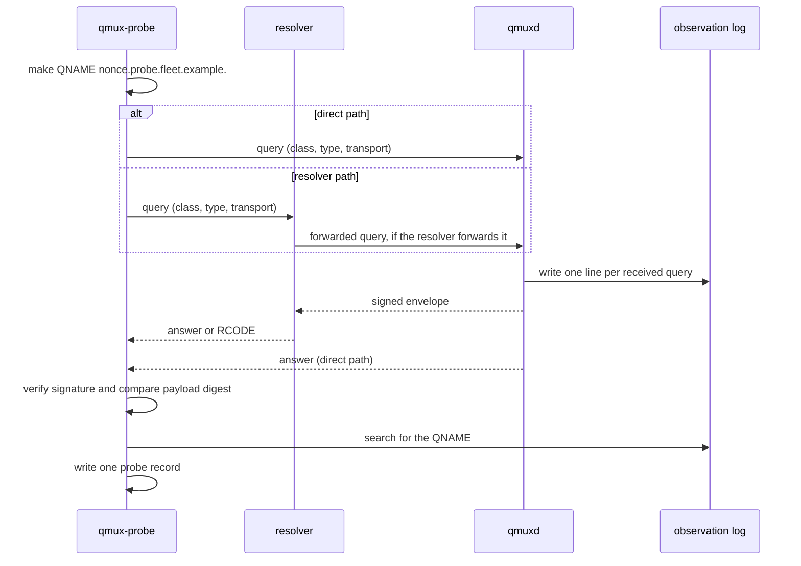
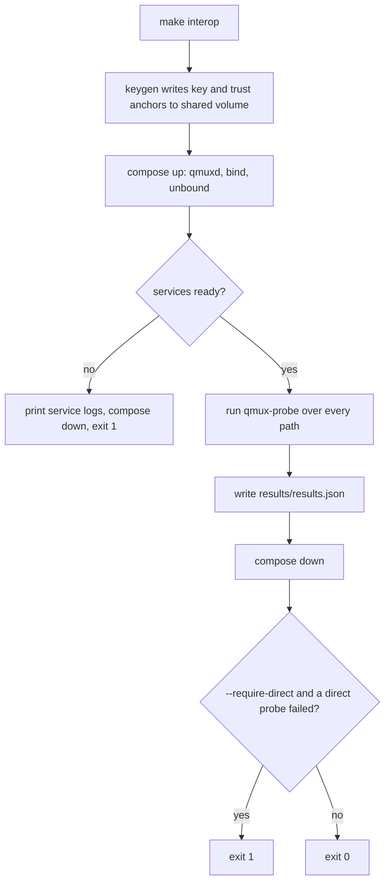

## Purpose

This feature measures what happens to QMux queries on each path: direct, through BIND,
and through Unbound. It sends one probe per combination of path, transport, class and
type. It records the RCODE, the answer, payload integrity, signature verification, sizes,
the round-trip time, and whether the probe reached the authoritative server.

The outcomes are research data, not pass or fail criteria. The one exception is the
direct path, which must pass in CI. The docs never claim compatibility beyond the
measured rows.

## User stories

- As a researcher, I want one command to run the interop matrix, so that anyone can
  reproduce the results.
- As a researcher, I want to know if a probe reached the authoritative server, so that I
  can tell a resolver refusal from a server failure.
- As a protocol developer, I want a table of which classes and types pass each resolver,
  so that I can choose a protocol key.
- As a maintainer, I want CI to fail when the direct path fails, so that a regression in
  QMux is visible.

## Functional requirements

### Probe protocol in qmuxd

- FR-interop-1 — `qmuxd` reads an optional `probe` section of the configuration file with
  the fields `zone` (text), `classes` (list of uint16) and `types` (list of uint16).
- FR-interop-2 — For each class and type pair in the `probe` section, `qmuxd` registers
  the probe protocol `org.qmux.probe`, version 1.
- FR-interop-3 — `qmuxd` rejects a `probe` section with a reserved class unless
  `allow_reserved_classes` is true.
- FR-interop-4 — `qmuxd` rejects a `probe` section with QTYPE 16 unless
  `allow_non_private_types` is true.
- FR-interop-5 — The probe protocol answers every QNAME at or below the probe zone.
- FR-interop-6 — The probe payload is the SHA-256 digest of the lowercase QNAME.
- FR-interop-7 — For QTYPE 16, the authoritative server splits the envelope bytes into
  TXT character-strings of at most 255 bytes.
- FR-interop-8 — The client SDK joins the TXT character-strings of a QTYPE 16 answer into
  the envelope bytes.
- FR-interop-9 — The TXT path exists only for the probe protocol and the benchmark
  reference row. No other QMux protocol uses it.

### qmux-probe command

- FR-interop-10 — `cmd/qmux-probe` sends one probe for each combination of path,
  transport, class and type.
- FR-interop-11 — `--server` sets the address of the direct path.
- FR-interop-12 — `--resolver name=addr` adds one resolver path. The flag repeats.
- FR-interop-12a — On a resolver path, `qmux-probe` sets `ClientConfig.Recursion`, so the query carries RD=1.
  On the direct path, the query carries RD=0.
- FR-interop-13 — `--classes` sets the classes. The default is `1,3,4,65280,65281`.
- FR-interop-14 — `--types` sets the types. The default is `16,65280`.
- FR-interop-15 — `--transports` sets the transports. The default is `udp,tcp`.
- FR-interop-16 — `--zone` sets the probe zone. The default is `probe.fleet.example.`
- FR-interop-17 — Each probe uses a unique QNAME `<nonce>.<zone>`. The nonce is 16 random
  lowercase hex characters.
- FR-interop-18 — `--trust-anchors` sets the trust anchor file that `qmux-probe` uses to
  verify answers.
- FR-interop-19 — `--timeout` sets the deadline of one probe. The default is 3 s.
- FR-interop-20 — `--observation-log` sets the path of the observation log of `qmuxd`.
- FR-interop-21 — `qmux-probe` sets `reached_authoritative` to true when the observation
  log holds a line with the QNAME of the probe.
- FR-interop-22 — `qmux-probe` records `observed_qclass` and `observed_qtype` from that
  observation log line.
- FR-interop-23 — `--output` writes a JSON array with one record per probe. The fields are
  listed in § Data touched.
- FR-interop-24 — `--markdown` prints the interop matrix as a markdown table to standard
  output.
- FR-interop-25 — `qmux-probe` exits with code 0 when every probe has a record, whatever
  the outcomes are.
- FR-interop-26 — With `--require-direct`, `qmux-probe` exits with code 1 when any probe
  on the direct path has an outcome other than `ok`.
- FR-interop-27 — `qmux-probe` sets `payload_ok` to true only when the payload equals the
  SHA-256 digest of the lowercase QNAME.

### Docker Compose environment

- FR-interop-28 — `tests/interoperability/compose.yaml` defines a network with fixed IP
  addresses for every service.
- FR-interop-29 — The service `qmuxd` builds from the repository `Dockerfile` and reads
  `tests/interoperability/qmuxd.json`.
- FR-interop-30 — The service `qmuxd` writes its observation log to a shared volume.
- FR-interop-31 — A start step runs `qmuxctl keygen` and writes the signing key and the
  trust anchor file to the shared volume before `qmuxd` starts.
- FR-interop-32 — The service `bind` uses the image `internetsystemsconsortium/bind9:9.20`.
- FR-interop-33 — The `bind` configuration allows recursion for the compose subnet only.
- FR-interop-34 — The `bind` configuration holds the zone `fleet.example` class IN, type
  forward, `forward only`, with `qmuxd` as the forwarder.
- FR-interop-35 — The `bind` configuration holds `validate-except { fleet.example; };`
- FR-interop-36 — The harness attempts a second `bind` configuration with a non-IN view
  for class 65281 and records whether `named-checkconf` accepts it.
- FR-interop-37 — The service `unbound` uses the image `klutchell/unbound:1.26.2`.
- FR-interop-38 — The `unbound` configuration holds a `forward-zone` for `fleet.example.`
  with `qmuxd` as the forward address.
- FR-interop-39 — The `unbound` configuration holds `domain-insecure: "fleet.example."`
- FR-interop-39a — The harness mounts the `unbound` configuration as a file in
  `/etc/unbound/custom.conf.d/`. The image's `unbound.conf` includes
  `/etc/unbound/custom.conf.d/*.conf` (verified 2026-11-20 by export of the image).
- FR-interop-39b — The `unbound` configuration sets `serve-expired: no`. The image default
  is `yes`, and an expired cached answer would hide the outcome of a probe.
- FR-interop-39c — Each probe record holds `host_arch` and `emulated`. `emulated` is true
  when the resolver image architecture differs from the host architecture.
- FR-interop-40 — The service `probe` builds from the repository and runs `qmux-probe`
  against the direct path, `bind` and `unbound`.

### Make target and CI

- FR-interop-41 — `make interop` starts the compose environment, runs the probe, and
  stops the environment.
- FR-interop-42 — `make interop` writes `tests/interoperability/results/results.json`.
- FR-interop-43 — `make interop` stops the compose environment when the probe fails.
- FR-interop-44 — `.github/workflows/interop.yml` runs `make interop` with
  `--require-direct` on each pull request to `dev` and to `main`.
- FR-interop-45 — The interop workflow uploads `results.json` as a workflow artifact.

### Interop documentation

- FR-interop-46 — `docs/interoperability.md` has a section `Test methodology`.
- FR-interop-47 — `docs/interoperability.md` has a section `Resolver configurations` that
  quotes the `bind` and `unbound` configuration files.
- FR-interop-48 — `docs/interoperability.md` has a section `Reproduction steps` with the
  exact commands.
- FR-interop-49 — `docs/interoperability.md` has a section `Observed results` that holds
  the `--markdown` table, the date, the commit and the image tags.
- FR-interop-50 — `docs/interoperability.md` has a section `Known limitations` that
  states the IN-only recursion of BIND and the IN class assumption of Unbound as expected
  outcomes.

## User flows

### Flow 1 — One probe



1. `qmux-probe` makes a unique QNAME for the probe.
2. If the path is direct, `qmux-probe` sends the query to `qmuxd`.
3. If the path is a resolver, `qmux-probe` sends the query to the resolver.
4. If the resolver forwards the query, `qmuxd` receives it.
5. `qmuxd` writes one observation log line for each query it receives.
6. `qmux-probe` receives an answer, an RCODE, or a timeout.
7. `qmux-probe` verifies the signature and compares the payload with the digest of the
   QNAME.
8. `qmux-probe` searches the observation log for the QNAME.
9. `qmux-probe` writes one probe record.

### Flow 2 — make interop



1. `make interop` runs the key generation step.
2. `make interop` starts `qmuxd`, `bind` and `unbound`.
3. If a service does not become ready, `make interop` prints the service logs, stops the
   environment, and exits with code 1.
4. `make interop` runs `qmux-probe` over every path.
5. `qmux-probe` writes `results/results.json`.
6. `make interop` stops the environment.
7. If `--require-direct` is set and a direct probe failed, the run exits with code 1.

## Screens & states

QMux has no graphical screens. `qmux-probe` writes to standard output.

Running:

```
qmux-probe: 3 paths x 2 transports x 5 classes x 2 types = 60 probes
direct  udp  65281/65280  NOERROR  ok       verified  reached  1.1 ms  71/232 B
bind    udp  65281/65280  REFUSED  rcode    -         -        0.9 ms  71/71 B
unbound tcp  1/65280      NOERROR  ok       verified  reached  3.4 ms  71/232 B
...
qmux-probe: wrote tests/interoperability/results/results.json (60 records)
```

`--markdown` table (populated):

```
| path | transport | class | type | outcome | reached | verified |
|---|---|---|---|---|---|---|
| direct | udp | 65281 | 65280 | ok | yes | yes |
| bind | udp | 65281 | 65280 | rcode REFUSED | no | — |
```

The rows above show the format only. They are not measured results.

Error states:

- No trust anchor file: `qmux-probe: --trust-anchors is required` and exit code 64.
- The observation log is missing: every record has `reached_authoritative: null` and the
  summary line prints a warning.

## Behaviour rules

- `qmux-probe` sends the probes one at a time, so the observation log lines map to probes
  without overlap.
- `qmux-probe` uses the client SDK with retries disabled: one attempt per probe. A
  timeout is an outcome.
- The outcome is exactly one of `ok`, `rcode`, `timeout`, `network`, `mismatch`,
  `verify`.
- `ok` means: RCODE `NOERROR`, the answer class and type equal the question, the
  signature verifies, and `payload_ok` is true.
- `qmux-probe` waits 500 ms after the last probe before it reads the observation log.
- The resolver containers clear no cache between probes. The unique QNAME prevents a
  cache hit.

## Data touched

Probe record (one JSON object per probe):

| Field | Type |
|---|---|
| `path` | text: `direct` or the resolver name |
| `transport` | text: `udp` or `tcp` |
| `qclass`, `qtype` | uint |
| `qname` | text |
| `rcode` | text, or null on timeout |
| `answer_class`, `answer_type` | uint, or null |
| `payload_ok`, `verified` | bool |
| `rtt_ms` | number |
| `query_bytes`, `response_bytes` | uint |
| `outcome` | text |
| `error` | text, empty when `ok` |
| `reached_authoritative` | bool, or null when no observation log exists |
| `observed_qclass`, `observed_qtype` | uint, or null |

Files: `tests/interoperability/qmuxd.json`, `compose.yaml`, `bind/named.conf`,
`bind/named-view-65281.conf`, `unbound/unbound.conf`, `results/results.json`.

## Interfaces

```bash
qmux-probe \
  --server 127.0.0.1:5353 \
  --classes 1,3,4,65280,65281 \
  --types 16,65280 \
  --output results.json
```

External interfaces:

- BIND 9.20, image `internetsystemsconsortium/bind9:9.20`,
  https://hub.docker.com/r/internetsystemsconsortium/bind9 (tag 9.20, retrieved
  2026-11-20). Configuration reference: BIND 9.20 ARM,
  https://bind9.readthedocs.io/en/v9.20/reference.html. The ARM states: "Views are
  class-specific". Recursion for non-IN views is disabled in `server.c` on the `bind-9.20`
  branch, https://gitlab.isc.org/isc-projects/bind9.
- Unbound 1.26.2, image `klutchell/unbound:1.26.2`,
  https://hub.docker.com/r/klutchell/unbound. Configuration reference:
  https://unbound.docs.nlnetlabs.nl/en/latest/manpages/unbound.conf.html. The page states
  for `forward-zone`: "Class IN is assumed."
- Docker Compose file format, https://docs.docker.com/reference/compose-file/.
- GitHub Actions `actions/upload-artifact`,
  https://github.com/actions/upload-artifact. Epic 0 pins the version.

## Edge cases & failures

- A resolver returns `SERVFAIL` for a private class: the record has outcome `rcode` and
  `reached_authoritative: false`. This is an expected result.
- A resolver changes the class or type of the forwarded query: `observed_qclass` or
  `observed_qtype` differs from the probe, and the record keeps both values.
- A resolver answers with a class or type that differs from the question: outcome
  `mismatch`.
- A resolver modifies the RDATA: outcome `verify`.
- `named-checkconf` rejects the class 65281 view: the harness records the error text in
  `results/bind-view-65281.txt` and the run continues.
- Docker is missing: `make interop` prints `docker not found` and exits with code 1.

## Acceptance criteria

- FR-interop-1 and FR-interop-2: with `probe.classes = [65281]` and `probe.types =
  [65280]`, `qmuxctl discover` lists `org.qmux.probe` at `(65281, 65280)`.
- FR-interop-3: a `probe` section with class 3 and no `allow_reserved_classes` makes
  `qmuxd` exit with an error that names the class.
- FR-interop-4: a `probe` section with type 16 and no `allow_non_private_types` makes
  `qmuxd` exit with an error that names the type.
- FR-interop-5: a query for `abc.probe.fleet.example.` returns application status `ok`.
- FR-interop-6 and FR-interop-27: a direct probe has `payload_ok: true`.
- FR-interop-7: a direct QTYPE 16 answer for a 300-byte envelope holds two
  character-strings.
- FR-interop-8: a direct QTYPE 16 probe has outcome `ok`.
- FR-interop-9: no registration outside the probe protocol and the benchmark has QTYPE 16.
- FR-interop-10, FR-interop-13 to FR-interop-15: a run with defaults and two paths writes
  40 records.
- FR-interop-11 and FR-interop-12: a run with `--resolver bind=…` holds records with
  `path: bind`.
- FR-interop-16 and FR-interop-17: every QNAME in a run is unique and ends in
  `probe.fleet.example.`
- FR-interop-18: a run with a wrong trust anchor file gives outcome `verify` on the
  direct path.
- FR-interop-19: a probe to an address that never answers has outcome `timeout` after 3 s. A refused port has outcome `network`.
- FR-interop-12a: a unit test of `qmux-probe` shows RD=1 in a resolver-path query and RD=0 in a direct-path query.
- FR-interop-20 to FR-interop-22: a direct probe has `reached_authoritative: true` and
  observed class and type equal to the probe.
- FR-interop-23: `results.json` parses as a JSON array with one object per probe and every
  field of § Data touched.
- FR-interop-24: `--markdown` prints a table with one row per probe.
- FR-interop-25: a run in which every resolver probe fails exits with code 0.
- FR-interop-26: a run with `--require-direct` and a stopped `qmuxd` exits with code 1.
- FR-interop-28 to FR-interop-31: `docker compose up` starts the services, and the shared
  volume holds the key and the trust anchor file.
- FR-interop-32 to FR-interop-35: an IN class, type 65280 probe through `bind` has
  `reached_authoritative: true`.
- FR-interop-36: `results/bind-view-65281.txt` exists after a run.
- FR-interop-39a: `docker compose exec unbound unbound-checkconf` reports no error, and the
  forward zone for `fleet.example.` is active.
- FR-interop-39b: a probe repeated after its TTL expires and after `qmuxd` stops shows
  outcome `rcode` or `timeout` on the `unbound` path, not a cached answer.
- FR-interop-39c: on an arm64 host, every `bind` record has `emulated: true`, and on an
  amd64 host it has `emulated: false`.
- FR-interop-37 to FR-interop-39: an IN class, type 65280 probe through `unbound` has
  `reached_authoritative: true`.
- FR-interop-40: `results.json` holds records for the paths `direct`, `bind` and `unbound`.
- FR-interop-41 to FR-interop-43: after `make interop`, `docker compose ps` lists no
  running service, and `results.json` exists.
- FR-interop-44: a pull request to `dev` shows the interop workflow run.
- FR-interop-45: the workflow run has an artifact that holds `results.json`.
- FR-interop-46 to FR-interop-50: `docs/interoperability.md` holds the five named sections.

## Out of scope

- Public resolvers, ISP resolvers, and any resolver other than BIND and Unbound.
- DNS over TLS, DNS over HTTPS, and DNS over QUIC.
- Middleboxes and firewalls.
- Assertions on resolver outcomes. They are data.

## Open questions

None. The planner closed these items by test on 2026-11-20:

- BIND 9.20 loads a view of class 65281 with a forward zone. It logs `recursion will be
  disabled for non-IN view 'priv'`. A query of class 65281, type 65280 gets `NOTIMP`, with
  RD set and with RD clear. FR-interop-36 records the same result in every run.
- The `internetsystemsconsortium/bind9:9.20` image is amd64 only. On an arm64 host it runs
  under emulation. FR-interop-39c labels those records. The CI run on amd64 is the
  reference run. The pass or fail outcome of a probe does not depend on emulation.
- Unbound with a custom root-hints file for a private class is out of scope. The Unbound
  source sets class IN for every hint.
- The configuration path inside `klutchell/unbound:1.26.2` is closed by FR-interop-39a.
