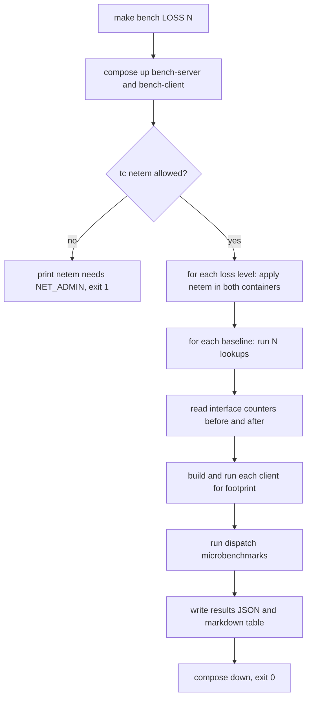
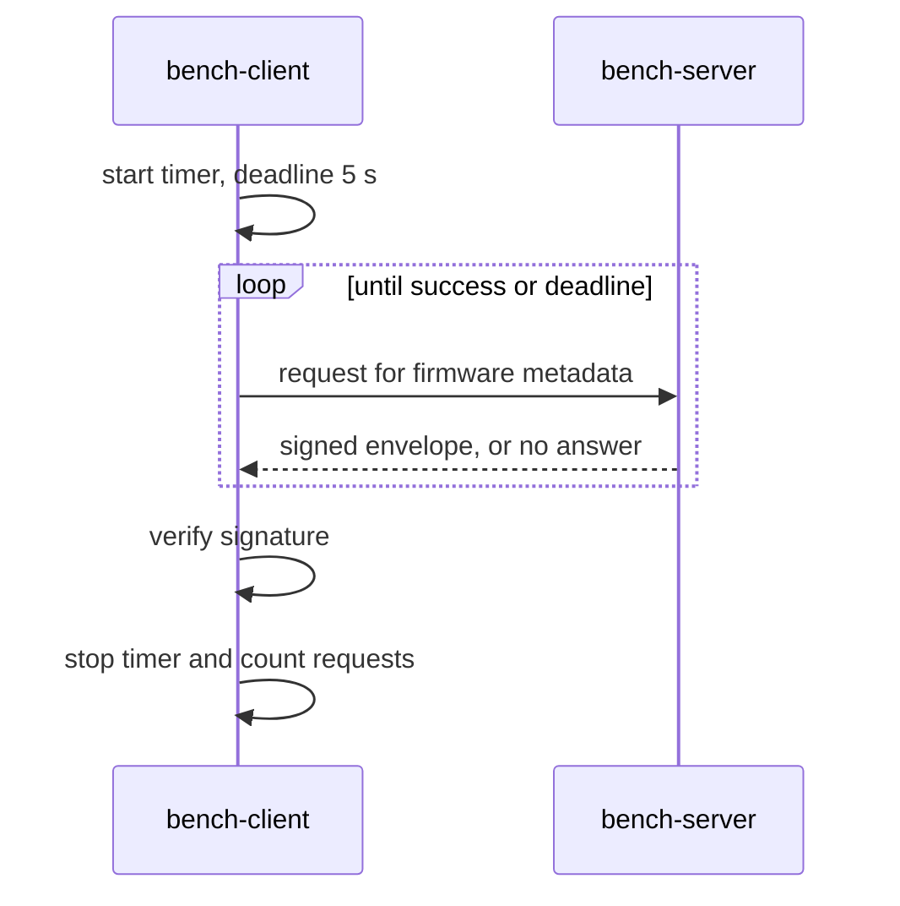

## Purpose

This feature answers the research question with measured numbers. It runs the same
firmware metadata lookup over QMux private classes and over each baseline. Every path
carries the same signed envelope bytes, and every client verifies the signature, so the
work is equal. The benchmark applies the same packet loss to UDP and TCP with netem.

The results separate measured values from assumptions. The findings cite only measured
numbers.

## User stories

- As a researcher, I want one command that measures every baseline at every loss level,
  so that the comparison is reproducible.
- As a researcher, I want the private-class path and the IN-class path to differ only in
  the class, so that a difference in the results comes from the class.
- As a device integrator, I want the binary size, memory and CPU of each client, so that
  I can judge the cost on a small device.
- As a reader of the docs, I want measured results apart from assumptions, so that I
  know what is evidence.

## Functional requirements

### Harness module and baseline servers

- FR-bench-1 — `tests/interoperability` is a Go module with `go 1.26` and a `replace`
  directive to the root module.
- FR-bench-2 — The harness module requires `github.com/plgd-dev/go-coap/v3` v3.8.2.
- FR-bench-3 — The root module does not require go-coap.
- FR-bench-4 — `bench-server` serves the baseline `qmux-private` at QCLASS 65282, QTYPE
  65280, QNAME `device42.fleet.example.`
- FR-bench-5 — `bench-server` serves the baseline `dns-in` at QCLASS IN, QTYPE 65280,
  QNAME `_fw.device42.fleet.example.`
- FR-bench-6 — `bench-server` serves the reference row `dns-in-txt` at QCLASS IN, QTYPE
  16, QNAME `_fw.device42.fleet.example.`
- FR-bench-7 — `bench-server` serves the baseline `coap` as a confirmable GET on
  `/fw/device42` with content-format 60 (`application/cbor`).
- FR-bench-8 — `bench-server` serves the baselines `https-cold` and `https-reuse` as
  `GET /fw/device42` over TLS 1.3.
- FR-bench-9 — Every baseline carries a QMux envelope with the same firmware payload
  bytes.
- FR-bench-10 — The `coap`, `https-cold` and `https-reuse` baselines carry the exact
  envelope bytes of `qmux-private`.
- FR-bench-11 — Every baseline client verifies the envelope signature before it counts a
  lookup as a success.

### Loss shaping

- FR-bench-12 — `tests/interoperability/bench-compose.yaml` runs `bench-server` and
  `bench-client` in two containers with the capability `NET_ADMIN`.
- FR-bench-13 — Before each benchmark run, the harness runs
  `tc qdisc replace dev eth0 root netem delay 10ms loss <X>%` in both containers.
- FR-bench-14 — If a container refuses `NET_ADMIN`, `qmux-bench` exits with code 1 and
  prints `netem needs NET_ADMIN: <tc error>`. `make bench` then fails with the exit code that
  GNU Make gives a failed recipe (2).

### qmux-bench runner

- FR-bench-15 — `qmux-bench` runs the loss levels from `--loss`. The default is
  `0,1,5,10`.
- FR-bench-16 — `qmux-bench` runs `--n` lookups per baseline per loss level. The default is
  500.
- FR-bench-17 — `qmux-bench` runs the lookups of one benchmark run one at a time.
- FR-bench-18 — Each lookup has a deadline of 5 s.
- FR-bench-19 — The DNS baselines use an attempt timeout of 1 s and at most 5 attempts in
  the deadline.
- FR-bench-20 — The `coap` baseline sets `TransmissionAcknowledgeTimeout` to 1 s,
  `TransmissionAcknowledgeRandomFactor` to 1.0 and `TransmissionMaxRetransmit` to 4. The
  first timeout then equals that of the DNS baselines. CoAP doubles each later timeout
  (RFC 7252 § 4.2), so it sends at 0, 1 and 3 s and makes 3 transmissions in the 5 s
  deadline, while each DNS baseline makes 5. The user ruled on 2026-11-20 to keep this
  backoff and the equal deadline. The go-coap v3.8.2 defaults are 2 s, 1.5 and 4
  (`udp/client/config.go`, tag v3.8.2), and they give CoAP even fewer transmissions.
- FR-bench-20a — The results file and the `Assumptions` section state the retry settings of
  every baseline. The HTTPS baselines use the Linux TCP defaults of the client container,
  and the environment block records `net.ipv4.tcp_syn_retries` and the kernel version.
- FR-bench-21 — The `https-cold` baseline opens a new TCP connection and a new TLS session
  for each lookup.
- FR-bench-22 — The `https-reuse` baseline keeps one connection for the whole benchmark
  run.
- FR-bench-23 — Each lookup in the `qmux-private`, `dns-in`, `dns-in-txt`, `coap` and
  `https-cold` baselines uses a new socket.
- FR-bench-24 — For each benchmark run, `qmux-bench` records the success rate.
- FR-bench-25 — For each benchmark run, `qmux-bench` records the median latency and the
  p95 latency of the successful lookups.
- FR-bench-26 — For each benchmark run, `qmux-bench` records the packets and bytes per
  lookup from the deltas of `/sys/class/net/eth0/statistics/{rx,tx}_{packets,bytes}` in
  the client container.
- FR-bench-27 — For each benchmark run, `qmux-bench` records the application requests per
  lookup. The count includes retries and TCP fallback.
- FR-bench-28 — `qmux-bench` writes `results/bench-<UTC timestamp>.json`.
- FR-bench-29 — `qmux-bench` writes a markdown table of the results.
- FR-bench-30 — The results file holds an environment block: CPU model, OS, kernel,
  Docker version, Go version, commit and date.

### Client footprint

- FR-bench-31 — `tests/interoperability/clients/<baseline>` holds one minimal client
  program per baseline. Each program does 100 lookups.
- FR-bench-32 — `qmux-bench` builds each client with `-trimpath -ldflags="-s -w"` and
  records the binary size in bytes.
- FR-bench-33 — `qmux-bench` runs each client as a child process and records the maximum
  resident set size from the child process resource usage.
- FR-bench-34 — `qmux-bench` records the user plus system CPU time of each client from the
  child process resource usage.

### Dispatch microbenchmark

- FR-bench-35 — `pkg/server` holds `BenchmarkDispatchByClass`. It dispatches across 8
  registrations that differ by class.
- FR-bench-36 — `pkg/server` holds `BenchmarkDispatchByLabel`. It dispatches across 8
  protocols under one IN-class protocol key by the first QNAME label.
- FR-bench-37 — `qmux-bench` runs both microbenchmarks and records ns/op and allocs/op.

### Make target and results documentation

- FR-bench-38 — `make bench` runs `qmux-bench` with the variables `LOSS` and `N`.
- FR-bench-39 — `docs/interoperability.md` has a section `Baseline results` with the
  measured table and the environment block.
- FR-bench-40 — `docs/interoperability.md` has a section `Assumptions` that lists every
  assumption of the benchmark apart from the results.
- FR-bench-41 — `docs/interoperability.md` has a section `Findings on the research
  question`.
- FR-bench-42 — Each statement in `Findings on the research question` cites a measured
  number from `Baseline results` that compares `qmux-private` with `dns-in`.

## User flows

### Flow 1 — make bench



1. `make bench` starts `bench-server` and `bench-client`.
2. If `tc` fails, `make bench` prints the netem error and exits with code 1.
3. For each loss level, the harness applies netem in both containers.
4. For each baseline, `qmux-bench` runs N lookups.
5. `qmux-bench` reads the interface counters before and after each benchmark run.
6. `qmux-bench` builds and runs each client program for the footprint values.
7. `qmux-bench` runs the dispatch microbenchmarks.
8. `qmux-bench` writes the results file and the markdown table.
9. `make bench` stops the containers.

### Flow 2 — One lookup



1. The client starts the timer with a deadline of 5 s.
2. The client sends the request.
3. If no answer arrives, the client repeats the request by the policy of the baseline.
4. The client verifies the signature.
5. The client records the latency and the request count.

## Screens & states

QMux has no graphical screens. `qmux-bench` writes to standard output.

```
qmux-bench: 6 baselines x 4 loss levels x 500 lookups
loss 0%   qmux-private  success 100.0%  p50 10.4 ms  p95 10.9 ms  2.0 pkt  410 B
loss 0%   https-cold    success 100.0%  p50 52.1 ms  p95 54.0 ms  14.0 pkt  4810 B
...
qmux-bench: wrote results/bench-20261120T150405Z.json
```

The rows above show the format only. They are not measured results.

Error states:

- netem refused: `netem needs NET_ADMIN: <tc error>`, exit code 1.
- `bench-server` unreachable: `bench-server not ready after 30 s`, exit code 1.

## Behaviour rules

- Each baseline runs at each loss level in a fixed order, so two runs are comparable.
- A lookup that misses its deadline counts as a failure. Its latency is not in the
  median or the p95.
- The latency is the wall-clock time from the first send to the verified envelope.
- The `dns-in-txt` row is labeled `reference` in every table.
- The `https-reuse` row is labeled `connection reuse` in every table.
- netem applies `loss <X>%` on the egress of both containers, so each direction gets X%.
- The harness logs every value that it does not measure as an assumption.

## Data touched

Results file `results/bench-<UTC timestamp>.json`:

| Field | Type |
|---|---|
| `environment` | object: `cpu`, `os`, `kernel`, `docker`, `go`, `commit`, `date` |
| `runs` | array: `baseline`, `loss`, `n`, `success_rate`, `p50_ms`, `p95_ms`, `packets_per_lookup`, `bytes_per_lookup`, `requests_per_lookup` |
| `clients` | array: `baseline`, `binary_bytes`, `max_rss_kib`, `cpu_ms` |
| `dispatch` | array: `name`, `ns_per_op`, `allocs_per_op` |

## Interfaces

```bash
make bench LOSS=0,1,5,10 N=500
```

External interfaces:

- go-coap v3.8.2, https://github.com/plgd-dev/go-coap (README, tag v3.8.2, retrieved
  2026-11-20): client `udp.Dial` and `Conn.Get`, server `mux.NewRouter` and
  `coap.ListenAndServe`.
- CoAP content-format 60 `application/cbor`, RFC 8949 § 9.5 and the IANA CoAP
  Content-Formats registry, https://www.iana.org/assignments/core-parameters.
- netem, https://man7.org/linux/man-pages/man8/tc-netem.8.html (iproute2 man page).
- Interface statistics, https://www.kernel.org/doc/Documentation/ABI/testing/sysfs-class-net-statistics.
- Process resource usage in Go, `os.ProcessState.SysUsage` returning `*syscall.Rusage`,
  https://pkg.go.dev/os#ProcessState.SysUsage (Go 1.26).
- TLS 1.3 in Go, `crypto/tls` with `MinVersion: tls.VersionTLS13`,
  https://pkg.go.dev/crypto/tls (Go 1.26).

## Edge cases & failures

- Every lookup of a benchmark run fails: the success rate is 0, and p50 and p95 are
  null.
- The host is not Linux and Docker is missing: `make bench` prints `docker not found` and
  exits with code 1.
- A client binary fails to build: `qmux-bench` stops and prints the build output.
- The interface counters wrap: not expected at these sizes, and the harness reports a
  negative delta as an error.

## Acceptance criteria

- FR-bench-1 and FR-bench-2: `go list -m all` in `tests/interoperability` shows go-coap
  v3.8.2.
- FR-bench-3: `go list -m all` in the root module does not show go-coap.
- FR-bench-4 to FR-bench-8: one lookup per baseline at loss 0 succeeds in a harness test.
- FR-bench-9 and FR-bench-10: a test compares the payload of every baseline and the
  envelope bytes of the CoAP and HTTPS baselines with `qmux-private`.
- FR-bench-11: an envelope with one changed byte counts as a failed lookup.
- FR-bench-12 and FR-bench-13: `tc qdisc show dev eth0` in each container prints
  `netem delay 10ms loss <X>%` during a benchmark run. At loss 0, `tc` prints
  `netem delay 10ms` with no loss field.
- FR-bench-14: with `NET_ADMIN` removed, `qmux-bench` exits with code 1, `make bench` fails, and the output holds
  `netem needs NET_ADMIN`.
- FR-bench-15 and FR-bench-16: `make bench LOSS=0 N=10` writes runs with `loss: 0` and
  `n: 10`.
- FR-bench-17: the server log shows no two lookups of one benchmark run in parallel.
- FR-bench-18: at loss 100, every lookup fails after about 5 s.
- FR-bench-19: at loss 100, a DNS baseline records 5 requests per lookup.
- FR-bench-20: at loss 100, a `coap` lookup records 3 transmissions of the request.
- FR-bench-20a: the results file holds a `retry` object for every baseline, and the
  environment block holds `tcp_syn_retries`.
- FR-bench-21: the `https-cold` row shows more packets per lookup than the `https-reuse`
  row.
- FR-bench-22: the server counts one TLS handshake in an `https-reuse` benchmark run.
- FR-bench-23: the server sees a new source port for each lookup of the DNS and CoAP
  baselines.
- FR-bench-24 and FR-bench-25: each run object holds `success_rate`, `p50_ms` and
  `p95_ms`.
- FR-bench-26: each run object holds nonzero `packets_per_lookup` and
  `bytes_per_lookup`.
- FR-bench-27: at loss 0, `qmux-private` records 1 request per lookup.
- FR-bench-28 and FR-bench-29: the results file and the markdown table exist after a run.
- FR-bench-30: the results file holds all seven environment fields.
- FR-bench-31 to FR-bench-34: the `clients` array holds one object per baseline with
  nonzero `binary_bytes`, `max_rss_kib` and `cpu_ms`.
- FR-bench-35 to FR-bench-37: the `dispatch` array holds both microbenchmarks.
- FR-bench-38: `make bench LOSS=0 N=10` exits with code 0.
- FR-bench-39 to FR-bench-41: `docs/interoperability.md` holds the three named sections.
- FR-bench-42: each finding contains a number that appears in the `Baseline results`
  table.

## Out of scope

- Throughput or load tests.
- Real radio links, real embedded hardware, and cross-compiled device builds.
- Resolvers in the benchmark path. The interop harness covers resolvers.
- Statistical significance tests beyond the median and the p95.

## Open questions

None. The planner closed these items on 2026-11-20:

- go-coap v3.8.2 defaults are ACK timeout 2 s, random factor 1.5 and 4 retransmissions
  (`udp/client/config.go`). The user chose to set the CoAP timers equal to the DNS timers
  (FR-bench-20).
- A container on the Docker bridge network has the interface `eth0` (verified with
  `ip -o link` in `alpine:3.20`). `qmux-bench` still checks it at start and fails with a
  clear message when it is absent.
