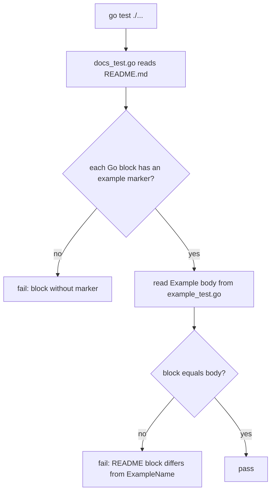

## Purpose

This feature completes the documentation of QMux and proves that every example runs.
Earlier epics write parts of `docs/protocol.md`, `docs/security.md` and
`docs/interoperability.md`. This epic writes `README.md` and `docs/architecture.md`,
checks every doc against the code, and maps each acceptance criterion of the spec to
its proof.

## User stories

- As a protocol developer, I want a README that runs as written, so that I can start in
  minutes.
- As a device integrator, I want the security limitations in the README, so that I know
  what QMux does not protect.
- As a researcher, I want a compatibility table with a date, so that I know which results
  are current.
- As a maintainer, I want a test to fail when a README example drifts from the code, so
  that the docs stay correct.

## Functional requirements

### README

- FR-docs-1 — `README.md` has a section that states what QMux is.
- FR-docs-2 — `README.md` has a section that states what QMux is not: not a DNS tunnel,
  not a replacement for conventional DNS, not a TCP-over-DNS transport.
- FR-docs-3 — `README.md` has a quick start with the exact commands to build, run
  `qmuxd`, query with `qmuxctl`, and run the demonstration.
- FR-docs-4 — `README.md` has working Go examples of a server and a client.
- FR-docs-5 — `README.md` has an architecture overview that links to
  `docs/architecture.md`.
- FR-docs-6 — `README.md` has a section on security limitations: no confidentiality,
  read-only operations, TTL is not a security expiry.
- FR-docs-7 — `README.md` has a compatibility status table copied from the measured
  interop results, with the date and the commit of the run.
- FR-docs-8 — `README.md` states the MIT license, and the repository root holds the
  `LICENSE` file.

### Architecture document

- FR-docs-9 — `docs/architecture.md` holds a mermaid diagram of the package import graph.
- FR-docs-10 — `docs/architecture.md` holds a mermaid sequence diagram of the lifecycle of
  one request from client to handler and back.
- FR-docs-11 — `docs/architecture.md` holds an index of every ADR in `docs/adr/`.
- FR-docs-12 — `docs/architecture.md` holds a section on design tradeoffs. Each tradeoff
  names the alternative and the reason.

### Final doc pass

- FR-docs-13 — `docs/protocol.md` matches the code for every envelope key, status value,
  message type, RCODE rule and default protocol key.
- FR-docs-14 — `docs/security.md` matches the code for every verification error, default
  and limit.
- FR-docs-15 — `docs/interoperability.md` matches the latest results files in `docs/results/`:
  `interop-<UTC date>.json` for the interop matrix and `bench-<UTC timestamp>.json` for the
  baseline benchmark.

### Executable examples

- FR-docs-16 — The root package holds `example_test.go` with one Go `Example` function per
  README Go block.
- FR-docs-17 — Each README Go block follows a line `<!-- example: ExampleName -->`.
- FR-docs-18 — `docs_test.go` in the root package fails when a README Go block differs
  from the body of its `Example` function.
- FR-docs-19 — `docs_test.go` fails when a README Go block has no `<!-- example: … -->`
  line.
- FR-docs-20 — `tests/integration/quickstart_test.go` builds `qmuxd` and `qmuxctl` and runs
  the README quick-start commands in order.
- FR-docs-21 — The quick-start test fails when any command exits with a code other than 0.

### Acceptance map

- FR-docs-22 — `docs/acceptance.md` quotes verbatim each acceptance criterion of the approved
  spec, `docs/specs/features/*.md`.
- FR-docs-23 — `docs/acceptance.md` names, for each criterion, the test, the doc section, the CI job
  or the committed file that proves it.

## User flows

### Flow 1 — A README example drifts



1. `go test ./...` runs `docs_test.go`.
2. `docs_test.go` reads every Go block in `README.md`.
3. If a block has no marker line, the test fails.
4. `docs_test.go` reads the body of the named `Example` function.
5. If the block differs from the body, the test fails and names the function.
6. If every block matches, the test passes.

## Screens & states

QMux has no graphical screens. The docs are markdown files on GitHub.

Test failure output:

```
--- FAIL: TestReadmeExamples
    docs_test.go:41: README.md block 2 differs from ExampleNewClient
```

## Behaviour rules

- The comparison in `docs_test.go` trims leading tabs of one indent level and trailing
  blank lines. It changes nothing else.
- The compatibility table in the README holds only rows from a committed results file.
- Every doc follows the STE rule of `.claude/rules/ste.md` and the spec's `## Terms`.
- Every link in the docs is relative inside the repository.

## Data touched

- `README.md`, `LICENSE`, `docs/architecture.md`, `docs/protocol.md`,
  `docs/security.md`, `docs/interoperability.md`, `docs/acceptance.md`.
- `example_test.go`, `docs_test.go`, `tests/integration/quickstart_test.go`.

## Interfaces

- Go testable examples, https://pkg.go.dev/testing#hdr-Examples (Go 1.25).
- GitHub mermaid rendering,
  https://docs.github.com/en/get-started/writing-on-github/working-with-advanced-formatting/creating-diagrams.

## Edge cases & failures

- An `Example` function has an `// Output:` comment: the test compares the body without
  that comment.
- The README names an `Example` function that does not exist: the test fails and names it.
- The quick-start port is in use: the quick-start test uses a port that the operating
  system selects and passes it to each command.

## Acceptance criteria

- FR-docs-1 to FR-docs-6: `README.md` holds the six named sections.
- FR-docs-7: the README compatibility table states a date and a commit, and every row
  appears in `tests/interoperability/results/results.json` at that commit.
- FR-docs-8: `LICENSE` holds the MIT license text.
- FR-docs-9 and FR-docs-10: GitHub renders both diagrams in `docs/architecture.md`.
- FR-docs-11: every file in `docs/adr/` has a line in the index.
- FR-docs-12: each tradeoff names an alternative.
- FR-docs-13: every envelope key, status value and message type in `pkg/protocol` and
  `pkg/codec` appears in `docs/protocol.md` with the same value.
- FR-docs-14: every exported verification error in `pkg/security` appears in
  `docs/security.md`.
- FR-docs-15: every number in `Baseline results` appears in the latest `docs/results/bench-*.json`.
- FR-docs-16 and FR-docs-17: each README Go block has a marker and a matching `Example`.
- FR-docs-18: a test changes one README line in a temporary copy and the comparison
  fails.
- FR-docs-19: a temporary README copy with an unmarked Go block fails the test.
- FR-docs-20 and FR-docs-21: `go test ./tests/integration -run TestQuickstart` passes.
- FR-docs-22 and FR-docs-23: `docs/acceptance.md` holds one row per acceptance criterion of
  `docs/specs/features/*.md`, and each row names a test or a doc section, or marks the
  criterion as a criterion with no proof.

## Out of scope

- A documentation website or a generated API reference beyond `go doc`.
- Translations.
- Promotion of `dev` to `main`. The PM does it after this epic.

## Open questions
