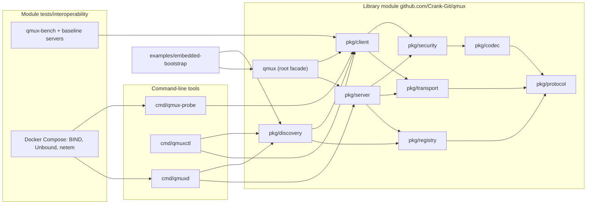
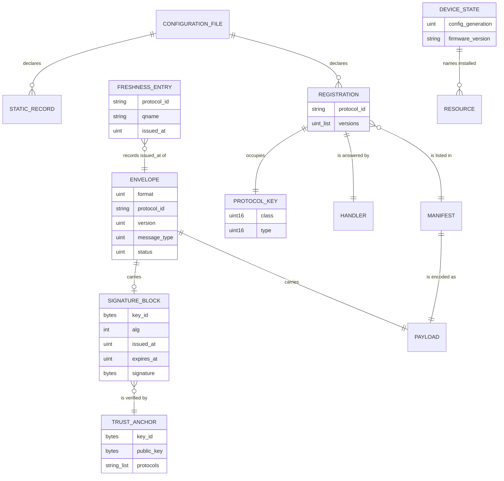

# QMux

## Overview

QMux is a Go framework that runs independent application protocols over DNS. Each protocol
owns a `(QCLASS, QTYPE)` pair, and the `QNAME` identifies the resource. A developer
registers a handler for a protocol key. QMux does all DNS packet processing, the
envelope encoding, and the signatures.

QMux has three parts. The library is importable: an authoritative server, a client SDK,
a protocol registry, a CBOR envelope codec, discovery, and Ed25519 signing. The three
command-line tools are `qmuxd`, `qmuxctl` and `qmux-probe`. The research harness holds an
embedded-device recovery demonstration, a resolver interop matrix, and benchmarks against
IN-class DNS, CoAP and HTTPS.

The project exists to answer one research question. The user stated it as follows:

> "The central research question is whether multiple DNS classes provide a measurable
> benefit for application protocol multiplexing compared with conventional IN-class DNS.
> Design the implementation so that this question can be answered objectively."

Every design choice below keeps that question measurable. The class is the only variable
between the private-class path and the IN-class baseline. The payload bytes, the
signatures and the server code are the same on both paths.

QMux is not a DNS tunnel. It is not a replacement for conventional DNS. It is not a
TCP-over-DNS transport. The source brief is the user's pasted "QMux — Implementation
Specification" (2026-11-20). This spec restates it and adds the decisions from the
planning interview.

## Terms

| Term | Part of speech | Meaning in this project | Do not use |
|---|---|---|---|
| QMux | noun | The whole framework: library, command-line tools and research harness. | the system, the app |
| DNS | noun | Domain Name System, the wire protocol QMux uses. | — |
| QNAME | noun | The domain name in the DNS question. It identifies the resource. | query name, hostname |
| QCLASS | noun | The class field of the DNS question. | query class |
| QTYPE | noun | The type field of the DNS question. | query type, record type |
| RDATA | noun | The data field of a DNS resource record. | record data, rdata blob |
| RR | noun | A DNS resource record. | entry |
| RCODE | noun | The DNS response code, for example `NOERROR` or `REFUSED`. | DNS status, DNS error code |
| EDNS(0) | noun | The DNS extension (RFC 6891) that carries a larger UDP size in an OPT RR. | EDNS0 option, extended DNS |
| TTL | noun | The DNS time-to-live of an RR, in seconds. It controls caching only. | expiry, lifetime |
| CBOR | noun | Concise Binary Object Representation (RFC 8949). | binary JSON |
| private class | noun | A QCLASS value in the IANA private-use range 65280–65534. | custom class, app class |
| private type | noun | A QTYPE value in the IANA private-use range 65280–65534. | custom type, app type |
| reserved class | noun | QCLASS `CH` (3) or `HS` (4). QMux accepts it only when the configuration enables it. | legacy class |
| protocol | noun | One application protocol that QMux carries, for example `org.qmux.firmware`. | service, app, namespace |
| protocol ID | noun | The stable reverse-DNS string that names a protocol. It does not depend on a class or type number. | protocol name, identifier |
| protocol version | noun | An unsigned integer that names one schema of a protocol. | revision, schema version |
| protocol key | noun | The `(QCLASS, QTYPE)` pair that a protocol occupies on one server. Go type `ProtocolKey`. | mapping, slot, route |
| registration | noun | One protocol key bound to one handler and one protocol ID with its supported versions. | binding, entry |
| registry | noun | The concurrency-safe set of registrations in one server. | router, table |
| register | verb | To add a registration to the registry. | bind, add, mount |
| unregister | verb | To remove a registration from the registry. | unbind, remove |
| remap | verb | To move a protocol ID to a different protocol key. | reassign, renumber |
| handler | noun | The application code that answers requests for one registration. Go interface `Handler`. | callback, plugin, controller |
| request | noun | The parsed DNS question plus source and metadata that QMux passes to a handler. | call, message |
| response | noun | What a handler returns: payload, TTL, application status and protocol version. | reply, result |
| query | noun | One DNS question that a client sends. | lookup (except in benchmarks), call |
| result | noun | What the client SDK returns for a successful query. | answer, reply |
| zone | noun | A domain suffix for which a server is authoritative, for example `fleet.example.` | domain, origin |
| authoritative server | noun | A QMux server that answers from its registry. It never recurses. | nameserver, daemon |
| resolver | noun | A recursive DNS server between a client and the authoritative server, for example BIND or Unbound. | proxy, forwarder, stub |
| direct query | noun | A query that the client sends to the authoritative server with no resolver. | authoritative query |
| transport | noun | UDP or TCP, as a DNS carrier. | channel, protocol |
| truncation | noun | The authoritative server sets the TC bit because the answer does not fit the UDP size limit. | overflow, cut |
| TCP fallback | noun | The client repeats a truncated UDP query over TCP. | retry over TCP, upgrade |
| UDP size limit | noun | The largest UDP response the authoritative server sends for one query. | MTU, buffer size |
| envelope | noun | The CBOR map that every QMux answer RR carries as its RDATA. | wrapper, frame, container |
| payload | noun | The protocol-specific bytes inside an envelope. | body, data, content |
| message type | noun | The envelope field that names the kind of envelope, for example `record` or `manifest`. | kind, op |
| application status | noun | The envelope field that states the application outcome, separate from the RCODE. | app error, status code |
| signature block | noun | The envelope field that holds the key ID, the validity window and the Ed25519 signature. | sig, signature metadata |
| signing input | noun | The deterministic CBOR bytes that a signature covers. | signed data, canonical form |
| sign | verb | To compute an Ed25519 signature over a signing input. | — |
| verify | verb | To check a signature against a trust anchor and check freshness. | validate (for signatures), check |
| key ID | noun | The first 8 bytes of the SHA-256 digest of an Ed25519 public key. | key fingerprint, kid |
| trust anchor | noun | A provisioned Ed25519 public key that a client accepts signatures from. | root key, trusted key |
| validity window | noun | The interval from `issued_at` to `expires_at` in a signature block. | lifetime, TTL |
| freshness | noun | The property that a verified envelope is inside its validity window and is not older than one the client already accepted. | recency |
| freshness store | noun | The client-side record of the newest `issued_at` per protocol ID and QNAME. | replay cache, nonce store |
| discovery | noun | The mechanism by which a client learns the protocols a server supports. | probing (not the probe), lookup |
| discovery name | noun | The QNAME `_qmux.<zone>` that carries the manifest. | discovery QNAME, well-known name |
| discovery key | noun | The protocol key that carries the manifest. The default is `(65280, 65534)`. | bootstrap key |
| manifest | noun | The signed discovery payload that lists every registration of one server. | catalog, directory |
| negotiate | verb | To pick the highest protocol version that both the client and the manifest support. | agree, select |
| version label | noun | The optional leftmost QNAME label `_v<N>` that names the requested protocol version. | version prefix |
| configuration file | noun | The JSON file that `qmuxd` reads at start. | config, settings file |
| static record | noun | A payload for one QNAME that the configuration file declares. | fixture, entry |
| observation log | noun | The JSONL file in which `qmuxd` writes one line per received query. | query log, access log |
| probe | noun | One query that `qmux-probe` sends for one combination of path, transport, class and type. | test case, check |
| probe protocol | noun | The echo protocol `org.qmux.probe.<class>-<type>` that `qmuxd` serves for interop runs, one protocol ID for each class and type pair. | test protocol |
| path | noun | The route of a probe: direct, through BIND, or through Unbound. | route, hop |
| interop matrix | noun | The table of probe outcomes over every path, transport, class and type. | compatibility table |
| baseline | noun | One of the comparison implementations: IN-class DNS, IN + TXT, CoAP or HTTPS. | alternative, competitor |
| lookup | noun | One retrieval of the firmware metadata in a benchmark run. | fetch, request (in benchmarks) |
| benchmark run | noun | One execution of N lookups for one baseline at one loss level. | trial, session |
| loss level | noun | The packet-loss percentage that netem applies in a benchmark run. | drop rate |
| device | noun | The simulated industrial controller in the embedded demonstration. | node, client device, agent |
| device state | noun | The JSON file that holds the device's installed configuration generation and firmware version. | local state, inventory |
| reconcile | verb | To compare the device state with verified remote metadata and download only the resources that changed. | sync, update, refresh |
| resource | noun | A configuration bundle or a firmware image that the mock HTTPS service serves. | artifact, file, blob |
| configuration generation | noun | The unsigned integer that names one approved configuration bundle. | config version, revision |
| management endpoint | noun | The URL that the bootstrap protocol returns for device management. | management URL, control endpoint |
| firmware signing key ID | noun | The key ID of the key that signed a firmware image. The firmware payload carries it. | firmware key, image signer |
| data directory | noun | The directory where the device stores downloaded resources. | download folder, storage dir |
| signing key | noun | The Ed25519 private key with which the authoritative server signs envelopes. | private key file, server key |
| token bucket | noun | The per-source rate-limit counter in the authoritative server. | throttle, limiter bucket |
| cache file | noun | One file in the manifest cache that holds the raw envelope of one zone. | cache entry |
| golden vector | noun | A committed CBOR file that a compatibility test decodes and encodes again. | fixture, test vector |
| reference row | noun | A benchmark row that is measured for comparison only, for example IN + TXT. | control row |
| client footprint | noun | The binary size, maximum RSS and CPU time of a minimal client binary. | client overhead |
| ADR | noun | Architecture Decision Record, one file in `docs/adr/`. | design note |
| CI | noun | Continuous Integration: the GitHub Actions workflows of the repository. | pipeline |
| FR | noun | A functional requirement, numbered `FR-<feature>-<n>`. | requirement item |

## Goals

1. Two or more protocols answer through independent private classes on one authoritative
   server, over UDP and over TCP.
2. A client discovers the protocols of a server, negotiates a protocol version, and queries
   each protocol with no hard-coded class numbers other than the discovery key.
3. Every answer RR carries a deterministic CBOR envelope, and the client decodes it strictly.
4. A client with trust anchors rejects each tampered, expired, replayed, mis-bound or
   unsigned envelope, and reports the reason.
5. The embedded demonstration reconciles a stale device end to end with one command.
6. The interop matrix is reproducible with one command on any host with Docker, and CI runs it.
7. The benchmark measures QMux private classes against IN + private type, IN + TXT, CoAP and
   HTTPS with equal payloads. The results separate measured values from assumptions.
8. `go test ./...`, `go test -race ./...`, `go vet ./...` and the linter pass on every batch PR.
9. The library module depends on two third-party modules only: miekg/dns and fxamacker/cbor.

## Non-goals

- DNS tunnels, payload fragmentation, or DNS-based file transfer.
- Recursive resolution, delegation, zone transfer, DNSSEC signing, or dynamic update.
- A DNS management platform, a web frontend, a database, or Kubernetes.
- State-changing operations: remote command execution, arbitrary RPC, device control.
- Firmware flashing in the demonstration.
- Public-resolver compatibility claims. QMux tests BIND and Unbound only.
- Confidentiality. DNS carries the envelope in clear text. Signatures give integrity and
  origin authentication only.
- A packaged release, a container registry push, or a hosted deployment in v1.
- An EDNS option that carries the protocol version. Version 1 uses the version label only.
- Private-class resolution through Unbound with custom root hints.

## Users & personas

| Persona | Needs | Allowed to |
|---|---|---|
| Protocol developer | Registers a handler for a protocol and gets DNS handling, envelopes and signatures from QMux. | Import the library, run `qmuxd`, define protocol IDs, choose private classes and types. |
| Device integrator | Embeds the client SDK in a device and needs verified, small metadata answers after an outage. | Provision trust anchors, run the client, read results. |
| Operator | Runs `qmuxd` with a configuration file and a signing key. | Edit the configuration file, generate keys with `qmuxctl keygen`, read the observation log. |
| Researcher | Runs the interop matrix and the benchmark and reads the results. | Run `make interop` and `make bench`, edit loss levels and sample counts. |

## Feature map

| Feature set | Spec file | Epic | Mockups |
|---|---|---|---|
| Foundation | [features/00-foundation.md](features/00-foundation.md) | Epic 0: Foundation | — |
| Protocol registry | [features/01-protocol-registry.md](features/01-protocol-registry.md) | Epic 1: Protocol registry | — |
| Authoritative server | [features/02-authoritative-server.md](features/02-authoritative-server.md) | Epic 2: Authoritative server | — |
| Client SDK | [features/03-client-sdk.md](features/03-client-sdk.md) | Epic 3: Client SDK | — |
| Envelope codec | [features/04-envelope-codec.md](features/04-envelope-codec.md) | Epic 4: Envelope codec | — |
| Discovery | [features/05-discovery.md](features/05-discovery.md) | Epic 5: Discovery and version negotiation | — |
| Signing and freshness | [features/06-signing-and-freshness.md](features/06-signing-and-freshness.md) | Epic 6: Signing and freshness | — |
| Embedded recovery | [features/07-embedded-recovery.md](features/07-embedded-recovery.md) | Epic 7: Embedded recovery demonstration | — |
| qmuxd daemon | [features/08-qmuxd-daemon.md](features/08-qmuxd-daemon.md) | Epic 8: qmuxd daemon | — |
| Interop harness | [features/09-interop-harness.md](features/09-interop-harness.md) | Epic 9: Interop harness | — |
| Baseline benchmarks | [features/10-baseline-benchmarks.md](features/10-baseline-benchmarks.md) | Epic 10: Baseline benchmarks | — |
| Documentation | [features/11-documentation.md](features/11-documentation.md) | Epic 11: Documentation | — |

QMux has no graphical screens, so the spec has no mockups. Each feature file states the
command-line output in place of screens.

## Architecture & stack



The arrows show Go import direction. No package imports a package to its left in the
list below, so the graph has no cycles.

| Package | Purpose | Imports (QMux only) |
|---|---|---|
| `pkg/protocol` | Core types: `ProtocolKey`, `Info`, `Request`, `Response`, `Handler`, `Status`, `MessageType`, range checks. | none |
| `pkg/registry` | Concurrency-safe registrations, conflict checks, remap, list. | protocol |
| `pkg/codec` | Envelope encode and decode, deterministic CBOR options, size limits. | protocol |
| `pkg/transport` | The only package that imports miekg/dns. Builds queries, packs opaque RDATA, applies EDNS(0) and the UDP size limit, matches answers. | protocol |
| `pkg/security` | Key IDs, signer, verifier, trust anchors, freshness store, key files. | protocol, codec |
| `pkg/server` | The authoritative server: listeners, validation, dispatch, envelopes, signing, rate limits, logging, shutdown. | protocol, registry, codec, transport, security |
| `pkg/client` | The client SDK: UDP, TCP fallback, retries, matching, decoding, verification. | protocol, codec, transport, security |
| `pkg/discovery` | Manifest schema, the discovery handler, client-side discovery, negotiation and manifest cache. | protocol, registry, codec, security, client |
| `qmux` (root) | Type aliases and constructors so the brief's API compiles as written: `qmux.NewServer`, `qmux.ProtocolKey`, `qmux.NewClient`, `qmux.Query`. | server, client, protocol |

Stack decisions:

| Choice | Pinned version | Why it beat the alternative | Documentation |
|---|---|---|---|
| Go | module directive `go 1.25`, CI on Go 1.25 and the latest stable Go | The brief requires Go 1.24 or newer. miekg/dns v1.1.73 declares `go 1.25.0`. | https://go.dev/doc/devel/release |
| `github.com/miekg/dns` | v1.1.73 | The brief names it. Its API is stable. It has `RFC3597` and `PrivateHandle` for opaque RDATA. The successor `codeberg.org/miekg/dns` is v0.6.x, allows API breaks, needs Go 1.27, and has no confirmed private-type API. v1 gets fixes only, so `pkg/transport` is the only importer. See ADR 0001. | https://github.com/miekg/dns (README, v1.1.73), verified with `go doc` and a pack/unpack test on 2026-11-20 |
| `github.com/fxamacker/cbor/v2` | v2.10.0 | It has RFC 8949 core deterministic encoding (`CoreDetEncOptions`) and strict decode limits. Its go.mod declares `go 1.24`. | https://pkg.go.dev/github.com/fxamacker/cbor/v2@v2.10.0 |
| Ed25519 | Go standard library `crypto/ed25519` | Standard library, fixed 32-byte keys and 64-byte signatures. | https://pkg.go.dev/crypto/ed25519 |
| Logging | `log/slog` | Standard library structured logging. | https://pkg.go.dev/log/slog |
| CoAP baseline | `github.com/plgd-dev/go-coap/v3` v3.8.2, in the `tests/interoperability` module only | It is maintained. Its go.mod declares `go 1.26.0`, so it stays out of the library module. See ADR 0002. | https://github.com/plgd-dev/go-coap (README, v3.8.2) |
| BIND | Docker image `internetsystemsconsortium/bind9:9.20` | Official ISC image. | https://hub.docker.com/r/internetsystemsconsortium/bind9 |
| Unbound | Docker image `klutchell/unbound:1.26.2` | NLnet Labs publishes no official image. This image is maintained and matches upstream 1.26.2. `mvance/unbound` stopped at 1.22.0 in 2024. | https://hub.docker.com/r/klutchell/unbound |
| Packet loss | Linux `tc netem` in Docker containers with `NET_ADMIN` | It applies the same loss to UDP and TCP, so the HTTPS baseline is fair. See ADR 0003. | https://man7.org/linux/man-pages/man8/tc-netem.8.html |
| Lint | `golangci-lint` v2, version pinned by Epic 0 | It runs `gocyclo`, `nestif`, `unused` and `errcheck` in one tool. | https://golangci-lint.run/ |
| CI | GitHub Actions | The repository is on GitHub. | https://docs.github.com/actions |

Two Go modules exist:

- The library module `github.com/Crank-Git/qmux` at the repository root holds `pkg/`,
  `cmd/`, `examples/` and `tests/integration/`.
- The harness module at `tests/interoperability/` holds the baselines and `qmux-bench`.
  It uses a `replace` directive to the root module. It keeps go-coap out of the library
  dependency graph.

QMux has no deploy target. Nothing runs in production. CI is the only automated
environment.

## Data model

QMux has no database. The entities below are wire structures, files and in-memory
records.



### Envelope (RDATA of every answer RR, from Epic 4)

A CBOR map with unsigned integer keys, encoded with `cbor.CoreDetEncOptions()`.

| Key | Field | CBOR type | Constraint |
|---|---|---|---|
| 0 | format | uint | Must be `1`. |
| 1 | protocol ID | text | 1–128 bytes, reverse-DNS form, lowercase `[a-z0-9.-]`. |
| 2 | protocol version | uint | 1–65535. |
| 3 | message type | uint | `1` = record, `2` = manifest. 256–65535 are protocol-specific. |
| 4 | application status | uint | See the status table. |
| 5 | payload | bytes | Length 0 to the payload limit. |
| 6 | signature block | map | Optional on the wire. Required when the client has trust anchors. |

Envelope limits: the envelope is at most 16384 bytes by default. The configured maximum
is never above 65000 bytes. The decoder rejects unknown keys, duplicate keys,
indefinite lengths, tags, invalid UTF-8, and nesting deeper than 8 levels.

Application status:

| Value | Name | Meaning |
|---|---|---|
| 0 | `ok` | The payload holds the requested resource. |
| 1 | `not-found` | The protocol has no resource for the QNAME. |
| 2 | `bad-request` | The QNAME labels do not parse for this protocol. |
| 3 | `version-unsupported` | The version label names a version the registration does not support. |
| 4 | `unavailable` | The handler cannot answer now. |
| 256–65535 | protocol-specific | The protocol defines the meaning. |

### Signature block (envelope key 6, from Epic 6)

| Key | Field | CBOR type | Constraint |
|---|---|---|---|
| 1 | key ID | bytes | Exactly 8 bytes. |
| 2 | algorithm | int | `-8` (EdDSA, RFC 9053). Other values are rejected. |
| 3 | issued_at | uint | Unix seconds. |
| 4 | expires_at | uint | Unix seconds. Greater than `issued_at`. |
| 5 | signature | bytes | Exactly 64 bytes. |

The signing input is the deterministic CBOR encoding of this array:

```
["qmux-sig/1", qname, qclass, qtype, format, protocol_id, version,
 message_type, status, payload, key_id, alg, issued_at, expires_at]
```

`qname` is the lowercase fully qualified QNAME. The signature binds the resource name,
the class, the type and the protocol ID. A valid envelope copied to another QNAME or
another protocol key fails verification.

### Manifest payload (message type 2, from Epic 5)

| Key | Field | CBOR type |
|---|---|---|
| 1 | framework version | uint, `1` |
| 2 | zone | text |
| 3 | protocols | array of maps: `{1: protocol ID, 2: [versions], 3: class, 4: type}` |

### Files

| File | Format | Owner |
|---|---|---|
| Configuration file | JSON, read by `qmuxd`. Schema in features/08-qmuxd-daemon.md. | Operator |
| Signing key | PKCS#8 PEM, Ed25519, mode 0600, written by `qmuxctl keygen`. | Operator |
| Trust anchor file | JSON `{"anchors":[{"key_id":"<hex>","public_key":"<base64>","protocols":["<protocol ID>"]}]}`. An empty `protocols` list allows every protocol ID. | Device integrator |
| Manifest cache | One file per zone that holds the raw envelope bytes. The client verifies the file again on load. | Client SDK |
| Observation log | JSONL, one object per received query. | `qmuxd` |
| Device state | JSON `{"config_generation":N,"firmware_version":"x.y.z"}`. | Demonstration |
| Interop results | JSON, one object per probe. | `qmux-probe` |
| Benchmark results | JSON plus a generated markdown table. | `qmux-bench` |

## Cross-cutting concerns

### Protocol key allocation

- The registry accepts private classes 65280–65534 and IN (1).
- The registry accepts a reserved class only when `AllowReservedClasses` is true.
- The registry rejects every other class, for example 0, 254 (NONE) and 255 (ANY).
- The registry accepts private types 65280–65534.
- The registry accepts a non-private type only when `AllowNonPrivateTypes` is true. That
  option exists for the TXT reference row of the benchmark and probe.
- The registry always rejects the types 0, OPT (41), TSIG (250), IXFR (251), AXFR (252),
  ANY (255) and the reserved type 65535.
- Class and type numbers are local to one server. A protocol ID is the stable name. The
  manifest maps protocol IDs to protocol keys.

The demonstration uses these defaults:

| Protocol ID | QCLASS | QTYPE |
|---|---|---|
| `org.qmux.discovery` | 65280 | 65534 |
| `org.qmux.bootstrap` | 65280 | 65280 |
| `org.qmux.configuration` | 65281 | 65280 |
| `org.qmux.firmware` | 65282 | 65280 |
| `org.qmux.probe.<class>-<type>` | as the interop configuration lists | as the interop configuration lists |

### Error semantics

The RCODE reports DNS-level outcomes. The application status reports application
outcomes. They never overlap.

| Condition | RCODE | Answer |
|---|---|---|
| A registration answers, with any application status | `NOERROR`, AA set | One RR with the envelope |
| The question count is not 1, or the packet does not parse | `FORMERR` | none |
| The opcode is not QUERY | `NOTIMP` | none |
| No registration for the protocol key | `REFUSED` | none |
| The QNAME is outside every configured zone | `REFUSED` | none |
| The source exceeds its rate limit | `REFUSED` | none |
| The handler returns an error, times out, or the envelope exceeds limits | `SERVFAIL` | none |
| The EDNS version is above 0 | `BADVERS` | none |

The client returns three separate Go error types:

- `*client.DNSError` for an RCODE that is not `NOERROR`, a transport failure, a timeout,
  or a mismatch between the question and the answer.
- `*client.AppError` for an application status that is not `ok`.
- `*client.VerifyError` for a signature or freshness failure.

### Security posture

- DNS gives no confidentiality, no integrity and no authentication. QMux assumes an
  on-path attacker can read, drop, replay and forge packets.
- A client with trust anchors verifies every envelope before it returns any field.
- A client with trust anchors never returns an unsigned or unverifiable envelope. No
  silent fallback exists.
- A client with no trust anchors returns results with `Verified: false`. Discovery
  refuses to run without trust anchors unless the caller sets `InsecureSkipVerify`.
- The TTL is never a security expiry. Only `expires_at` is.
- QMux supports read-only operations only.
- The server enforces a maximum query size of 512 bytes without EDNS(0) and 1232 bytes
  with it. It enforces the envelope limit and an optional per-source rate limit.
- Fuzz tests cover the envelope decoder, the server request path and the verifier.

### Logging

The server and `qmuxd` log with `log/slog`. One record per query carries `qname`,
`qclass`, `qtype`, `transport`, `source`, `rcode`, `status`, `bytes_in`, `bytes_out` and
`duration_ms`. The default level is `info`. The library never logs payload bytes or
private keys.

### Performance targets

- A direct UDP query on loopback completes in under 2 ms at the median. This is a
  target, not a claim. The benchmark measures it.
- A normal response fits in 1232 bytes, so it travels over UDP with no truncation.
- The server handles 100 concurrent queries with no data race under `go test -race`.

### Timeouts and defaults

| Setting | Default |
|---|---|
| Server UDP size limit with EDNS(0) | 1232 bytes |
| Server UDP size limit without EDNS(0) | 512 bytes |
| Handler timeout | 2 s |
| Server read and write timeout | 2 s |
| Graceful shutdown grace period | 5 s |
| Default response TTL | 60 s |
| Signature validity | 1 h |
| Client attempt timeout | 1 s |
| Client attempts over UDP | 3 |
| Client advertised UDP size | 1232 bytes |
| Allowed clock skew | 60 s |
| Longest validity window a client accepts | 24 h |

## Environments & config

| Environment | Purpose |
|---|---|
| Local | A developer runs `make test`, `make interop`, `make bench` and the demonstration. |
| CI | GitHub Actions runs the test, race, vet and lint jobs on every PR to `dev` and `main`. A second workflow runs the interop matrix. |

QMux reads no environment variables. Every setting is a Go config struct field or a
command-line flag. `qmuxd` reads its configuration file from `--config`.

Secrets:

- Signing keys are generated with `qmuxctl keygen` and are never committed.
- `.gitignore` excludes `*.key`.
- Tests derive keys from fixed seeds in test code with `ed25519.NewKeyFromSeed`.
- The demonstration generates a fresh key at each start.

Seed data:

- `examples/qmuxd.json` is a working configuration file for the three demonstration
  protocols.
- `tests/interoperability/qmuxd.json` is the probe configuration.

## Testing strategy

| Layer | Location | What it covers |
|---|---|---|
| Unit | `pkg/**/*_test.go` | Every FR in the library packages. Table tests. |
| Fuzz | `pkg/codec`, `pkg/server`, `pkg/security` | `FuzzDecodeEnvelope`, `FuzzServeMessage`, `FuzzVerify`. CI runs the seed corpus. `make fuzz` runs each target for `FUZZTIME` (default 30s). |
| Integration | `tests/integration/` | Real UDP and TCP listeners on loopback: two protocols, truncation and TCP fallback, concurrency, shutdown under load, discovery, verification failures. |
| Example | `example_test.go`, `examples/embedded-bootstrap` | Go `Example` functions that the README quotes. The demonstration runs as a test. |
| Interop | `tests/interoperability/` | Docker Compose matrix through BIND and Unbound. CI asserts that the direct path passes. It records resolver outcomes as data. |
| Benchmark | `tests/interoperability/` | `make bench`. Local only, because shared runners give unstable timings. |

A change is done when these commands pass:

```bash
go vet ./...
go test ./...
go test -race ./...
golangci-lint run
```

A change that touches `tests/interoperability/` also passes `make interop`.

## Epics

Every epic is one batch, one PR into `dev`, and one CI run.

| Epic | Goal | Feature file | Depends on | Exit criteria |
|---|---|---|---|---|
| Epic 0: Foundation | The repository builds, tests and lints. The DNS library is proven for private classes and opaque RDATA. | 00-foundation | — | A fresh clone passes `make check`. The wire-format test passes. CI runs on a PR to `dev`. |
| Epic 1: Protocol registry | Protocol keys, protocol IDs and registrations exist and are safe for concurrency. | 01-protocol-registry | Epic 0 | Conflict, remap and range tests pass under `-race`. |
| Epic 2: Authoritative server | The server answers registered protocol keys with opaque RDATA over UDP and TCP. | 02-authoritative-server | Epic 1 | The RCODE table tests pass. Truncation and shutdown tests pass. |
| Epic 3: Client SDK | The client queries over UDP with TCP fallback, and `qmuxctl query` works. | 03-client-sdk | Epic 2 | Phase 1 deliverable: two protocols answer through two private classes in an integration test. |
| Epic 4: Envelope codec | Every answer carries a strict deterministic CBOR envelope. | 04-envelope-codec | Epic 3 | Golden vectors and fuzz seeds pass. Server and client use the envelope. |
| Epic 5: Discovery and version negotiation | A client discovers protocols and negotiates versions. `qmuxctl discover` works. | 05-discovery | Epic 4 | Phase 2 deliverable: an integration test discovers and queries every registration. |
| Epic 6: Signing and freshness | Envelopes are signed, and clients reject bad ones. | 06-signing-and-freshness | Epic 5 | Phase 3 deliverable: tampered, expired, replayed, mis-bound and unsigned envelopes fail with distinct errors. |
| Epic 7: Embedded recovery demonstration | A stale device reconciles through three protocols and a mock HTTPS service. | 07-embedded-recovery | Epic 6 | Phase 4 deliverable: the demonstration test passes for the stale, current and tampered cases. |
| Epic 8: qmuxd daemon | `qmuxd serve` runs from a configuration file, with rate limits and an observation log. | 08-qmuxd-daemon | Epic 7 | `qmuxd` serves `examples/qmuxd.json`, and `qmuxctl` verifies every protocol. |
| Epic 9: Interop harness | `qmux-probe` and the Docker Compose matrix record outcomes over every path. | 09-interop-harness | Epic 8 | `make interop` writes `results.json`. The CI interop workflow passes. |
| Epic 10: Baseline benchmarks | The private-class path is measured against the four baselines. | 10-baseline-benchmarks | Epic 9 | Phase 5 deliverable: `make bench` writes results, and `docs/interoperability.md` holds a measured table. |
| Epic 11: Documentation | README and every doc in `docs/` are complete, and every example runs. | 11-documentation | Epic 10 | The docs example test passes. Each acceptance criterion in § 15 of the brief maps to a test or a doc section. |

Epic 8 depends on Epic 7, because `examples/qmuxd.json` uses the payload schemas that Epic 7 defines.

## Milestones

| Milestone | After | Shippable means |
|---|---|---|
| M0 | Epic 0 | Green CI on an empty but structured module. |
| M1 — Phase 1 | Epic 3 | Raw binary exchange over two private classes, UDP and TCP. |
| M2 — Phase 2 | Epic 5 | Envelopes, discovery and version negotiation. |
| M3 — Phase 3 | Epic 6 | Signed envelopes, verified by default when trust anchors exist. |
| M4 — Phase 4 | Epics 7 and 8 | The demonstration and the daemon work end to end. |
| M5 — Phase 5 | Epics 9 and 10 | Reproducible interop matrix and benchmark results. |
| M6 | Epic 11 | Every acceptance criterion of the brief holds. `dev` is promoted to `main`. |

## Assumptions

1. The module path is `github.com/Crank-Git/qmux`, and the license is MIT.
2. A root package `qmux` holds type aliases and constructors, so the brief's API examples
   compile without change. The real code lives in `pkg/`. See ADR 0004.
3. `pkg/transport` is the DNS wire layer and the only importer of miekg/dns.
4. Discovery uses the protocol key `(65280, 65534)` and the discovery name `_qmux.<zone>`.
   The IN option uses `(1, 65534)` with the same discovery name.
5. A request names its protocol version with an optional leftmost QNAME label `_v<N>`. With no
   version label, the server uses the highest version of the registration. A QNAME label
   passes through every resolver, but an EDNS option can be stripped.
6. The authoritative server signs each envelope at answer time (online signing). Handlers
   never sign.
7. Replay protection uses the validity window plus a monotonic `issued_at` check per
   protocol ID and QNAME in the freshness store. QMux uses no nonces, because a DNS
   question carries no client nonce through a resolver cache.
8. The decoder enforces deterministic encoding for signed data: it decodes the envelope,
   encodes it again, and compares the bytes. fxamacker/cbor has no decode option that
   rejects non-deterministic input.
9. The IN-class baseline uses QCLASS IN, QTYPE 65280, and a protocol label in the QNAME
   (`_fw.device42.fleet.example.`). The class is then the only variable.
10. The IN + TXT reference row splits the same envelope bytes into TXT character-strings
    of at most 255 bytes. QMux protocols never use TXT.
11. Each benchmark lookup is cold: a new UDP socket, TCP connection or TLS session. HTTPS
    with connection reuse is a second, labeled row.
12. Rate limiting is a per-source-IP token bucket written in QMux. The library default is
    off. The `qmuxd` default is 50 queries per second with a burst of 100.
13. Version 1 has no release process. Promotion of `dev` to `main` is the release.

## Risks & open questions

- **Resolvers drop private classes (measured risk, not blocking).** BIND 9.20 disables
  recursion for every non-IN view (`server.c`, `bind-9.20` branch). A planner test on
  2026-11-20 confirmed it: BIND loads a class-65281 view, logs `recursion will be disabled
  for non-IN view 'priv'`, and answers a class-65281 query with `NOTIMP`. Unbound 1.26.2
  documents "Class IN is assumed" for `stub-zone` and `forward-zone`. Private-class
  probes through both resolvers will most likely fail. The interop matrix records the
  result. The docs state it as a finding. Only direct queries can carry private
  classes. Sources:
  - https://gitlab.isc.org/isc-projects/bind9 (`bind-9.20`)
  - https://github.com/NLnetLabs/unbound (`release-1.26.2`)
  - https://unbound.docs.nlnetlabs.nl/en/latest/manpages/unbound.conf.html
- **The BIND image is amd64 only.** On an arm64 host it runs under emulation, so its
  latency is not comparable. Each probe record labels the architecture. The CI run on
  amd64 is the reference run. The benchmark does not use BIND.
- **Unbound serves expired answers by default** (`serve-expired: yes` in the image). The
  interop configuration sets `serve-expired: no`.
- **DNSSEC validation in the resolvers.** Both resolvers validate by default. The
  interop configuration marks `fleet.example.` as insecure (`domain-insecure` in Unbound,
  `validate-except` in BIND), so validation does not hide the class result.
- **miekg/dns v1 is in maintenance mode.** It gets fixes only and will be archived. ADR 0001
  confines it to `pkg/transport`.
- **netem needs `NET_ADMIN`.** Docker Desktop on macOS supports it inside its Linux VM.
  A host that refuses the capability cannot run `make bench`. The benchmark then exits
  with a clear error.
- **Retry timers are a confound in the benchmark.** The go-coap defaults (2 s, factor 1.5)
  differ from the DNS client (1 s). The user chose equal timers for DNS and CoAP. HTTPS
  uses the Linux TCP defaults, and the results record them.

No open question remains. Two items moved to the non-goals: an EDNS option for the
protocol version, and Unbound root hints for a private class.

## Issue map

spec-to-issues created these issues on 2026-11-20 in `Crank-Git/qmux`.

| Epic | Epic issue | Sub-issues |
|---|---|---|
| Epic 0: Foundation | #1 | #13, #14, #15, #16 |
| Epic 1: Protocol registry | #2 | #17, #18, #19, #20 |
| Epic 2: Authoritative server | #3 | #21, #22, #23, #24, #25 |
| Epic 3: Client SDK | #4 | #26, #27, #28, #29, #30, #31 |
| Epic 4: Envelope codec | #5 | #32, #33, #34, #35, #36 |
| Epic 5: Discovery and version negotiation | #6 | #37, #38, #39, #40, #41, #42 |
| Epic 6: Signing and freshness | #7 | #43, #44, #45, #46, #47, #48 |
| Epic 7: Embedded recovery demonstration | #8 | #49, #50, #51, #52, #53 |
| Epic 8: qmuxd daemon | #9 | #54, #55, #56, #57, #58, #59 |
| Epic 9: Interop harness | #10 | #60, #61, #62, #63, #64 |
| Epic 10: Baseline benchmarks | #11 | #65, #66, #67, #68, #69, #70 |
| Epic 11: Documentation | #12 | #71, #72, #73, #74, #75 |

### FR → issue

| Feature | Issue | FRs |
|---|---|---|
| foundation | #13 | FR-foundation-1, FR-foundation-2, FR-foundation-3, FR-foundation-4, FR-foundation-5, FR-foundation-6, FR-foundation-7, FR-foundation-8, FR-foundation-9 |
| foundation | #14 | FR-foundation-10, FR-foundation-11, FR-foundation-12, FR-foundation-13, FR-foundation-14, FR-foundation-15, FR-foundation-16, FR-foundation-17, FR-foundation-18, FR-foundation-19, FR-foundation-20 |
| foundation | #15 | FR-foundation-21, FR-foundation-22, FR-foundation-23, FR-foundation-24, FR-foundation-25, FR-foundation-26, FR-foundation-27 |
| foundation | #16 | FR-foundation-28, FR-foundation-29, FR-foundation-30, FR-foundation-31, FR-foundation-32, FR-foundation-33 |
| protocol-registry | #17 | FR-registry-1, FR-registry-2, FR-registry-3, FR-registry-4, FR-registry-5, FR-registry-6, FR-registry-7, FR-registry-8, FR-registry-9, FR-registry-10, FR-registry-11 |
| protocol-registry | #18 | FR-registry-12, FR-registry-13, FR-registry-14, FR-registry-15, FR-registry-16, FR-registry-17, FR-registry-18, FR-registry-19, FR-registry-20, FR-registry-21, FR-registry-22, FR-registry-23 |
| protocol-registry | #19 | FR-registry-24, FR-registry-25, FR-registry-26, FR-registry-27, FR-registry-28, FR-registry-29, FR-registry-30, FR-registry-31, FR-registry-32, FR-registry-33 |
| protocol-registry | #20 | FR-registry-34, FR-registry-35, FR-registry-36, FR-registry-37, FR-registry-38, FR-registry-39 |
| authoritative-server | #21 | FR-server-1, FR-server-2, FR-server-3, FR-server-4, FR-server-5, FR-server-6, FR-server-7, FR-server-8, FR-server-9, FR-server-10, FR-server-11, FR-server-12 |
| authoritative-server | #22 | FR-server-13, FR-server-14, FR-server-15, FR-server-16, FR-server-17, FR-server-18, FR-server-19, FR-server-20, FR-server-21, FR-server-22 |
| authoritative-server | #23 | FR-server-23, FR-server-24, FR-server-25, FR-server-26, FR-server-27, FR-server-28, FR-server-29, FR-server-30, FR-server-31, FR-server-32, FR-server-33, FR-server-34, FR-server-35, FR-server-36 |
| authoritative-server | #24 | FR-server-37, FR-server-38, FR-server-39, FR-server-40, FR-server-41 |
| authoritative-server | #25 | FR-server-42, FR-server-43, FR-server-44, FR-server-45 |
| client-sdk | #26 | FR-client-1, FR-client-2, FR-client-3, FR-client-4, FR-client-5, FR-client-6, FR-client-7 |
| client-sdk | #27 | FR-client-8, FR-client-9, FR-client-10, FR-client-11, FR-client-12, FR-client-13, FR-client-14, FR-client-15 |
| client-sdk | #28 | FR-client-16, FR-client-17, FR-client-18, FR-client-19, FR-client-20, FR-client-21, FR-client-22, FR-client-23, FR-client-24, FR-client-25 |
| client-sdk | #29 | FR-client-26, FR-client-27, FR-client-28, FR-client-29, FR-client-30, FR-client-31, FR-client-32 |
| client-sdk | #30 | FR-client-33, FR-client-34, FR-client-35, FR-client-36, FR-client-37, FR-client-38, FR-client-39, FR-client-40 |
| client-sdk | #31 | FR-client-41, FR-client-42, FR-client-43, FR-client-44, FR-client-45 |
| envelope-codec | #32 | FR-codec-1, FR-codec-2, FR-codec-3, FR-codec-4, FR-codec-5, FR-codec-6 |
| envelope-codec | #33 | FR-codec-7, FR-codec-8, FR-codec-9, FR-codec-10, FR-codec-11, FR-codec-12, FR-codec-13, FR-codec-14, FR-codec-15, FR-codec-16, FR-codec-17, FR-codec-18 |
| envelope-codec | #34 | FR-codec-19, FR-codec-20, FR-codec-21, FR-codec-22 |
| envelope-codec | #35 | FR-codec-23, FR-codec-24, FR-codec-25, FR-codec-26, FR-codec-27, FR-codec-28 |
| envelope-codec | #36 | FR-codec-29, FR-codec-30, FR-codec-31, FR-codec-32, FR-codec-33, FR-codec-34, FR-codec-35, FR-codec-36, FR-codec-37, FR-codec-38, FR-codec-39, FR-codec-40, FR-codec-41, FR-codec-42, FR-codec-43, FR-codec-44 |
| discovery | #37 | FR-discovery-1, FR-discovery-2, FR-discovery-3, FR-discovery-4, FR-discovery-5, FR-discovery-6, FR-discovery-7, FR-discovery-8, FR-discovery-9 |
| discovery | #38 | FR-discovery-10, FR-discovery-11, FR-discovery-12, FR-discovery-13, FR-discovery-14, FR-discovery-15, FR-discovery-16 |
| discovery | #39 | FR-discovery-17, FR-discovery-18, FR-discovery-19, FR-discovery-20, FR-discovery-21, FR-discovery-22 |
| discovery | #40 | FR-discovery-23, FR-discovery-24, FR-discovery-25, FR-discovery-26, FR-discovery-27, FR-discovery-28, FR-discovery-29, FR-discovery-30, FR-discovery-31, FR-discovery-32 |
| discovery | #41 | FR-discovery-33, FR-discovery-34, FR-discovery-35, FR-discovery-36, FR-discovery-37, FR-discovery-38 |
| discovery | #42 | FR-discovery-39, FR-discovery-40, FR-discovery-41, FR-discovery-42 |
| signing-and-freshness | #43 | FR-security-1, FR-security-2, FR-security-3, FR-security-4, FR-security-5, FR-security-6, FR-security-7, FR-security-8, FR-security-9, FR-security-10 |
| signing-and-freshness | #44 | FR-security-11, FR-security-12, FR-security-13, FR-security-14, FR-security-15, FR-security-16, FR-security-17 |
| signing-and-freshness | #45 | FR-security-18, FR-security-19, FR-security-20, FR-security-21, FR-security-22, FR-security-23, FR-security-24, FR-security-25, FR-security-26, FR-security-27, FR-security-28, FR-security-29, FR-security-30, FR-security-31, FR-security-32, FR-security-33 |
| signing-and-freshness | #46 | FR-security-34, FR-security-35, FR-security-36, FR-security-37, FR-security-38, FR-security-39, FR-security-40 |
| signing-and-freshness | #47 | FR-security-41, FR-security-42, FR-security-43, FR-security-44, FR-security-45, FR-security-46, FR-security-47 |
| signing-and-freshness | #48 | FR-security-48, FR-security-49, FR-security-50, FR-security-51, FR-security-52, FR-security-53, FR-security-54, FR-security-55, FR-security-56 |
| embedded-recovery | #49 | FR-demo-1, FR-demo-2, FR-demo-3, FR-demo-4, FR-demo-5, FR-demo-6 |
| embedded-recovery | #50 | FR-demo-7, FR-demo-8, FR-demo-9, FR-demo-10, FR-demo-11, FR-demo-12, FR-demo-13, FR-demo-14, FR-demo-15, FR-demo-16, FR-demo-17, FR-demo-18 |
| embedded-recovery | #51 | FR-demo-19, FR-demo-20, FR-demo-21, FR-demo-22, FR-demo-23, FR-demo-24, FR-demo-25, FR-demo-26, FR-demo-27, FR-demo-28, FR-demo-29, FR-demo-30, FR-demo-31, FR-demo-32, FR-demo-33, FR-demo-34, FR-demo-35, FR-demo-36 |
| embedded-recovery | #52 | FR-demo-37, FR-demo-38, FR-demo-39, FR-demo-40, FR-demo-41, FR-demo-42, FR-demo-43, FR-demo-44 |
| embedded-recovery | #53 | FR-demo-45 |
| qmuxd-daemon | #54 | FR-qmuxd-1, FR-qmuxd-2, FR-qmuxd-3, FR-qmuxd-4, FR-qmuxd-5, FR-qmuxd-6, FR-qmuxd-7 |
| qmuxd-daemon | #55 | FR-qmuxd-8, FR-qmuxd-9, FR-qmuxd-10, FR-qmuxd-11, FR-qmuxd-12, FR-qmuxd-13, FR-qmuxd-14, FR-qmuxd-15 |
| qmuxd-daemon | #56 | FR-qmuxd-16, FR-qmuxd-17, FR-qmuxd-18, FR-qmuxd-19, FR-qmuxd-20, FR-qmuxd-21, FR-qmuxd-22, FR-qmuxd-23 |
| qmuxd-daemon | #57 | FR-qmuxd-24, FR-qmuxd-25, FR-qmuxd-26, FR-qmuxd-27, FR-qmuxd-28, FR-qmuxd-29, FR-qmuxd-30 |
| qmuxd-daemon | #58 | FR-qmuxd-31, FR-qmuxd-32, FR-qmuxd-33, FR-qmuxd-34, FR-qmuxd-35, FR-qmuxd-36 |
| qmuxd-daemon | #59 | FR-qmuxd-37, FR-qmuxd-38, FR-qmuxd-39, FR-qmuxd-40, FR-qmuxd-41, FR-qmuxd-42, FR-qmuxd-43, FR-qmuxd-44 |
| interop-harness | #60 | FR-interop-1, FR-interop-2, FR-interop-3, FR-interop-4, FR-interop-5, FR-interop-6, FR-interop-7, FR-interop-8, FR-interop-9 |
| interop-harness | #61 | FR-interop-10, FR-interop-11, FR-interop-12, FR-interop-12a, FR-interop-13, FR-interop-14, FR-interop-15, FR-interop-16, FR-interop-17, FR-interop-18, FR-interop-19, FR-interop-20, FR-interop-21, FR-interop-22, FR-interop-23, FR-interop-24, FR-interop-25, FR-interop-26, FR-interop-27 |
| interop-harness | #62 | FR-interop-28, FR-interop-29, FR-interop-30, FR-interop-31, FR-interop-32, FR-interop-33, FR-interop-34, FR-interop-35, FR-interop-36, FR-interop-37, FR-interop-38, FR-interop-39, FR-interop-39a, FR-interop-39b, FR-interop-39c, FR-interop-40 |
| interop-harness | #63 | FR-interop-41, FR-interop-42, FR-interop-43, FR-interop-44, FR-interop-45 |
| interop-harness | #64 | FR-interop-46, FR-interop-47, FR-interop-48, FR-interop-49, FR-interop-50 |
| baseline-benchmarks | #65 | FR-bench-1, FR-bench-2, FR-bench-3, FR-bench-4, FR-bench-5, FR-bench-6, FR-bench-7, FR-bench-8, FR-bench-9, FR-bench-10, FR-bench-11 |
| baseline-benchmarks | #66 | FR-bench-12, FR-bench-13, FR-bench-14 |
| baseline-benchmarks | #67 | FR-bench-15, FR-bench-16, FR-bench-17, FR-bench-18, FR-bench-19, FR-bench-20, FR-bench-20a, FR-bench-21, FR-bench-22, FR-bench-23, FR-bench-24, FR-bench-25, FR-bench-26, FR-bench-27, FR-bench-28, FR-bench-29, FR-bench-30 |
| baseline-benchmarks | #68 | FR-bench-31, FR-bench-32, FR-bench-33, FR-bench-34 |
| baseline-benchmarks | #69 | FR-bench-35, FR-bench-36, FR-bench-37 |
| baseline-benchmarks | #70 | FR-bench-38, FR-bench-39, FR-bench-40, FR-bench-41, FR-bench-42 |
| documentation | #71 | FR-docs-1, FR-docs-2, FR-docs-3, FR-docs-4, FR-docs-5, FR-docs-6, FR-docs-7, FR-docs-8 |
| documentation | #72 | FR-docs-9, FR-docs-10, FR-docs-11, FR-docs-12 |
| documentation | #73 | FR-docs-13, FR-docs-14, FR-docs-15 |
| documentation | #74 | FR-docs-16, FR-docs-17, FR-docs-18, FR-docs-19, FR-docs-20, FR-docs-21 |
| documentation | #75 | FR-docs-22, FR-docs-23 |

## Changelog

- 2026-11-20 — First draft from the user's brief and three interview rounds:
  - GitHub `Crank-Git/qmux`, dev-and-live, public, MIT.
  - The interop matrix runs in CI. The benchmark runs locally.
  - `qmuxd` serves a JSON configuration file. netem gives the packet loss.
  - miekg/dns v1.1.73. The benchmark includes an IN + TXT reference row.
- 2026-11-20 — Feature files 00–11 written. Nine terms added from the feature files.
- 2026-11-20 — Review round 1: the user asked to close the open questions before approval.
  - Closed by test: the BIND class-65281 view (`NOTIMP`), the Unbound configuration path,
    the `eth0` name, and the go-coap defaults.
  - The user chose equal DNS and CoAP retry timers.
  - The user chose the official amd64 BIND image, with an architecture label on each
    record.
  - Unbound `serve-expired: no`. The EDNS version option and Unbound root hints moved to
    the non-goals.
- 2026-11-20 — The user approved the spec and the project scaffold.
- 2026-11-20 — spec-to-issues created 12 epics (#1–#12) and 63 sub-issues (#13–#75). Every feature is now `issued`.
- 2026-11-20 — An earlier session built #13–#23 outside the issue-flow process. The user
  reset `dev` to the Epic 0 merge and chose to rebuild. The earlier work is on
  `archive/qwen-dev` for reference only.
- 2026-11-20 — The root module declares `go 1.25.0`, because miekg/dns v1.1.73 declares
  `go 1.25.0` and the Go tool does not accept `go 1.25` next to it.
- 2026-11-20 — The user accepted ADR 0005: `pkg/transport` runs its own UDP and TCP read
  loops and exports only QMux types. #88 and #89 build it. Foundation is `built` (#91).
- 2026-11-20 — The user ruled that the registry always rejects type 65535, also with
  `AllowNonPrivateTypes`. FR-registry-22 lists it (#20).
- 2026-11-20 — Protocol registry is `built` (#97). The batch also carried #88, the server
  side of the transport API, because #88 needs `protocol.ProtocolKey`.
- 2026-11-20 — Authoritative server is `built` (#111). Decisions: the 512-byte limit
  without EDNS(0) applies over UDP and TCP. A zone matches by label (#104). A handler
  that ignores its context gets SERVFAIL at `HandlerTimeout`, and its goroutine stays
  until it returns.
- 2026-11-20 — Client SDK first batch shipped (#110). An error response with zero
  questions returns its RCODE (ADR 0005, Exchange rule 4).
- 2026-11-20 — Client SDK is `built` (#110, #118). `DNSError` text matches the qmuxctl
  screens (#115). An invalid `--name` exits 64.
- 2026-11-20 — The user ruled that `qmuxctl query` shows the envelope fields as `key: value`
  lines and prints the result before an `AppError` (#36). The envelope rejects a message
  type or status above 65535 (`ErrInvalidStatus`, #33).
- 2026-11-20 — Envelope codec is `built` (#122).
- 2026-11-20 — Discovery decisions (#6): the user ruled that `InClass` registers discovery
  only at `(1, 65534)` (FR-discovery-12). A `version-unsupported` envelope reaches the
  caller as an `AppError` (#130). The Epic 2 version label rules are marked as replaced
  (#125).
- 2026-11-20 — Discovery is `built` (#132).
- 2026-11-20 — Signing decisions (#7): `VerifyError.Reason` holds the sentinel error
  (#137). A client with trust anchors returns a `VerifyError` and no result for any failed
  check, including bytes that do not decode. Only `expires_at` ends a manifest cache
  entry. `client.Result.Raw` holds the verified envelope bytes.
- 2026-11-20 — Signing and freshness is `built` (#140). The security review found that
  `strings.ToLower` folds Unicode. `pkg/security` now folds QNAMEs with ASCII rules (RFC 4343,
  #141). #142 applies the same fold in every package.
- 2026-11-20 — Embedded recovery decisions (#8): the server runs the schema only on an
  answer with the status `ok` (#147). The discovery log line prints no expiry. A run with no
  download, the rollback case included, prints `result: up to date (0 downloads)`.
  `protocol.FoldName` is the one ASCII fold for DNS names (#142).
- 2026-11-20 — Embedded recovery demonstration is `built` (#151).
- 2026-11-20 — qmuxd decisions (#9): one discovery registration serves every zone
  (`discovery.RegisterZones`). The `ttl` range is 1–86400, and 0 exits 2 (#155). A parsed
  query whose response write fails still writes an observation line. `qmuxd` checks each
  payload against the codec decode limits at load time (#159). `qmuxd` binds with
  `transport.Listen` (#158).
- 2026-11-20 — qmuxd daemon is `built` (#163). A config error gives the same text on every
  Go version (#164).
- 2026-11-20 — Interop decisions (#10): the user ruled that each probe pair registers the
  protocol ID `org.qmux.probe.<class>-<type>` (#168). ADR 0006 records the one-key-per-ID
  rule. The QTYPE 16 TXT path joins the character-strings in the client (ADR 0005, Exchange
  rule 6). The observed matrix: every direct probe is ok, and through BIND 9.20 and
  Unbound 1.26.2 only class IN reaches the authoritative server.
- 2026-11-20 — Interop harness is `built` (#173). The CI interop run on amd64 (no emulation)
  gives the same matrix as the arm64 run.
- 2026-11-20 — Benchmark decisions (#11): the user ruled that CoAP keeps the RFC 7252 backoff,
  so it makes 3 transmissions in the 5 s deadline (FR-bench-20). `make bench` fails with the
  GNU Make exit code 2 when `qmux-bench` exits 1 (#180). ADR 0007 records the footprint
  client leaf package. The measured result on the direct path: `qmux-private` and `dns-in`
  have the same latency, bytes and size within the run noise. Private classes do not reach
  the authoritative server through BIND or Unbound.
- 2026-11-20 — Baseline benchmarks is `built` (#182).
